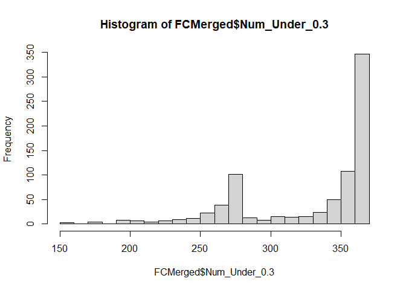
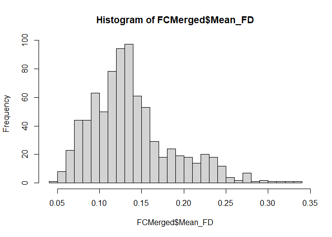
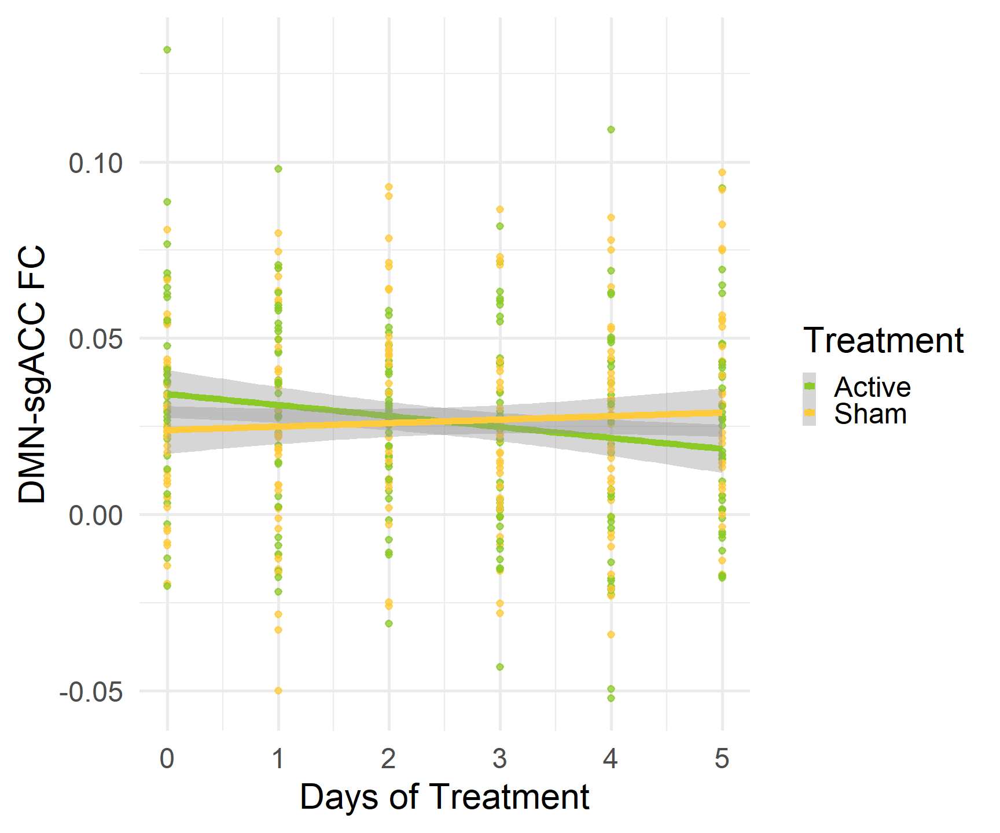
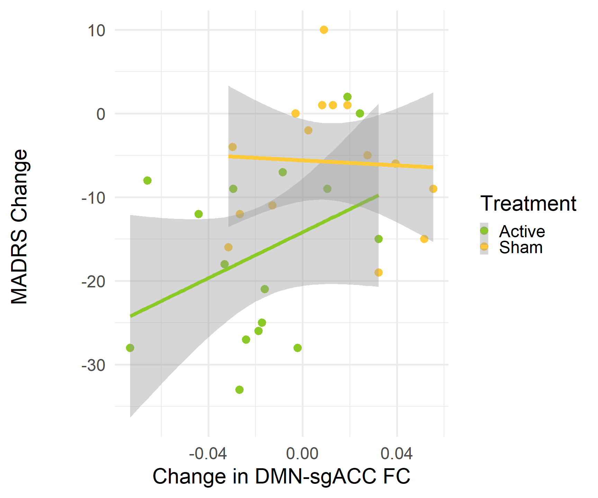
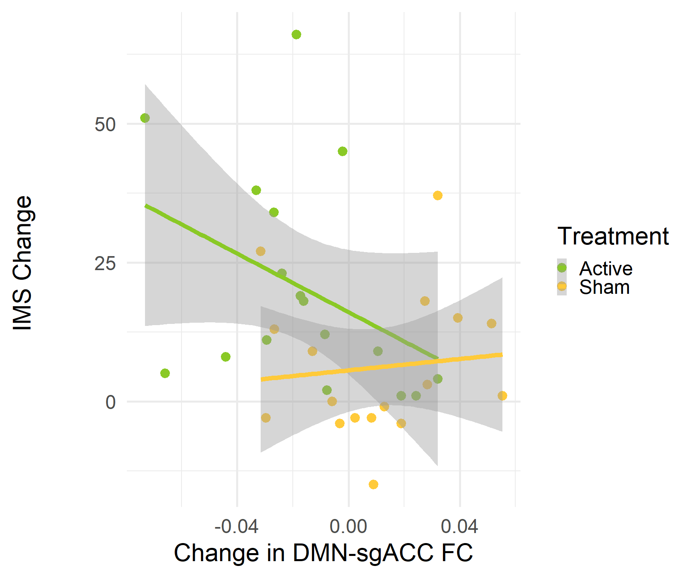
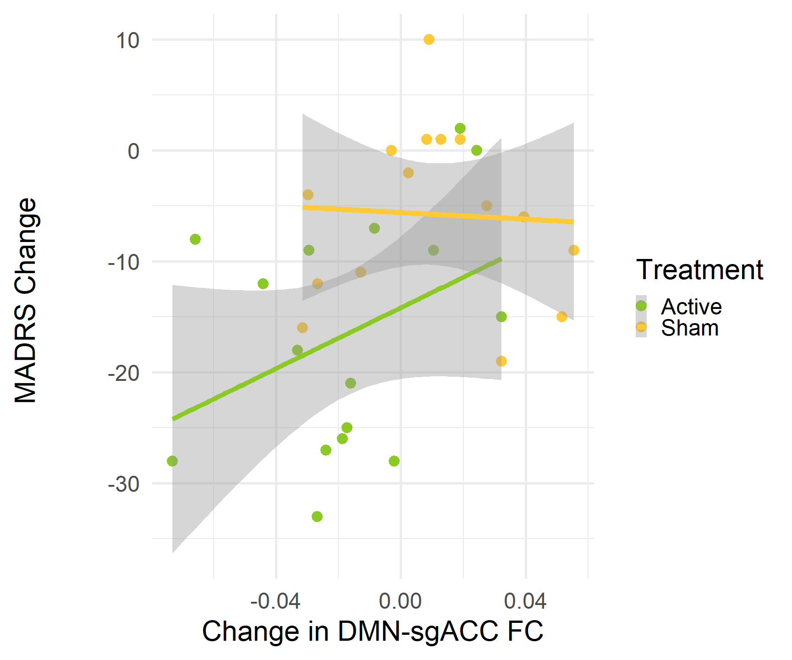
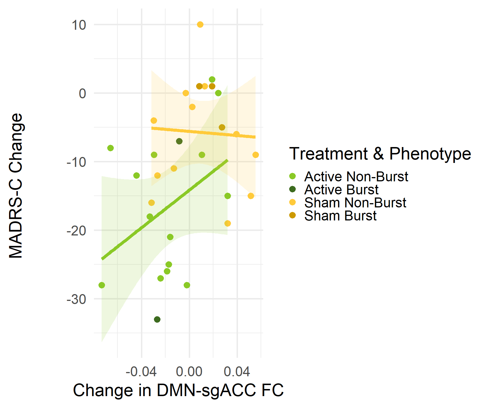
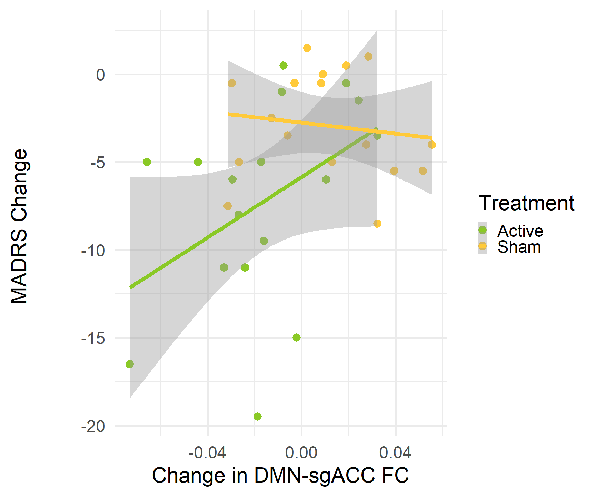
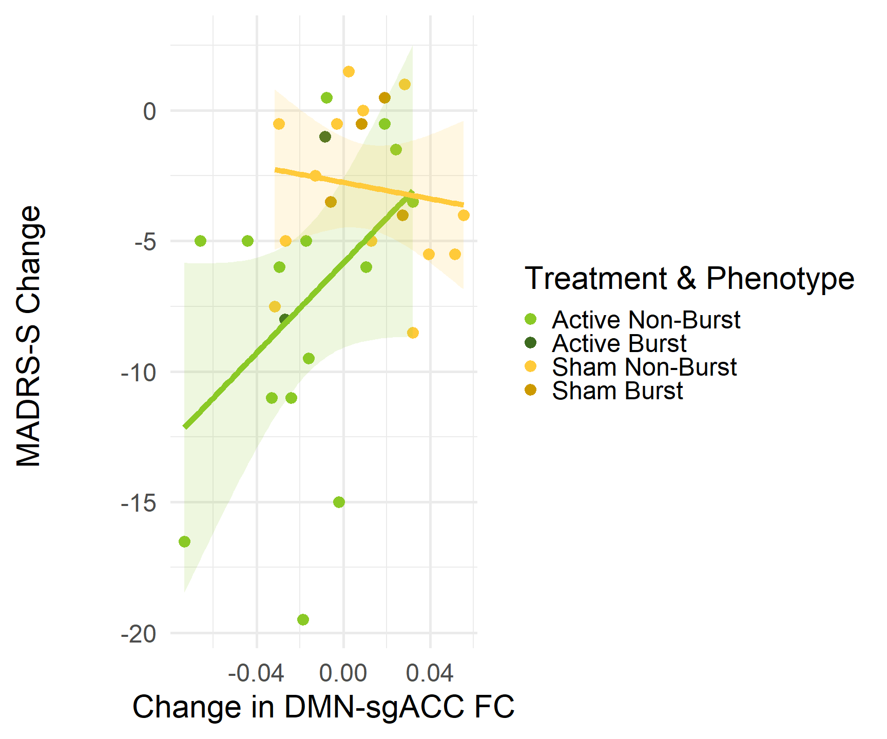
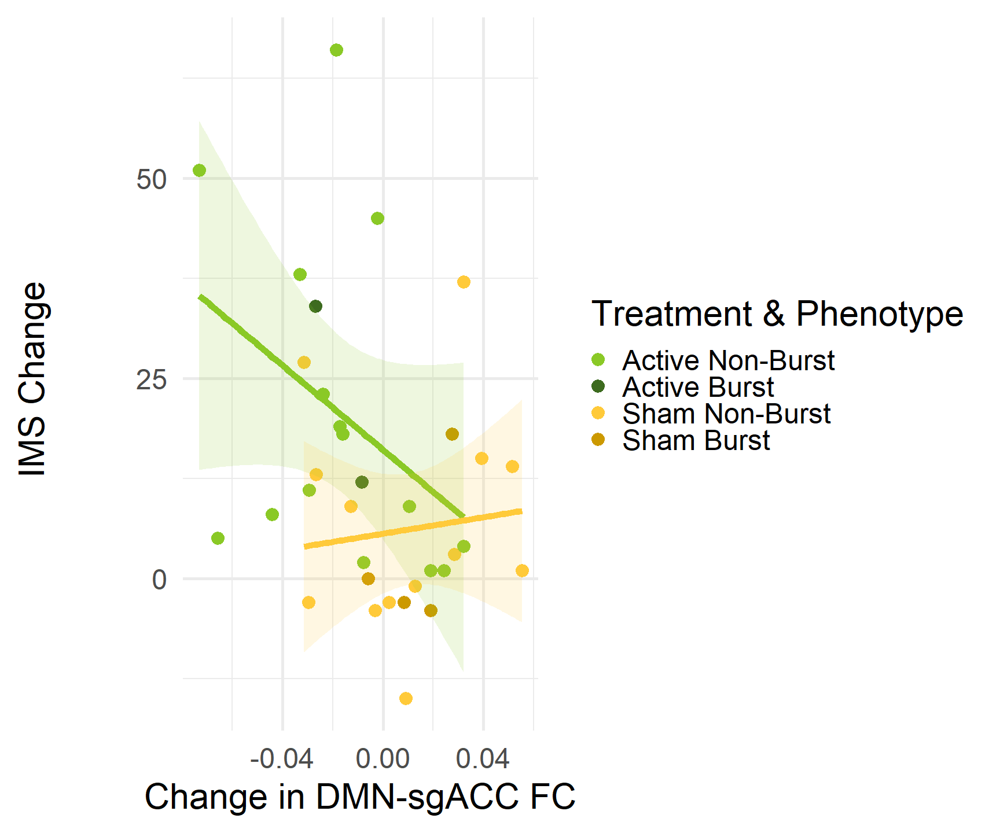

Fig2
================
2026-06-21

``` r
library(nlme)
library(ggplot2)
```

    ## Warning: package 'ggplot2' was built under R version 4.5.3

``` r
library(tidyr)
library(dplyr)
```

    ## 
    ## Attaching package: 'dplyr'

    ## The following object is masked from 'package:nlme':
    ## 
    ##     collapse

    ## The following objects are masked from 'package:stats':
    ## 
    ##     filter, lag

    ## The following objects are masked from 'package:base':
    ## 
    ##     intersect, setdiff, setequal, union

``` r
#################
# load in FC's, apply exclusions
#################

FCs=read.csv('E://Downloads/AllSubjects_FC(10).csv')

# remove subject X
FCs=FCs[FCs$Var1!='s00x',]

# make a theoretical included df: subj_sesh_scan for all subjs, V2-V10, V2_1,V2_2,V2_3,V2_4, two scans for rest of visits
includedSubjects <- data.frame(subj = sprintf("s%03d", 1:53))

sessions <- paste0("V", 2:10)
scan_counts <- c(4, rep(2, length(sessions) - 1))  # V2=4, rest=2

# build rows correctly
df <- do.call(rbind, lapply(seq_along(sessions), function(i) {
  sesh <- sessions[i]
  n_scans <- scan_counts[i]
  expand.grid(
    subj = includedSubjects$subj,
    sesh = sesh,
    scan = seq_len(n_scans),
    stringsAsFactors = FALSE
  )
}))

# starting point for alluvial: theoretical include
df$TheoIncl=1


# find subjects with any completed scans
df$CompletedScans <- ifelse(df$subj %in% unique(FCs$Var1), 1, 0)

# need unique row key now that we are beyond individual subject level
df$key  <- paste(df$subj, df$sesh, df$scan, sep = "_")
#paste0 is just to account for 2 vs. V2 denotation
FCs$key <- paste(FCs$Var1, paste0('V',FCs$Var2), FCs$Var3, sep = "_")
# mark 1 if the full row (subj+sesh+scan) exists in FCs
df$InFCs <- ifelse(df$key %in% FCs$key, 1, 0)

# mark scans not passing func QC
FCs <- FCs[!(FCs$Var1 == "s016" & FCs$Var2 == 4), ]
# func QC 
df$FuncQC <- ifelse(df$key %in% FCs$key, 1, 0)

# subject s005 has no fieldmaps specifically for session V2 (V2a, but was told this takes precedence over V2)
# note we will also need to exclude 1st 3rd salience network obs. based on this exclusion
FCs <- FCs[!(FCs$Var1 == "s005" & FCs$Var2 == 2), ]
# Missing Fieldmaps
df$MissFmaps <- ifelse(df$key %in% FCs$key, 1, 0)
# s005 should be omitted entirely, references in email from Ian Kratter 8/4/2025 at 3:01 PM
FCs=FCs[FCs$Var1!="s005",]
# s020 for head motion, 8/4/2025 at 3:01 PM
FCs=FCs[FCs$Var1!="s020",]
# s021 for condition allocation, 8/4/2025 at 3:01 PM
FCs=FCs[FCs$Var1!="s021",]
# s023 missed some stuff due to campus outages, 8/4/2025 at 3:01 PM
FCs=FCs[FCs$Var1!="s023",]
# s053 did not complete treatment week
FCs=FCs[FCs$Var1!="s053",]
# s008 dropped prior to randomization 
FCs=FCs[FCs$Var1!="s008",]
FCs=FCs[FCs$Var1!="s013",]
FCs=FCs[FCs$Var1!="s014",]

# Targeting scans accidentally administered in non-targeting sessions
FCs <- FCs[FCs$key != 's031_V9_1', ]
FCs <- FCs[FCs$key != 's030_V9_1', ]
FCs <- FCs[FCs$key != 's030_V9_2', ]

# add to alluvial
df$PassIK_Excludes <- ifelse(df$key %in% FCs$key, 1, 0)

# commented out for markdown for brevity
# query scans in theoretical dataframe but not in real
# missing_rows <- df[!(df$key %in% FCs$key), ]
# print(missing_rows)
```

``` r
#################
# still in sample construction phase, but now working in FD measurements, demographics, and maudsley
#################

# load head motion file
BRAINS_headmotion <- read.csv('E://Downloads/fd_summary_per_scan.csv', stringsAsFactors = FALSE)
# clean Subject column
# Some rows have "sub-s001" and some have the full filename. Let's normalize:
BRAINS_headmotion$Subject <- sub("^sub-", "", BRAINS_headmotion$Subject)       # strip "sub-"
BRAINS_headmotion$Subject <- sub("_.*$", "", BRAINS_headmotion$Subject)        # remove trailing filename junk
# clean Session column
# strip "ses-" prefix, just keep number
BRAINS_headmotion$Session <- sub("^ses-V", "", BRAINS_headmotion$Session)
# derive Scan number
# scans are Resting1, Resting2, Resting3, Resting4 in filename
BRAINS_headmotion$ScanNum <- as.numeric(sub(".*Resting([0-9]+).*", "\\1", BRAINS_headmotion$Scan))
```

    ## Warning: NAs introduced by coercion

``` r
# build equivalent key
BRAINS_headmotion$key <- paste0(BRAINS_headmotion$Subject, "_V", BRAINS_headmotion$Session, "_", BRAINS_headmotion$ScanNum)
# Deduplicate
BRAINS_headmotion <- BRAINS_headmotion[!duplicated(BRAINS_headmotion$key), ]

# great, lets try merging with FC
FCMerged=merge(FCs,BRAINS_headmotion,by='key')

# looks good, hist of remaining TRs
hist(FCMerged$Num_Under_0.3,breaks=30)
```

<!-- -->

``` r
# mean FD
hist(FCMerged$Mean_FD,breaks=30)
```

<!-- -->

``` r
# Automated QC criteria is mean FD < 0.2. Note manual QC alreayd applied.
print(dim(FCMerged))
```

    ## [1] 808  34

``` r
FCMerged=FCMerged[FCMerged$Mean_FD<=.2,]
print(dim(FCMerged))
```

    ## [1] 706  34

``` r
library(ggplot2)
library(reshape2)
```

    ## Warning: package 'reshape2' was built under R version 4.5.1

    ## 
    ## Attaching package: 'reshape2'

    ## The following object is masked from 'package:tidyr':
    ## 
    ##     smiths

``` r
library(ggalluvial)
```

    ## Warning: package 'ggalluvial' was built under R version 4.5.2

``` r
# record for alluvial DF
df$FD_QC <- ifelse(df$key %in% FCMerged$key, 1, 0)

#### now read in demographics
demo=read.csv('E:\\Downloads/Demo_All_TP_Long.csv')
# make subject names equiv
demo$Subject <- sub(".*_(s[0-9]+[a-z]?)", "\\1", demo$record_id)
# remove trailing a's
demo$Subject <- sub("a$", "", demo$Subject)
# remove trailing space with obscure conversion
demo$Subject <- gsub("\u00A0", " ", demo$Subject, fixed = TRUE)
# then trim whitespace
demo$Subject <- trimws(demo$Subject)

# merge with FC
FCMergedDemo=merge(FCMerged,demo,by='Subject')

# s008, s013, s014, s049 not in demographics file. Note they were missing most scans.
df$HasDemo <- ifelse(df$key %in% FCMergedDemo$key, 1, 0)

# add in maudsley data
Mauds=read.csv('E:\\Downloads/Maudsley_data.csv')
# make subject names equiv
Mauds$Subject <- sub(".*_(s[0-9]+[a-z]?)", "\\1", Mauds$record_id)
# remove trailing a's
Mauds$Subject <- sub("a$", "", Mauds$Subject)
Mauds$Subject <- gsub("\u00A0", " ", Mauds$Subject, fixed = TRUE)
Mauds$Subject <- trimws(Mauds$Subject)
# only need mauds value and subject
Mauds=data.frame(cbind(Mauds$Subject,Mauds$Maudsley.Staging.Method.Score))
colnames(Mauds)=c('Subjects','MaudScore')
# ensure that every subject is here
df$HasMaud <- ifelse(df$subj %in% Mauds$Subject, 1, 0)


# first alluvial: pre self-reported
df$TheoIncl       <- factor(df$TheoIncl, levels=c(1,0))
df$CompletedScans <- factor(df$CompletedScans, levels=c(1,0))
#df$StructQC       <- factor(df$StructQC, levels=c(1,0))
df$InFCs          <- factor(df$InFCs, levels=c(1,0))
df$FD_QC          <- factor(df$FD_QC, levels=c(1,0))
df$FuncQC <- factor(df$FuncQC, levels=c(1,0))
df$MissFmaps <- factor(df$MissFmaps, levels=c(1,0))
df$HasDemo <- factor(df$HasDemo, levels=c(1,0))
df$PassIK_Excludes <- factor(df$PassIK_Excludes, levels=c(1,0))
df$HasMaud <- factor(df$HasMaud, levels=c(1,0))

# Melt into long form for ggalluvial
df_long <- melt(df,
  id.vars = c("key","subj"),
  measure.vars = c("TheoIncl","CompletedScans","InFCs","FuncQC","MissFmaps","PassIK_Excludes","FD_QC","HasDemo","HasMaud"),
  variable.name = "Stage",
  value.name = "Status"
)

# order stages in sequence 
df_long$Stage <- factor(df_long$Stage,
                        levels = c("TheoIncl","CompletedScans","StructQC", "InFCs","FuncQC","MissFmaps","PassIK_Excludes","FD_QC","HasDemo","HasMaud"),
                        labels = c("AllPossibleScans/Subjects",
                                   "PT Completed Scans",
                                   "Passed Struct QC",
                                   "Missing Scans",
                                   "Functional QC",
                                   "MissingFieldmaps","PassIK_Excludes",
                                   "FD QC","Has_Demographics","HasMaud"))


# Full plotting outsourced to separate alluvial r markdown
#ggplot(df_long, aes(x = Stage, stratum = Status, alluvium = key, fill = subj, label = subj)) +
#  geom_flow(stat = "alluvium",aes.flow = "backward", alpha = 0.6) +
#  geom_stratum() +
#  theme_minimal() +
#  labs(title="QC Inclusion Flow",
#       y="Number of scans")# +
  #scale_fill_manual(values=c("1"="steelblue","0"="gray70"))
```

``` r
# leaves us with a nice FCMerged for analyses independent of SR
colnames(FCMergedDemo)[3:29]=c('subj', 'sesh', 'scan', 'DM_sgAv', 'DM_DMAv', 'DM_FPLAv', 'DM_FPRAv', 'avg_sd', 'avg_kurt', 'bwAv', 'nGSC', 'sgSD', 'sgKurt', 'sgBw', 'sgSC', 'dmSD', 'dmKurt', 'dmBw', 'dmSC', 'slSD', 'slKurt', 'slBw', 'slSC', 'fpSD', 'fpKurt', 'fpBw', 'fpSC')


#### hypothesis 1
# analyses of treatment effects, irrespective of SR
FCMergedDemo$DaysSinceInit=as.numeric(FCMergedDemo$ses)-3
# remove target sesssion
FCMergedDemo=FCMergedDemo[FCMergedDemo$DaysSinceInit>=0,]
# set sham group as reference for interpretability 
FCMergedDemo$Group<-as.factor(FCMergedDemo$Group)
FCMergedDemo$Group=relevel(FCMergedDemo$Group,ref='Y')
# clin trials hypo only concerns V3-V8, remove V9 and V10
FCMergedDemo=FCMergedDemo[as.numeric(FCMergedDemo$Session)<9,]

Dif_TRx<-lme(DM_sgAv ~Gender+Mean_FD+DaysSinceInit*Group+Age.at.screening.consent+Maudsley.Staging.Method.Score, random = ~ 1 | Subject, data = FCMergedDemo)
summary(Dif_TRx)
```

    ## Linear mixed-effects model fit by REML
    ##   Data: FCMergedDemo 
    ##         AIC       BIC   logLik
    ##   -1640.442 -1600.111 830.2209
    ## 
    ## Random effects:
    ##  Formula: ~1 | Subject
    ##         (Intercept)   Residual
    ## StdDev:  0.01675242 0.02949185
    ## 
    ## Fixed effects:  DM_sgAv ~ Gender + Mean_FD + DaysSinceInit * Group + Age.at.screening.consent +      Maudsley.Staging.Method.Score 
    ##                                     Value  Std.Error  DF   t-value p-value
    ## (Intercept)                    0.03155714 0.02236727 382  1.410863  0.1591
    ## GenderMale                    -0.02054386 0.00639603  35 -3.211968  0.0028
    ## Mean_FD                       -0.08870012 0.06583106 382 -1.347390  0.1787
    ## DaysSinceInit                  0.00101634 0.00118753 382  0.855842  0.3926
    ## GroupX                         0.01065013 0.00750919  35  1.418279  0.1650
    ## Age.at.screening.consent       0.00011282 0.00028376  35  0.397588  0.6933
    ## Maudsley.Staging.Method.Score  0.00111004 0.00216540  35  0.512628  0.6114
    ## DaysSinceInit:GroupX          -0.00425066 0.00168907 382 -2.516571  0.0123
    ##  Correlation: 
    ##                               (Intr) GndrMl Men_FD DysSnI GroupX Ag.t.. M.S.M.
    ## GenderMale                    -0.213                                          
    ## Mean_FD                       -0.209  0.083                                   
    ## DaysSinceInit                 -0.141 -0.018  0.032                            
    ## GroupX                        -0.187  0.098 -0.090  0.373                     
    ## Age.at.screening.consent      -0.482  0.227 -0.149 -0.009  0.156              
    ## Maudsley.Staging.Method.Score -0.677 -0.142 -0.097  0.013 -0.059 -0.123       
    ## DaysSinceInit:GroupX           0.095  0.043 -0.008 -0.703 -0.545  0.008 -0.018
    ## 
    ## Standardized Within-Group Residuals:
    ##         Min          Q1         Med          Q3         Max 
    ## -2.52652898 -0.64825814 -0.01497286  0.64519641  3.26897105 
    ## 
    ## Number of Observations: 425
    ## Number of Groups: 40

``` r
# accounting for unequal variances between groups produces similar result
Dif_TRx <- lme(DM_sgAv ~ Gender + Mean_FD + DaysSinceInit*Group + 
               Age.at.screening.consent + Maudsley.Staging.Method.Score,
               random = list(Subject = pdDiag(~ Group - 1)), 
               data = FCMergedDemo)

summary(Dif_TRx)
```

    ## Linear mixed-effects model fit by REML
    ##   Data: FCMergedDemo 
    ##         AIC       BIC  logLik
    ##   -1638.442 -1594.078 830.221
    ## 
    ## Random effects:
    ##  Formula: ~Group - 1 | Subject
    ##  Structure: Diagonal
    ##             GroupY     GroupX   Residual
    ## StdDev: 0.01672171 0.01678165 0.02949197
    ## 
    ## Fixed effects:  DM_sgAv ~ Gender + Mean_FD + DaysSinceInit * Group + Age.at.screening.consent +      Maudsley.Staging.Method.Score 
    ##                                     Value  Std.Error  DF   t-value p-value
    ## (Intercept)                    0.03162013 0.02236861 382  1.413594  0.1583
    ## GenderMale                    -0.02053216 0.00639693  35 -3.209690  0.0028
    ## Mean_FD                       -0.08864998 0.06582552 382 -1.346742  0.1789
    ## DaysSinceInit                  0.00101589 0.00118753 382  0.855465  0.3928
    ## GroupX                         0.01065449 0.00750924  35  1.418849  0.1648
    ## Age.at.screening.consent       0.00011332 0.00028376  35  0.399339  0.6921
    ## Maudsley.Staging.Method.Score  0.00109813 0.00216532  35  0.507147  0.6152
    ## DaysSinceInit:GroupX          -0.00425051 0.00168908 382 -2.516460  0.0123
    ##  Correlation: 
    ##                               (Intr) GndrMl Men_FD DysSnI GroupX Ag.t.. M.S.M.
    ## GenderMale                    -0.214                                          
    ## Mean_FD                       -0.210  0.083                                   
    ## DaysSinceInit                 -0.141 -0.018  0.032                            
    ## GroupX                        -0.187  0.098 -0.090  0.373                     
    ## Age.at.screening.consent      -0.482  0.228 -0.148 -0.009  0.156              
    ## Maudsley.Staging.Method.Score -0.677 -0.141 -0.097  0.013 -0.059 -0.123       
    ## DaysSinceInit:GroupX           0.095  0.043 -0.008 -0.703 -0.545  0.008 -0.018
    ## 
    ## Standardized Within-Group Residuals:
    ##         Min          Q1         Med          Q3         Max 
    ## -2.52707907 -0.64847284 -0.01476695  0.64478873  3.26837587 
    ## 
    ## Number of Observations: 425
    ## Number of Groups: 40

``` r
# plot it by residualizing DMN-SGACC FC on other variables in the model, leaving only the relationships of interest
ReducedMod<-lme(DM_sgAv~Gender+Mean_FD+Age.at.screening.consent+Maudsley.Staging.Method.Score, random = ~ 1 | Subject, data = FCMergedDemo)
FCMergedDemo$Resids=ReducedMod$residuals[,2]+mean(FCMergedDemo$DM_sgAv)
# clarify group legend label
FCMergedDemo$Treatment=factor(x='Active',levels=c('Active','Sham'))
FCMergedDemo$Treatment[FCMergedDemo$Group=='Y']='Sham'
ggplot(FCMergedDemo,aes(x=DaysSinceInit,y=Resids,Group=Treatment,color=Treatment))+geom_point(alpha=.7,size=3)+geom_smooth(method='lm')+theme_minimal(base_size = 46)+ylab('DMN-sgACC FC')+xlab('Days of Treatment')+scale_color_manual(values=c('#8ac926','#ffca3a'))
```

    ## `geom_smooth()` using formula = 'y ~ x'

<!-- -->

``` r
print(summary(Dif_TRx))
```

    ## Linear mixed-effects model fit by REML
    ##   Data: FCMergedDemo 
    ##         AIC       BIC  logLik
    ##   -1638.442 -1594.078 830.221
    ## 
    ## Random effects:
    ##  Formula: ~Group - 1 | Subject
    ##  Structure: Diagonal
    ##             GroupY     GroupX   Residual
    ## StdDev: 0.01672171 0.01678165 0.02949197
    ## 
    ## Fixed effects:  DM_sgAv ~ Gender + Mean_FD + DaysSinceInit * Group + Age.at.screening.consent +      Maudsley.Staging.Method.Score 
    ##                                     Value  Std.Error  DF   t-value p-value
    ## (Intercept)                    0.03162013 0.02236861 382  1.413594  0.1583
    ## GenderMale                    -0.02053216 0.00639693  35 -3.209690  0.0028
    ## Mean_FD                       -0.08864998 0.06582552 382 -1.346742  0.1789
    ## DaysSinceInit                  0.00101589 0.00118753 382  0.855465  0.3928
    ## GroupX                         0.01065449 0.00750924  35  1.418849  0.1648
    ## Age.at.screening.consent       0.00011332 0.00028376  35  0.399339  0.6921
    ## Maudsley.Staging.Method.Score  0.00109813 0.00216532  35  0.507147  0.6152
    ## DaysSinceInit:GroupX          -0.00425051 0.00168908 382 -2.516460  0.0123
    ##  Correlation: 
    ##                               (Intr) GndrMl Men_FD DysSnI GroupX Ag.t.. M.S.M.
    ## GenderMale                    -0.214                                          
    ## Mean_FD                       -0.210  0.083                                   
    ## DaysSinceInit                 -0.141 -0.018  0.032                            
    ## GroupX                        -0.187  0.098 -0.090  0.373                     
    ## Age.at.screening.consent      -0.482  0.228 -0.148 -0.009  0.156              
    ## Maudsley.Staging.Method.Score -0.677 -0.141 -0.097  0.013 -0.059 -0.123       
    ## DaysSinceInit:GroupX           0.095  0.043 -0.008 -0.703 -0.545  0.008 -0.018
    ## 
    ## Standardized Within-Group Residuals:
    ##         Min          Q1         Med          Q3         Max 
    ## -2.52707907 -0.64847284 -0.01476695  0.64478873  3.26837587 
    ## 
    ## Number of Observations: 425
    ## Number of Groups: 40

``` r
### secondary hypotheses
########## load in MADRS
# new version from chris sent 8/5/2025 at 12:11 pm
MADRSInfo=read.csv('E:/Downloads/madrs_data_for_brains/brains_madrs-cr.csv')
# set timepoint equivalence
tp_map1 <- c(
  "baseline_visit_2_arm_2"   = "V2",
  "study_day_1_visit_arm_2"  = "V3",
  "study_day_2_visit_arm_2"  = "V4",
  "study_day_3_visit_arm_2"  = "V5",
  "study_day_4_visit_arm_2"  = "V6",
  "study_day_5_visit_arm_2"  = "V7",
  "next_day_visit_vis_arm_2" = "V8",
  "immediate_post_vis_arm_2" = "V9",
  "1month_post_visit_arm_2"  = "V10"
)

# add new sesh column, others become NA
MADRSInfo$sesh <- tp_map1[MADRSInfo$redcap_event_name]

# make subject names equiv
MADRSInfo$Subject <- sub(".*_(s[0-9]+[a-z]?)", "\\1", MADRSInfo$record_id)
# remove trailing a's
MADRSInfo$Subject <- sub("a$", "", MADRSInfo$Subject)

# ok, now we need a session-wise key instead of subj/session/scan because we dont have a MADRS for each scan
FCMergedDemo$Key_Sess <- sub("_[0-9]+$", "", FCMergedDemo$key)

# cool, now we need an equivalent key column
MADRSInfo$Key_Sess <- paste(MADRSInfo$Subject, MADRSInfo$sesh, sep = "_")

# merge em
FCMergedMADRS=merge(FCMergedDemo,MADRSInfo,by=c("Key_Sess","Subject"))
FCMergedMADRS=FCMergedMADRS[!is.na(FCMergedMADRS$madrs_total_mentorrater),]


# calculate change in FC (V8 - V3)
FCMergedMADRS_change <- FCMergedMADRS[FCMergedMADRS$sesh.x %in% c(3, 8), ]
FC_change <- FCMergedMADRS_change %>%
  group_by(Subject, Group, sesh.x) %>%
  summarise(DM_sgAv_mean = mean(DM_sgAv, na.rm = TRUE), .groups = "drop") %>%
  pivot_wider(names_from = sesh.x, 
              values_from = DM_sgAv_mean,
              names_prefix = "V") %>%
  mutate(FC_change = V8 - V3) %>%
  filter(!is.na(FC_change))

# calculate change in MADRS

MADRS_change <- FCMergedMADRS_change %>%
  group_by(Subject, sesh.x,Group) %>%
  summarise(MADRS_mean = mean(madrs_total_mentorrater, na.rm = TRUE), .groups = "drop") %>%
  pivot_wider(names_from = sesh.x, 
              values_from = MADRS_mean,
              names_prefix = "V") %>%
  mutate(MADRS_change = V8 - V3) %>%
  filter(!is.na(MADRS_change))# Remove subjects without both timepoints

# according to protocol, evaluate normality of change in FC and MADRS (shapiro-wilk)
shapiro.test(MADRS_change$MADRS_change)
```

    ## 
    ##  Shapiro-Wilk normality test
    ## 
    ## data:  MADRS_change$MADRS_change
    ## W = 0.96704, p-value = 0.4414

``` r
shapiro.test(FC_change$FC_change)
```

    ## 
    ##  Shapiro-Wilk normality test
    ## 
    ## data:  FC_change$FC_change
    ## W = 0.98151, p-value = 0.8532

``` r
# note neither meets criteria for non-normality, proceeding with pearsons
change_scores <- merge(MADRS_change, FC_change, by = "Subject")
# and subset by X and Y
Xchange=change_scores[change_scores$Group.x=='X',]
Ychange=change_scores[change_scores$Group.x=='Y',]

XchangeCor=cor.test(Xchange$MADRS_change,Xchange$FC_change)$estimate
YchangeCor=cor.test(Ychange$MADRS_change,Ychange$FC_change)$estimate

# test MADRS change scores
library(diffcor)
```

    ## Warning: package 'diffcor' was built under R version 4.5.2

    ## Loading required package: MASS

    ## 
    ## Attaching package: 'MASS'

    ## The following object is masked from 'package:dplyr':
    ## 
    ##     select

``` r
diffcor.two(XchangeCor,YchangeCor,16,15)
```

    ##      r1     r2    LL1   UL1   LL2   UL2    z     p Cohen_q
    ## 1 0.379 -0.053 -0.143 0.737 -0.55 0.472 1.13 0.129   0.452

``` r
# plot it
change_scores$Treatment=factor(x='Active',levels=c('Active','Sham'))
change_scores$Treatment[change_scores$Group.x=='Y']='Sham'
ggplot(data=change_scores,aes(x=FC_change,y=MADRS_change,color=Treatment))+geom_point()+geom_smooth(method='lm')+ylab('MADRS Change \n \n') + xlab('Change in DMN-sgACC FC')+theme_minimal(base_size=46)+scale_color_manual(values=c('#8ac926','#ffca3a'))
```

    ## `geom_smooth()` using formula = 'y ~ x'

<!-- -->

``` r
# now repeating with MADRS-SR
# new version from chris sent 8/5/2025 at 12:11 pm
MADRSInfo=read.csv('E:/Downloads/madrs_data_for_brains/brains_madrs-s.csv')
# set timepoint equivalence
tp_map1 <- c(
  "baseline_visit_2_arm_2"   = "V2",
  "study_day_1_visit_arm_2"  = "V3",
  "study_day_2_visit_arm_2"  = "V4",
  "study_day_3_visit_arm_2"  = "V5",
  "study_day_4_visit_arm_2"  = "V6",
  "study_day_5_visit_arm_2"  = "V7",
  "next_day_visit_vis_arm_2" = "V8",
  "immediate_post_vis_arm_2" = "V9",
  "1month_post_visit_arm_2"  = "V10"
)

# add new sesh column, others become NA
MADRSInfo$sesh <- tp_map1[MADRSInfo$redcap_event_name]

# make subject names equiv
MADRSInfo$Subject <- sub(".*_(s[0-9]+[a-z]?)", "\\1", MADRSInfo$record_id)
# remove trailing a's
MADRSInfo$Subject <- sub("a$", "", MADRSInfo$Subject)

# ok, now we need a session-wise key instead of subj/session/scan because we dont have a MADRS for each scan
FCMergedDemo$Key_Sess <- sub("_[0-9]+$", "", FCMergedDemo$key)

# cool, now we need an equivalent key column
MADRSInfo$Key_Sess <- paste(MADRSInfo$Subject, MADRSInfo$sesh, sep = "_")

# merge em
FCMergedMADRS=merge(FCMergedDemo,MADRSInfo,by=c("Key_Sess","Subject"))
FCMergedMADRS=FCMergedMADRS[!is.na(FCMergedMADRS$madrs_s_total),]


# calculate change in FC (V8 - V3)
FCMergedMADRS_change <- FCMergedMADRS[FCMergedMADRS$sesh.x %in% c(3, 8), ]
FC_change <- FCMergedMADRS_change %>%
  group_by(Subject, Group, sesh.x) %>%
  summarise(DM_sgAv_mean = mean(DM_sgAv, na.rm = TRUE), .groups = "drop") %>%
  pivot_wider(names_from = sesh.x, 
              values_from = DM_sgAv_mean,
              names_prefix = "V") %>%
  mutate(FC_change = V8 - V3) %>%
  filter(!is.na(FC_change))

# calculate change in MADRS

MADRS_change <- FCMergedMADRS_change %>%
  group_by(Subject, sesh.x,Group) %>%
  summarise(MADRS_mean = mean(madrs_s_total, na.rm = TRUE), .groups = "drop") %>%
  pivot_wider(names_from = sesh.x, 
              values_from = MADRS_mean,
              names_prefix = "V") %>%
  mutate(MADRS_change = V8 - V3) %>%
  filter(!is.na(MADRS_change))# Remove subjects without both timepoints

# according to protocol, evaluate normality of change in FC and MADRS (shapiro-wilk)
shapiro.test(MADRS_change$MADRS_change)
```

    ## 
    ##  Shapiro-Wilk normality test
    ## 
    ## data:  MADRS_change$MADRS_change
    ## W = 0.90664, p-value = 0.0069

``` r
shapiro.test(FC_change$FC_change)
```

    ## 
    ##  Shapiro-Wilk normality test
    ## 
    ## data:  FC_change$FC_change
    ## W = 0.98326, p-value = 0.8685

``` r
# madrs s meets criteria for non-normality, use spearmans
change_scores <- merge(MADRS_change, FC_change, by = "Subject")
# and subset by X and Y
Xchange=change_scores[change_scores$Group.x=='X',]
Ychange=change_scores[change_scores$Group.x=='Y',]

XchangeCor=cor.test(Xchange$MADRS_change,Xchange$FC_change,method='spearman')$estimate
```

    ## Warning in cor.test.default(Xchange$MADRS_change, Xchange$FC_change, method =
    ## "spearman"): Cannot compute exact p-value with ties

``` r
YchangeCor=cor.test(Ychange$MADRS_change,Ychange$FC_change,method='spearman')$estimate
```

    ## Warning in cor.test.default(Ychange$MADRS_change, Ychange$FC_change, method =
    ## "spearman"): Cannot compute exact p-value with ties

``` r
# test MADRS change scores
library(diffcor)
diffcor.two(XchangeCor,YchangeCor,16,15)
```

    ##      r1     r2    LL1   UL1    LL2   UL2     z     p Cohen_q
    ## 1 0.475 -0.169 -0.027 0.786 -0.627 0.376 1.715 0.043   0.686

``` r
# plot it - saved at 1500x1200
change_scores$Treatment=factor(x='Active',levels=c('Active','Sham'))
change_scores$Treatment[change_scores$Group.x=='Y']='Sham'
ggplot(data=change_scores,aes(x=FC_change,y=MADRS_change,color=Treatment))+geom_point()+geom_smooth(method='lm')+ylab('MADRS Change \n \n') + xlab('Change in DMN-sgACC FC')+theme_minimal(base_size=46)+scale_color_manual(values=c('#8ac926','#ffca3a'))
```

    ## `geom_smooth()` using formula = 'y ~ x'

<!-- -->

``` r
# load in IMS 12
# add IMS
IMS=read.csv('E:\\Downloads/Brains_IMS.csv')
# add new sesh column, others become NA
IMS$sesh <- tp_map1[IMS$redcap_event_name]
# make subject names equiv
IMS$Subject <- sub(".*_(s[0-9]+[a-z]?)", "\\1", IMS$record_id)
# remove trailing a's
IMS$Subject <- sub("a$", "", IMS$Subject)

#merge
IMS$Key_Sess <- paste(IMS$Subject, IMS$sesh, sep = "_")
FCMergedIMS=merge(FCMergedDemo,IMS,by=c("Key_Sess","Subject"))
# omit NAs
FCMergedIMS=FCMergedIMS[!is.na(FCMergedIMS$ims12_totalscore),]
FCMergedIMS_Change <- FCMergedIMS[FCMergedIMS$sesh.x %in% c(3, 8), ]

# FC Change
FC_change <- FCMergedIMS_Change %>%
  group_by(Subject, Group, sesh.x) %>%
  summarise(DM_sgAv_mean = mean(DM_sgAv, na.rm = TRUE), .groups = "drop") %>%
  pivot_wider(names_from = sesh.x, 
              values_from = DM_sgAv_mean,
              names_prefix = "V") %>%
  mutate(FC_change = V8 - V3) %>%
  filter(!is.na(FC_change))


# calculate change in IMS
IMS_Change <- FCMergedIMS_Change %>%
  group_by(Subject, sesh.x, Group) %>%
  summarise(IMS_mean = mean(ims12_totalscore, na.rm = TRUE), .groups = "drop") %>%
  pivot_wider(names_from = sesh.x, 
              values_from = IMS_mean,
              names_prefix = "V") %>%
  mutate(IMS_Change = V8 - V3) %>%
  filter(!is.na(IMS_Change))# Remove subjects without both timepoints

# according to protocol, evaluate normality of change  in IMS (shapiro-wilk)
shapiro.test(IMS_Change$IMS_Change)
```

    ## 
    ##  Shapiro-Wilk normality test
    ## 
    ## data:  IMS_Change$IMS_Change
    ## W = 0.90078, p-value = 0.00481

``` r
shapiro.test(FC_change$FC_change)
```

    ## 
    ##  Shapiro-Wilk normality test
    ## 
    ## data:  FC_change$FC_change
    ## W = 0.98326, p-value = 0.8685

``` r
# IMS meets criteria for non-normality. Proceed with spearmans
change_scores <- merge(IMS_Change, FC_change, by = "Subject")
# and subset by X and Y
Xchange=change_scores[change_scores$Group.x=='X',]
Ychange=change_scores[change_scores$Group.x=='Y',]

XchangeCor=cor.test(Xchange$IMS_Change,Xchange$FC_change,method='spearman')$estimate
```

    ## Warning in cor.test.default(Xchange$IMS_Change, Xchange$FC_change, method =
    ## "spearman"): Cannot compute exact p-value with ties

``` r
YchangeCor=cor.test(Ychange$IMS_Change,Ychange$FC_change,method='spearman')$estimate
```

    ## Warning in cor.test.default(Ychange$IMS_Change, Ychange$FC_change, method =
    ## "spearman"): Cannot compute exact p-value with ties

``` r
# test IMS change scores
diffcor.two(XchangeCor,YchangeCor,17,17)
```

    ##       r1    r2    LL1    UL1    LL2   UL2      z     p Cohen_q
    ## 1 -0.484 0.208 -0.783 -0.005 -0.303 0.626 -1.956 0.025  -0.739

``` r
# plot it - saved at 1500x1200
change_scores$Treatment=factor(x='Active',levels=c('Active','Sham'))
change_scores$Treatment[change_scores$Group.x=='Y']='Sham'
ggplot(data=change_scores,aes(x=FC_change,y=IMS_Change,color=Treatment))+geom_point()+geom_smooth(method='lm')+ylab('IMS Change \n \n') + xlab('Change in DMN-sgACC FC')+theme_minimal(base_size=46)+scale_color_manual(values=c('#8ac926','#ffca3a'))
```

    ## `geom_smooth()` using formula = 'y ~ x'

<!-- -->

``` r
# temporal precedence
#################
# Cross-lagged panel analysis: DMN-sgACC FC vs. MADRS-SR and vs. IMS
# Does FC(t) predict symptom(t+1) controlling for symptom(t) [FC -> symptom],
# and does symptom(t) predict FC(t+1) controlling for FC(t) [symptom -> FC]?
#################

library(lme4)
```

    ## Warning: package 'lme4' was built under R version 4.5.1

    ## Loading required package: Matrix

    ## 
    ## Attaching package: 'Matrix'

    ## The following objects are masked from 'package:tidyr':
    ## 
    ##     expand, pack, unpack

    ## 
    ## Attaching package: 'lme4'

    ## The following object is masked from 'package:nlme':
    ## 
    ##     lmList

``` r
library(lmerTest)
```

    ## Warning: package 'lmerTest' was built under R version 4.5.1

    ## 
    ## Attaching package: 'lmerTest'

    ## The following object is masked from 'package:lme4':
    ## 
    ##     lmer

    ## The following object is masked from 'package:stats':
    ## 
    ##     step

``` r
# ---- 1. Collapse FC to one value per subject per session ----
# (Key_Sess already exists on FCMergedDemo from the MADRS chunk above)
FC_persession <- aggregate(DM_sgAv ~ Subject + Key_Sess + Group,
                            data = FCMergedDemo, FUN = mean)
FC_persession$SessNum <- as.numeric(sub(".*_V", "", FC_persession$Key_Sess))

# ---- 2A. FC vs MADRS-SR ----
# MADRSInfo at this point in the script IS the self-report version
# (brains_madrs-s.csv was the last thing read into it), already has
# Key_Sess and madrs_s_total
FC_SR <- merge(FC_persession, MADRSInfo[, c("Subject", "Key_Sess", "madrs_s_total")],
               by = c("Subject", "Key_Sess"))
FC_SR <- FC_SR[!is.na(FC_SR$madrs_s_total), ]
FC_SR <- FC_SR[order(FC_SR$Subject, FC_SR$SessNum), ]

make_lag_pairs_FC_SR <- function(d) {
  n <- nrow(d)
  if (n < 2) return(NULL)
  cur <- d[1:(n - 1), ]
  nxt <- d[2:n, ]
  data.frame(
    Subject = cur$Subject, Group = cur$Group,
    Sess_t = cur$SessNum, Sess_t1 = nxt$SessNum,
    fc_t = cur$DM_sgAv, sr_t = cur$madrs_s_total,
    fc_t1 = nxt$DM_sgAv, sr_t1 = nxt$madrs_s_total
  )
}

# bind it all together
lagged_FC_SR <- do.call(rbind, lapply(split(FC_SR, FC_SR$Subject), make_lag_pairs_FC_SR))

# normalize
lagged_FC_SR$fc_t_z  <- scale(lagged_FC_SR$fc_t)
lagged_FC_SR$sr_t_z  <- scale(lagged_FC_SR$sr_t)
lagged_FC_SR$fc_t1_z <- scale(lagged_FC_SR$fc_t1)
lagged_FC_SR$sr_t1_z <- scale(lagged_FC_SR$sr_t1)
lagged_FC_SR$Subject <- as.factor(lagged_FC_SR$Subject)

mod_sr_next_from_fc <- lmer(sr_t1_z ~ sr_t_z + fc_t_z + (1 | Subject),
                             data = lagged_FC_SR, REML = FALSE)
mod_fc_next_from_sr <- lmer(fc_t1_z ~ fc_t_z + sr_t_z + (1 | Subject),
                             data = lagged_FC_SR, REML = FALSE)

cat("\n=== FC(t) -> MADRS-SR(t+1), controlling MADRS-SR(t) ===\n")
```

    ## 
    ## === FC(t) -> MADRS-SR(t+1), controlling MADRS-SR(t) ===

``` r
print(summary(mod_sr_next_from_fc)$coefficients)
```

    ##                  Estimate Std. Error       df      t value     Pr(>|t|)
    ## (Intercept) -0.0002940782 0.07526808  20.9608 -0.003907078 9.969196e-01
    ## sr_t_z       0.5576556408 0.04629791 177.7146 12.044942318 8.223328e-25
    ## fc_t_z      -0.0280707395 0.04322558 175.7043 -0.649401165 5.169271e-01

``` r
cat("\n=== MADRS-SR(t) -> FC(t+1), controlling FC(t) ===\n")
```

    ## 
    ## === MADRS-SR(t) -> FC(t+1), controlling FC(t) ===

``` r
print(summary(mod_fc_next_from_sr)$coefficients)
```

    ##                Estimate Std. Error        df    t value  Pr(>|t|)
    ## (Intercept)  0.01568593 0.09651762  11.53704  0.1625188 0.8737090
    ## fc_t_z       0.11172593 0.07479212 156.78541  1.4938196 0.1372326
    ## sr_t_z      -0.06986402 0.07777727 109.35479 -0.8982576 0.3710218

``` r
# ---- 2B. FC vs IMS ----
FC_IMS <- merge(FC_persession, IMS[, c("Subject", "Key_Sess", "ims12_totalscore")],
                by = c("Subject", "Key_Sess"))
FC_IMS <- FC_IMS[!is.na(FC_IMS$ims12_totalscore), ]
FC_IMS <- FC_IMS[order(FC_IMS$Subject, FC_IMS$SessNum), ]


make_lag_pairs_FC_IMS <- function(d) {
  n <- nrow(d)
  if (n < 2) return(NULL)
  cur <- d[1:(n - 1), ]
  nxt <- d[2:n, ]
  data.frame(
    Subject = cur$Subject, Group = cur$Group,
    Sess_t = cur$SessNum, Sess_t1 = nxt$SessNum,
    fc_t = cur$DM_sgAv, ims_t = cur$ims12_totalscore,
    fc_t1 = nxt$DM_sgAv, ims_t1 = nxt$ims12_totalscore
  )
}

lagged_FC_IMS <- do.call(rbind, lapply(split(FC_IMS, FC_IMS$Subject), make_lag_pairs_FC_IMS))

lagged_FC_IMS$fc_t_z   <- scale(lagged_FC_IMS$fc_t)
lagged_FC_IMS$ims_t_z  <- scale(lagged_FC_IMS$ims_t)
lagged_FC_IMS$fc_t1_z  <- scale(lagged_FC_IMS$fc_t1)
lagged_FC_IMS$ims_t1_z <- scale(lagged_FC_IMS$ims_t1)
lagged_FC_IMS$Subject  <- as.factor(lagged_FC_IMS$Subject)

mod_ims_next_from_fc <- lmer(ims_t1_z ~ ims_t_z + fc_t_z + (1 | Subject),
                              data = lagged_FC_IMS, REML = FALSE)
mod_fc_next_from_ims <- lmer(fc_t1_z ~ fc_t_z + ims_t_z + (1 | Subject),
                              data = lagged_FC_IMS, REML = FALSE)

cat("\n=== FC(t) -> IMS(t+1), controlling IMS(t) ===\n")
```

    ## 
    ## === FC(t) -> IMS(t+1), controlling IMS(t) ===

``` r
print(summary(mod_ims_next_from_fc)$coefficients)
```

    ##                 Estimate Std. Error        df     t value     Pr(>|t|)
    ## (Intercept) -0.007358915 0.07549613  25.02879 -0.09747407 9.231263e-01
    ## ims_t_z      0.589478362 0.04772875 178.99857 12.35059287 9.626703e-26
    ## fc_t_z      -0.118288802 0.04631234 177.52647 -2.55415299 1.148475e-02

``` r
cat("\n=== IMS(t) -> FC(t+1), controlling FC(t) ===\n")
```

    ## 
    ## === IMS(t) -> FC(t+1), controlling FC(t) ===

``` r
print(summary(mod_fc_next_from_ims)$coefficients)
```

    ##               Estimate Std. Error        df   t value  Pr(>|t|)
    ## (Intercept) 0.01769552 0.10105904  15.58108 0.1751008 0.8632556
    ## fc_t_z      0.08605342 0.07509983 170.85781 1.1458536 0.2534581
    ## ims_t_z     0.05249115 0.07677430 157.17157 0.6837074 0.4951667

``` r
# ---- 2C. FC vs MADRS-CR ----
# MADRSInfo was overwritten by brains_madrs-s.csv earlier in the script,
# so the CR version needs to be reloaded separately here
MADRSInfo_CR <- read.csv('E:/Downloads/madrs_data_for_brains/brains_madrs-cr.csv')
MADRSInfo_CR$sesh    <- tp_map1[MADRSInfo_CR$redcap_event_name]
MADRSInfo_CR$Subject <- sub(".*_(s[0-9]+[a-z]?)", "\\1", MADRSInfo_CR$record_id)
MADRSInfo_CR$Subject <- sub("a$", "", MADRSInfo_CR$Subject)
MADRSInfo_CR$Key_Sess <- paste(MADRSInfo_CR$Subject, MADRSInfo_CR$sesh, sep = "_")

FC_CR <- merge(FC_persession, MADRSInfo_CR[, c("Subject", "Key_Sess", "madrs_total_mentorrater")],
               by = c("Subject", "Key_Sess"))
FC_CR <- FC_CR[!is.na(FC_CR$madrs_total_mentorrater), ]
FC_CR <- FC_CR[order(FC_CR$Subject, FC_CR$SessNum), ]

make_lag_pairs_FC_CR <- function(d) {
  n <- nrow(d)
  if (n < 2) return(NULL)
  cur <- d[1:(n - 1), ]
  nxt <- d[2:n, ]
  data.frame(
    Subject = cur$Subject, Group = cur$Group,
    Sess_t = cur$SessNum, Sess_t1 = nxt$SessNum,
    fc_t = cur$DM_sgAv, cr_t = cur$madrs_total_mentorrater,
    fc_t1 = nxt$DM_sgAv, cr_t1 = nxt$madrs_total_mentorrater
  )
}

lagged_FC_CR <- do.call(rbind, lapply(split(FC_CR, FC_CR$Subject), make_lag_pairs_FC_CR))

lagged_FC_CR$fc_t_z  <- scale(lagged_FC_CR$fc_t)
lagged_FC_CR$cr_t_z  <- scale(lagged_FC_CR$cr_t)
lagged_FC_CR$fc_t1_z <- scale(lagged_FC_CR$fc_t1)
lagged_FC_CR$cr_t1_z <- scale(lagged_FC_CR$cr_t1)
lagged_FC_CR$Subject <- as.factor(lagged_FC_CR$Subject)

mod_cr_next_from_fc <- lmer(cr_t1_z ~ cr_t_z + fc_t_z + (1 | Subject),
                             data = lagged_FC_CR, REML = FALSE)
mod_fc_next_from_cr <- lmer(fc_t1_z ~ fc_t_z + cr_t_z + (1 | Subject),
                             data = lagged_FC_CR, REML = FALSE)

cat("\n=== FC(t) -> MADRS-CR(t+1), controlling MADRS-CR(t) ===\n")
```

    ## 
    ## === FC(t) -> MADRS-CR(t+1), controlling MADRS-CR(t) ===

``` r
print(summary(mod_cr_next_from_fc)$coefficients)
```

    ##                Estimate Std. Error        df    t value     Pr(>|t|)
    ## (Intercept)  0.01164650 0.07818816  21.23174  0.1489548 8.829951e-01
    ## cr_t_z       0.57260835 0.04755839 160.82490 12.0401133 3.285826e-24
    ## fc_t_z      -0.01426412 0.04426585 156.46198 -0.3222375 7.477029e-01

``` r
cat("\n=== MADRS-CR(t) -> FC(t+1), controlling FC(t) ===\n")
```

    ## 
    ## === MADRS-CR(t) -> FC(t+1), controlling FC(t) ===

``` r
print(summary(mod_fc_next_from_cr)$coefficients)
```

    ##                Estimate Std. Error        df    t value  Pr(>|t|)
    ## (Intercept)  0.02232497 0.11428332  15.29882  0.1953476 0.8476916
    ## fc_t_z       0.03600410 0.07898867 160.06677  0.4558134 0.6491419
    ## cr_t_z      -0.04624190 0.08337334 139.58482 -0.5546366 0.5800309

``` r
# plot SR with burst breathers annotated. Repeating same exact code for each symptom measure, but adding in burst breathers
BBs=read.csv('E:/Downloads/BurstBreathersvec.csv')
# MADRS CR
MADRSInfo=read.csv('E:/Downloads/madrs_data_for_brains/brains_madrs-cr.csv')
# set timepoint equivalence
tp_map1 <- c(
  "baseline_visit_2_arm_2"   = "V2",
  "study_day_1_visit_arm_2"  = "V3",
  "study_day_2_visit_arm_2"  = "V4",
  "study_day_3_visit_arm_2"  = "V5",
  "study_day_4_visit_arm_2"  = "V6",
  "study_day_5_visit_arm_2"  = "V7",
  "next_day_visit_vis_arm_2" = "V8",
  "immediate_post_vis_arm_2" = "V9",
  "1month_post_visit_arm_2"  = "V10"
)

# add new sesh column, others become NA
MADRSInfo$sesh <- tp_map1[MADRSInfo$redcap_event_name]

# make subject names equiv
MADRSInfo$Subject <- sub(".*_(s[0-9]+[a-z]?)", "\\1", MADRSInfo$record_id)
# remove trailing a's
MADRSInfo$Subject <- sub("a$", "", MADRSInfo$Subject)

# ok, now we need a session-wise key instead of subj/session/scan because we dont have a MADRS for each scan
FCMergedDemo$Key_Sess <- sub("_[0-9]+$", "", FCMergedDemo$key)

# cool, now we need an equivalent key column
MADRSInfo$Key_Sess <- paste(MADRSInfo$Subject, MADRSInfo$sesh, sep = "_")

# merge em
FCMergedMADRS=merge(FCMergedDemo,MADRSInfo,by=c("Key_Sess","Subject"))
FCMergedMADRS=FCMergedMADRS[!is.na(FCMergedMADRS$madrs_total_mentorrater),]


# calculate change in FC (V8 - V3)
FCMergedMADRS_change <- FCMergedMADRS[FCMergedMADRS$sesh.x %in% c(3, 8), ]
FC_change <- FCMergedMADRS_change %>%
  group_by(Subject, Group, sesh.x) %>%
  summarise(DM_sgAv_mean = mean(DM_sgAv, na.rm = TRUE), .groups = "drop") %>%
  pivot_wider(names_from = sesh.x, 
              values_from = DM_sgAv_mean,
              names_prefix = "V") %>%
  mutate(FC_change = V8 - V3) %>%
  filter(!is.na(FC_change))

# calculate change in MADRS

MADRS_change <- FCMergedMADRS_change %>%
  group_by(Subject, sesh.x,Group) %>%
  summarise(MADRS_mean = mean(madrs_total_mentorrater, na.rm = TRUE), .groups = "drop") %>%
  pivot_wider(names_from = sesh.x, 
              values_from = MADRS_mean,
              names_prefix = "V") %>%
  mutate(MADRS_change = V8 - V3) %>%
  filter(!is.na(MADRS_change))# Remove subjects without both timepoints

# according to protocol, evaluate normality of change in FC and MADRS (shapiro-wilk)
shapiro.test(MADRS_change$MADRS_change)
```

    ## 
    ##  Shapiro-Wilk normality test
    ## 
    ## data:  MADRS_change$MADRS_change
    ## W = 0.96704, p-value = 0.4414

``` r
shapiro.test(FC_change$FC_change)
```

    ## 
    ##  Shapiro-Wilk normality test
    ## 
    ## data:  FC_change$FC_change
    ## W = 0.98151, p-value = 0.8532

``` r
# note neither meets criteria for non-normality, proceeding with pearsons
change_scores <- merge(MADRS_change, FC_change, by = "Subject")
# and subset by X and Y
Xchange=change_scores[change_scores$Group.x=='X',]
Ychange=change_scores[change_scores$Group.x=='Y',]

XchangeCor=cor.test(Xchange$MADRS_change,Xchange$FC_change)$estimate
YchangeCor=cor.test(Ychange$MADRS_change,Ychange$FC_change)$estimate

# test MADRS change scores
library(diffcor)
diffcor.two(XchangeCor,YchangeCor,16,15)
```

    ##      r1     r2    LL1   UL1   LL2   UL2    z     p Cohen_q
    ## 1 0.379 -0.053 -0.143 0.737 -0.55 0.472 1.13 0.129   0.452

``` r
# plot it
change_scores$Treatment=factor(x='Active',levels=c('Active','Sham'))
change_scores$Treatment[change_scores$Group.x=='Y']='Sham'
ggplot(data=change_scores,aes(x=FC_change,y=MADRS_change,color=Treatment))+geom_point()+geom_smooth(method='lm')+ylab('MADRS Change \n \n') + xlab('Change in DMN-sgACC FC')+theme_minimal(base_size=46)+scale_color_manual(values=c('#8ac926','#ffca3a'))
```

    ## `geom_smooth()` using formula = 'y ~ x'

<!-- -->

``` r
# Add burst breather flag
change_scores$burst_breather <- change_scores$Subject %in% BBs$x
change_scores$Treatment <- factor(ifelse(change_scores$Group.x == 'X', 'Active', 'Sham'), 
                                  levels = c('Active', 'Sham'))

# Create combined group for coloring
change_scores$group_type <- factor(
  paste(change_scores$Treatment, ifelse(change_scores$burst_breather, 'Burst', 'Non-Burst')),
  levels = c('Active Non-Burst', 'Active Burst', 'Sham Non-Burst', 'Sham Burst')
)

# Plot
ggplot(data=change_scores, aes(x=FC_change, y=MADRS_change, color=group_type)) +
  geom_point(size=6) +
  geom_smooth(method='lm', se=TRUE, aes(group=Treatment, color=Treatment, fill=Treatment), alpha=0.15) +
  ylab('MADRS-C Change \n \n') + 
  xlab('Change in DMN-sgACC FC') +
  theme_minimal(base_size=46) +
  scale_color_manual(
    values=c(
      'Active Non-Burst' = '#8ac926',
      'Active Burst' = '#3d6b1f',
      'Sham Non-Burst' = '#ffca3a',
      'Sham Burst' = '#cc9900',
      'Active' = '#8ac926',
      'Sham' = '#ffca3a'
    ),
    breaks=c('Active Non-Burst', 'Active Burst', 'Sham Non-Burst', 'Sham Burst'),
    name = 'Treatment & Phenotype'
  ) +
  scale_fill_manual(
    values=c(
      'Active' = '#8ac926',
      'Sham' = '#ffca3a'
    ),
    guide='none'
  ) +
  theme(legend.position='right')
```

    ## `geom_smooth()` using formula = 'y ~ x'

<!-- -->

``` r
# MADRS-S with burst
MADRSInfo=read.csv('E:/Downloads/madrs_data_for_brains/brains_madrs-s.csv')
# set timepoint equivalence
tp_map1 <- c(
  "baseline_visit_2_arm_2"   = "V2",
  "study_day_1_visit_arm_2"  = "V3",
  "study_day_2_visit_arm_2"  = "V4",
  "study_day_3_visit_arm_2"  = "V5",
  "study_day_4_visit_arm_2"  = "V6",
  "study_day_5_visit_arm_2"  = "V7",
  "next_day_visit_vis_arm_2" = "V8",
  "immediate_post_vis_arm_2" = "V9",
  "1month_post_visit_arm_2"  = "V10"
)

# add new sesh column, others become NA
MADRSInfo$sesh <- tp_map1[MADRSInfo$redcap_event_name]

# make subject names equiv
MADRSInfo$Subject <- sub(".*_(s[0-9]+[a-z]?)", "\\1", MADRSInfo$record_id)
# remove trailing a's
MADRSInfo$Subject <- sub("a$", "", MADRSInfo$Subject)

# ok, now we need a session-wise key instead of subj/session/scan because we dont have a MADRS for each scan
FCMergedDemo$Key_Sess <- sub("_[0-9]+$", "", FCMergedDemo$key)

# cool, now we need an equivalent key column
MADRSInfo$Key_Sess <- paste(MADRSInfo$Subject, MADRSInfo$sesh, sep = "_")

# merge em
FCMergedMADRS=merge(FCMergedDemo,MADRSInfo,by=c("Key_Sess","Subject"))
FCMergedMADRS=FCMergedMADRS[!is.na(FCMergedMADRS$madrs_s_total),]


# calculate change in FC (V8 - V3)
FCMergedMADRS_change <- FCMergedMADRS[FCMergedMADRS$sesh.x %in% c(3, 8), ]
FC_change <- FCMergedMADRS_change %>%
  group_by(Subject, Group, sesh.x) %>%
  summarise(DM_sgAv_mean = mean(DM_sgAv, na.rm = TRUE), .groups = "drop") %>%
  pivot_wider(names_from = sesh.x, 
              values_from = DM_sgAv_mean,
              names_prefix = "V") %>%
  mutate(FC_change = V8 - V3) %>%
  filter(!is.na(FC_change))

# calculate change in MADRS

MADRS_change <- FCMergedMADRS_change %>%
  group_by(Subject, sesh.x,Group) %>%
  summarise(MADRS_mean = mean(madrs_s_total, na.rm = TRUE), .groups = "drop") %>%
  pivot_wider(names_from = sesh.x, 
              values_from = MADRS_mean,
              names_prefix = "V") %>%
  mutate(MADRS_change = V8 - V3) %>%
  filter(!is.na(MADRS_change))# Remove subjects without both timepoints

# according to protocol, evaluate normality of change in FC and MADRS (shapiro-wilk)
shapiro.test(MADRS_change$MADRS_change)
```

    ## 
    ##  Shapiro-Wilk normality test
    ## 
    ## data:  MADRS_change$MADRS_change
    ## W = 0.90664, p-value = 0.0069

``` r
shapiro.test(FC_change$FC_change)
```

    ## 
    ##  Shapiro-Wilk normality test
    ## 
    ## data:  FC_change$FC_change
    ## W = 0.98326, p-value = 0.8685

``` r
# madrs s meets criteria for non-normality, use spearmans
change_scores <- merge(MADRS_change, FC_change, by = "Subject")
# and subset by X and Y
Xchange=change_scores[change_scores$Group.x=='X',]
Ychange=change_scores[change_scores$Group.x=='Y',]

XchangeCor=cor.test(Xchange$MADRS_change,Xchange$FC_change,method='spearman')$estimate
```

    ## Warning in cor.test.default(Xchange$MADRS_change, Xchange$FC_change, method =
    ## "spearman"): Cannot compute exact p-value with ties

``` r
YchangeCor=cor.test(Ychange$MADRS_change,Ychange$FC_change,method='spearman')$estimate
```

    ## Warning in cor.test.default(Ychange$MADRS_change, Ychange$FC_change, method =
    ## "spearman"): Cannot compute exact p-value with ties

``` r
# test MADRS change scores
library(diffcor)
diffcor.two(XchangeCor,YchangeCor,16,15)
```

    ##      r1     r2    LL1   UL1    LL2   UL2     z     p Cohen_q
    ## 1 0.475 -0.169 -0.027 0.786 -0.627 0.376 1.715 0.043   0.686

``` r
# plot it - saved at 1500x1200
change_scores$Treatment=factor(x='Active',levels=c('Active','Sham'))
change_scores$Treatment[change_scores$Group.x=='Y']='Sham'
ggplot(data=change_scores,aes(x=FC_change,y=MADRS_change,color=Treatment))+geom_point()+geom_smooth(method='lm')+ylab('MADRS Change \n \n') + xlab('Change in DMN-sgACC FC')+theme_minimal(base_size=46)+scale_color_manual(values=c('#8ac926','#ffca3a'))
```

    ## `geom_smooth()` using formula = 'y ~ x'

<!-- -->

``` r
# Add burst breather flag
change_scores$burst_breather <- change_scores$Subject %in% BBs$x
change_scores$Treatment <- factor(ifelse(change_scores$Group.x == 'X', 'Active', 'Sham'), 
                                  levels = c('Active', 'Sham'))

# Create combined group for coloring
change_scores$group_type <- factor(
  paste(change_scores$Treatment, ifelse(change_scores$burst_breather, 'Burst', 'Non-Burst')),
  levels = c('Active Non-Burst', 'Active Burst', 'Sham Non-Burst', 'Sham Burst')
)

# Plot
ggplot(data=change_scores, aes(x=FC_change, y=MADRS_change, color=group_type)) +
  geom_point(size=6) +
  geom_smooth(method='lm', se=TRUE, aes(group=Treatment, color=Treatment, fill=Treatment), alpha=0.15) +
  ylab('MADRS-S Change \n \n') + 
  xlab('Change in DMN-sgACC FC') +
  theme_minimal(base_size=46) +
  scale_color_manual(
    values=c(
      'Active Non-Burst' = '#8ac926',
      'Active Burst' = '#3d6b1f',
      'Sham Non-Burst' = '#ffca3a',
      'Sham Burst' = '#cc9900',
      'Active' = '#8ac926',
      'Sham' = '#ffca3a'
    ),
    breaks=c('Active Non-Burst', 'Active Burst', 'Sham Non-Burst', 'Sham Burst'),
    name = 'Treatment & Phenotype'
  ) +
  scale_fill_manual(
    values=c(
      'Active' = '#8ac926',
      'Sham' = '#ffca3a'
    ),
    guide='none'
  ) +
  theme(legend.position='right')
```

    ## `geom_smooth()` using formula = 'y ~ x'

<!-- -->

``` r
# IMS and burst breathing
IMS=read.csv('E:\\Downloads/Brains_IMS.csv')
# add new sesh column, others become NA
IMS$sesh <- tp_map1[IMS$redcap_event_name]
# make subject names equiv
IMS$Subject <- sub(".*_(s[0-9]+[a-z]?)", "\\1", IMS$record_id)
# remove trailing a's
IMS$Subject <- sub("a$", "", IMS$Subject)

#merge
IMS$Key_Sess <- paste(IMS$Subject, IMS$sesh, sep = "_")
FCMergedIMS=merge(FCMergedDemo,IMS,by=c("Key_Sess","Subject"))
# omit NAs
FCMergedIMS=FCMergedIMS[!is.na(FCMergedIMS$ims12_totalscore),]
FCMergedIMS_Change <- FCMergedIMS[FCMergedIMS$sesh.x %in% c(3, 8), ]

# FC Change
FC_change <- FCMergedIMS_Change %>%
  group_by(Subject, Group, sesh.x) %>%
  summarise(DM_sgAv_mean = mean(DM_sgAv, na.rm = TRUE), .groups = "drop") %>%
  pivot_wider(names_from = sesh.x, 
              values_from = DM_sgAv_mean,
              names_prefix = "V") %>%
  mutate(FC_change = V8 - V3) %>%
  filter(!is.na(FC_change))


# calculate change in IMS
IMS_Change <- FCMergedIMS_Change %>%
  group_by(Subject, sesh.x, Group) %>%
  summarise(IMS_mean = mean(ims12_totalscore, na.rm = TRUE), .groups = "drop") %>%
  pivot_wider(names_from = sesh.x, 
              values_from = IMS_mean,
              names_prefix = "V") %>%
  mutate(IMS_Change = V8 - V3) %>%
  filter(!is.na(IMS_Change))# Remove subjects without both timepoints

# according to protocol, evaluate normality of change  in IMS (shapiro-wilk)
shapiro.test(IMS_Change$IMS_Change)
```

    ## 
    ##  Shapiro-Wilk normality test
    ## 
    ## data:  IMS_Change$IMS_Change
    ## W = 0.90078, p-value = 0.00481

``` r
shapiro.test(FC_change$FC_change)
```

    ## 
    ##  Shapiro-Wilk normality test
    ## 
    ## data:  FC_change$FC_change
    ## W = 0.98326, p-value = 0.8685

``` r
# IMS meets criteria for non-normality. Proceed with spearmans
change_scores <- merge(IMS_Change, FC_change, by = "Subject")
# and subset by X and Y
Xchange=change_scores[change_scores$Group.x=='X',]
Ychange=change_scores[change_scores$Group.x=='Y',]

XchangeCor=cor.test(Xchange$IMS_Change,Xchange$FC_change,method='spearman')$estimate
```

    ## Warning in cor.test.default(Xchange$IMS_Change, Xchange$FC_change, method =
    ## "spearman"): Cannot compute exact p-value with ties

``` r
YchangeCor=cor.test(Ychange$IMS_Change,Ychange$FC_change,method='spearman')$estimate
```

    ## Warning in cor.test.default(Ychange$IMS_Change, Ychange$FC_change, method =
    ## "spearman"): Cannot compute exact p-value with ties

``` r
# test IMS change scores
diffcor.two(XchangeCor,YchangeCor,17,17)
```

    ##       r1    r2    LL1    UL1    LL2   UL2      z     p Cohen_q
    ## 1 -0.484 0.208 -0.783 -0.005 -0.303 0.626 -1.956 0.025  -0.739

``` r
# plot it - saved at 1500x1200
change_scores$Treatment=factor(x='Active',levels=c('Active','Sham'))
change_scores$Treatment[change_scores$Group.x=='Y']='Sham'
ggplot(data=change_scores,aes(x=FC_change,y=IMS_Change,color=Treatment))+geom_point()+geom_smooth(method='lm')+ylab('IMS Change \n \n') + xlab('Change in DMN-sgACC FC')+theme_minimal(base_size=46)+scale_color_manual(values=c('#8ac926','#ffca3a'))
```

    ## `geom_smooth()` using formula = 'y ~ x'

<!-- -->

``` r
# Add burst breather flag
change_scores$burst_breather <- change_scores$Subject %in% BBs$x
change_scores$Treatment <- factor(ifelse(change_scores$Group.x == 'X', 'Active', 'Sham'), 
                                  levels = c('Active', 'Sham'))

# Create combined group for coloring
change_scores$group_type <- factor(
  paste(change_scores$Treatment, ifelse(change_scores$burst_breather, 'Burst', 'Non-Burst')),
  levels = c('Active Non-Burst', 'Active Burst', 'Sham Non-Burst', 'Sham Burst')
)

# Plot
ggplot(data=change_scores, aes(x=FC_change, y=IMS_Change, color=group_type)) +
  geom_point(size=6) +
  geom_smooth(method='lm', se=TRUE, aes(group=Treatment, color=Treatment, fill=Treatment), alpha=0.15) +
  ylab('IMS Change \n \n') + 
  xlab('Change in DMN-sgACC FC') +
  theme_minimal(base_size=46) +
  scale_color_manual(
    values=c(
      'Active Non-Burst' = '#8ac926',
      'Active Burst' = '#3d6b1f',
      'Sham Non-Burst' = '#ffca3a',
      'Sham Burst' = '#cc9900',
      'Active' = '#8ac926',
      'Sham' = '#ffca3a'
    ),
    breaks=c('Active Non-Burst', 'Active Burst', 'Sham Non-Burst', 'Sham Burst'),
    name = 'Treatment & Phenotype'
  ) +
  scale_fill_manual(
    values=c(
      'Active' = '#8ac926',
      'Sham' = '#ffca3a'
    ),
    guide='none'
  ) +
  theme(legend.position='right')
```

    ## `geom_smooth()` using formula = 'y ~ x'

<!-- -->
