Fig2
================
2026-06-21

``` r
library(nlme)
library(lme4)
```

    ## Warning: package 'lme4' was built under R version 4.5.1

    ## Loading required package: Matrix

    ## 
    ## Attaching package: 'lme4'

    ## The following object is masked from 'package:nlme':
    ## 
    ##     lmList

``` r
library(ggplot2)
```

    ## Warning: package 'ggplot2' was built under R version 4.5.3

``` r
library(tidyr)
```

    ## 
    ## Attaching package: 'tidyr'

    ## The following objects are masked from 'package:Matrix':
    ## 
    ##     expand, pack, unpack

``` r
library(dplyr)
```

    ## 
    ## Attaching package: 'dplyr'

    ## The following object is masked from 'package:nlme':
    ## 
    ##     collapse

    ## The following objects are masked from 'package:stats':
    ## 
    ##     filter, lag

    ## The following objects are masked from 'package:base':
    ## 
    ##     intersect, setdiff, setequal, union

``` r
#################
# load in FC's, apply exclusions
#################

FCs=read.csv('E://Downloads/AllSubjects_FC(10).csv')

# remove subject X
FCs=FCs[FCs$Var1!='s00x',]

# make a theoretical included df: subj_sesh_scan for all subjs, V2-V10, V2_1,V2_2,V2_3,V2_4, two scans for rest of visits
includedSubjects <- data.frame(subj = sprintf("s%03d", 1:53))

sessions <- paste0("V", 2:10)
scan_counts <- c(4, rep(2, length(sessions) - 1))  # V2=4, rest=2

# build rows correctly
df <- do.call(rbind, lapply(seq_along(sessions), function(i) {
  sesh <- sessions[i]
  n_scans <- scan_counts[i]
  expand.grid(
    subj = includedSubjects$subj,
    sesh = sesh,
    scan = seq_len(n_scans),
    stringsAsFactors = FALSE
  )
}))

# starting point for alluvial: theoretical include
df$TheoIncl=1


# find subjects with any completed scans
df$CompletedScans <- ifelse(df$subj %in% unique(FCs$Var1), 1, 0)

# need unique row key now that we are beyond individual subject level
df$key  <- paste(df$subj, df$sesh, df$scan, sep = "_")
#paste0 is just to account for 2 vs. V2 denotation
FCs$key <- paste(FCs$Var1, paste0('V',FCs$Var2), FCs$Var3, sep = "_")
# mark 1 if the full row (subj+sesh+scan) exists in FCs
df$InFCs <- ifelse(df$key %in% FCs$key, 1, 0)

# mark scans not passing func QC
FCs <- FCs[!(FCs$Var1 == "s016" & FCs$Var2 == 4), ]
# func QC 
df$FuncQC <- ifelse(df$key %in% FCs$key, 1, 0)

# subject s005 has no fieldmaps specifically for session V2 (V2a, but was told this takes precedence over V2)
# note we will also need to exclude 1st 3rd salience network obs. based on this exclusion
FCs <- FCs[!(FCs$Var1 == "s005" & FCs$Var2 == 2), ]
# Missing Fieldmaps
df$MissFmaps <- ifelse(df$key %in% FCs$key, 1, 0)
# s005 should be omitted entirely, references in email from Ian Kratter 8/4/2025 at 3:01 PM
FCs=FCs[FCs$Var1!="s005",]
# s020 for head motion, 8/4/2025 at 3:01 PM
# temporary comment out to look at FD pre-qc
FCs=FCs[FCs$Var1!="s020",]
# s021 for condition allocation, 8/4/2025 at 3:01 PM
FCs=FCs[FCs$Var1!="s021",]
# s023 missed some stuff due to campus outages, 8/4/2025 at 3:01 PM
FCs=FCs[FCs$Var1!="s023",]
# s053 did not complete treatment week
FCs=FCs[FCs$Var1!="s053",]
# s008 dropped prior to randomization 
FCs=FCs[FCs$Var1!="s008",]
FCs=FCs[FCs$Var1!="s013",]
FCs=FCs[FCs$Var1!="s014",]

# Targeting scans accidentally administered in non-targeting sessions
FCs <- FCs[FCs$key != 's031_V9_1', ]
FCs <- FCs[FCs$key != 's030_V9_1', ]
FCs <- FCs[FCs$key != 's030_V9_2', ]

# add to alluvial
df$PassIK_Excludes <- ifelse(df$key %in% FCs$key, 1, 0)

# commented out for markdown for brevity
# query scans in theoretical dataframe but not in real
# missing_rows <- df[!(df$key %in% FCs$key), ]
# print(missing_rows)
```

``` r
#################
# still in sample construction phase, but now working in FD measurements, demographics, and maudsley
#################

# load head motion file
BRAINS_headmotion <- read.csv('E://Downloads/fd_summary_per_scan.csv', stringsAsFactors = FALSE)
# clean Subject column
# Some rows have "sub-s001" and some have the full filename. Let's normalize:
BRAINS_headmotion$Subject <- sub("^sub-", "", BRAINS_headmotion$Subject)       # strip "sub-"
BRAINS_headmotion$Subject <- sub("_.*$", "", BRAINS_headmotion$Subject)        # remove trailing filename junk
# clean Session column
# strip "ses-" prefix, just keep number
BRAINS_headmotion$Session <- sub("^ses-V", "", BRAINS_headmotion$Session)
# derive Scan number
# scans are Resting1, Resting2, Resting3, Resting4 in filename
BRAINS_headmotion$ScanNum <- as.numeric(sub(".*Resting([0-9]+).*", "\\1", BRAINS_headmotion$Scan))
```

    ## Warning: NAs introduced by coercion

``` r
# build equivalent key
BRAINS_headmotion$key <- paste0(BRAINS_headmotion$Subject, "_V", BRAINS_headmotion$Session, "_", BRAINS_headmotion$ScanNum)
# Deduplicate
BRAINS_headmotion <- BRAINS_headmotion[!duplicated(BRAINS_headmotion$key), ]

# great, lets try merging with FC
FCMerged=merge(FCs,BRAINS_headmotion,by='key')

# looks good, hist of remaining TRs
hist(FCMerged$Num_Under_0.3,breaks=30)
```

<!-- -->

``` r
# mean FD
hist(FCMerged$Mean_FD,breaks=30)
```

<!-- -->

``` r
# Automated QC criteria is mean FD < 0.2. Note manual QC alreayd applied.
print(dim(FCMerged))
```

    ## [1] 808  34

``` r
# save version for comparison of FD by treatment arm, response, and days
FCMerged_unQCd=FCMerged
FCMerged=FCMerged[FCMerged$Mean_FD<=.2,]
print(dim(FCMerged))
```

    ## [1] 706  34

``` r
library(ggplot2)
library(reshape2)
```

    ## Warning: package 'reshape2' was built under R version 4.5.1

    ## 
    ## Attaching package: 'reshape2'

    ## The following object is masked from 'package:tidyr':
    ## 
    ##     smiths

``` r
library(ggalluvial)
```

    ## Warning: package 'ggalluvial' was built under R version 4.5.2

``` r
#### now read in demographics
demo=read.csv('E:\\Downloads/Demo_All_TP_Long.csv')
# make subject names equiv
demo$Subject <- sub(".*_(s[0-9]+[a-z]?)", "\\1", demo$record_id)
# remove trailing a's
demo$Subject <- sub("a$", "", demo$Subject)
# remove trailing space with obscure conversion
demo$Subject <- gsub("\u00A0", " ", demo$Subject, fixed = TRUE)
# then trim whitespace
demo$Subject <- trimws(demo$Subject)

# merge with FC
FCMergedDemo=merge(FCMerged,demo,by='Subject')
# unqced version for comparison
FCMergedDemo_unqcd=merge(FCMerged_unQCd,demo,by='Subject')


# add in maudsley data
Mauds=read.csv('E:\\Downloads/Maudsley_data.csv')
# make subject names equiv
Mauds$Subject <- sub(".*_(s[0-9]+[a-z]?)", "\\1", Mauds$record_id)
# remove trailing a's
Mauds$Subject <- sub("a$", "", Mauds$Subject)
Mauds$Subject <- gsub("\u00A0", " ", Mauds$Subject, fixed = TRUE)
Mauds$Subject <- trimws(Mauds$Subject)
# only need mauds value and subject
Mauds=data.frame(cbind(Mauds$Subject,Mauds$Maudsley.Staging.Method.Score))
colnames(Mauds)=c('Subjects','MaudScore')
```

``` r
# leaves us with a nice FCMerged for analyses independent of SR
colnames(FCMergedDemo)[3:6]=c('subj', 'sesh', 'scan', 'DM_sgAv')

# same for uncqc'd
colnames(FCMergedDemo_unqcd)[3:6]=c('subj', 'sesh', 'scan', 'DM_sgAv')

# analyses of treatment effects, irrespective of SR
FCMergedDemo$DaysSinceInit=as.numeric(FCMergedDemo$ses)-3
FCMergedDemo_unqcd$DaysSinceInit=as.numeric(FCMergedDemo_unqcd$ses)-3
# remove target sesssion
FCMergedDemo=FCMergedDemo[FCMergedDemo$DaysSinceInit>=0,]
FCMergedDemo_unqcd=FCMergedDemo_unqcd[FCMergedDemo_unqcd$DaysSinceInit>=0,]
# set sham group as reference for interpretability 
FCMergedDemo$Group<-as.factor(FCMergedDemo$Group)
FCMergedDemo$Group=relevel(FCMergedDemo$Group,ref='Y')
FCMergedDemo_unqcd$Group<-as.factor(FCMergedDemo_unqcd$Group)
FCMergedDemo_unqcd$Group=relevel(FCMergedDemo_unqcd$Group,ref='Y')
# clin trials hypo only concerns V3-V8, remove V9 and V10
FCMergedDemo=FCMergedDemo[as.numeric(FCMergedDemo$Session)<9,]
FCMergedDemo_unqcd=FCMergedDemo_unqcd[as.numeric(FCMergedDemo_unqcd$Session)<9,]

# average FD per day for equivalent FCMergedDemo_unqcd in unqc'd df
  FCMergedDemo_unqcd_daily <- FCMergedDemo_unqcd %>%
  group_by(Subject, Group, Session) %>%
  summarise(Mean_FD = mean(Mean_FD, na.rm = TRUE), .groups = "drop") %>%
  pivot_wider(names_from = Session, 
              values_from = Mean_FD,
              names_prefix = "V")

FCMergedDemo_unqcd_daily<-melt(FCMergedDemo_unqcd_daily,id.vars = c('Subject','Group'))
# as numeric it
FCMergedDemo_unqcd_daily$day=as.numeric(gsub('V','',FCMergedDemo_unqcd_daily$variable))
FCMergedDemo_unqcd_daily=FCMergedDemo_unqcd_daily[!is.na(FCMergedDemo_unqcd_daily$value),]
FCMergedDemo_unqcd_daily$Subject<-as.factor(FCMergedDemo_unqcd_daily$Subject)
# does mean FD vary by day?
meanFDbyday=lme(value~day, random = ~ 1 | Subject, data=FCMergedDemo_unqcd_daily)
print(summary(meanFDbyday))
```

    ## Linear mixed-effects model fit by REML
    ##   Data: FCMergedDemo_unqcd_daily 
    ##         AIC       BIC   logLik
    ##   -1010.218 -996.2784 509.1088
    ## 
    ## Random effects:
    ##  Formula: ~1 | Subject
    ##         (Intercept)   Residual
    ## StdDev:  0.04210616 0.02203125
    ## 
    ## Fixed effects:  value ~ day 
    ##                  Value   Std.Error  DF   t-value p-value
    ## (Intercept) 0.13483920 0.008117147 201 16.611650  0.0000
    ## day         0.00054025 0.000825744 201  0.654255  0.5137
    ##  Correlation: 
    ##     (Intr)
    ## day -0.56 
    ## 
    ## Standardized Within-Group Residuals:
    ##         Min          Q1         Med          Q3         Max 
    ## -2.32179931 -0.61147118 -0.03269395  0.48129482  2.84324042 
    ## 
    ## Number of Observations: 243
    ## Number of Groups: 41

``` r
# plot for figure S3
ReducedMod<-lme(value~1, random = ~ 1 | Subject, data=FCMergedDemo_unqcd_daily)
FCMergedDemo_unqcd_daily$Resids=ReducedMod$residuals[,2]+mean(FCMergedDemo_unqcd_daily$value)
# saved at 1300 x 1000
ggplot(FCMergedDemo_unqcd_daily,aes(x=day-3,y=value))+geom_point(alpha=.7,size=6)+geom_smooth(method='lm')+theme_minimal(base_size = 52)+ylab('Mean F.D.')+xlab('Days of Treatment')
```

    ## `geom_smooth()` using formula = 'y ~ x'

<!-- -->

``` r
# annoying but thoroughness-oriented check for same effect, by group
meanFDbyday_gr=lme(value~day*Group, random = ~ 1 | Subject, data=FCMergedDemo_unqcd_daily)
print(summary(meanFDbyday_gr))
```

    ## Linear mixed-effects model fit by REML
    ##   Data: FCMergedDemo_unqcd_daily 
    ##         AIC       BIC  logLik
    ##   -988.8081 -967.9493 500.404
    ## 
    ## Random effects:
    ##  Formula: ~1 | Subject
    ##         (Intercept)   Residual
    ## StdDev:  0.04258367 0.02207587
    ## 
    ## Fixed effects:  value ~ day * Group 
    ##                   Value   Std.Error  DF   t-value p-value
    ## (Intercept)  0.13041596 0.011446070 200 11.393951  0.0000
    ## day          0.00089044 0.001156259 200  0.770100  0.4421
    ## GroupX       0.00904525 0.016370655  39  0.552528  0.5837
    ## day:GroupX  -0.00071627 0.001655320 200 -0.432710  0.6657
    ##  Correlation: 
    ##            (Intr) day    GroupX
    ## day        -0.558              
    ## GroupX     -0.699  0.390       
    ## day:GroupX  0.389 -0.699 -0.556
    ## 
    ## Standardized Within-Group Residuals:
    ##         Min          Q1         Med          Q3         Max 
    ## -2.35243443 -0.62260862 -0.04629604  0.49142846  2.87378131 
    ## 
    ## Number of Observations: 243
    ## Number of Groups: 41

``` r
# saved at 1700 x 1000 
ggplot(FCMergedDemo_unqcd_daily,aes(x = day - 3, y = value, color = Group)) +
  geom_point(alpha = 0.7, size = 6) +
  geom_smooth(method = "lm") +
  theme_minimal(base_size = 52) +
  ylab("Mean F.D.") + xlab("Days of Treatment")+scale_color_manual(labels=c('Sham','Active'),values=c('#ffca3a','#8ac926'))+labs(color='Group')
```

    ## `geom_smooth()` using formula = 'y ~ x'

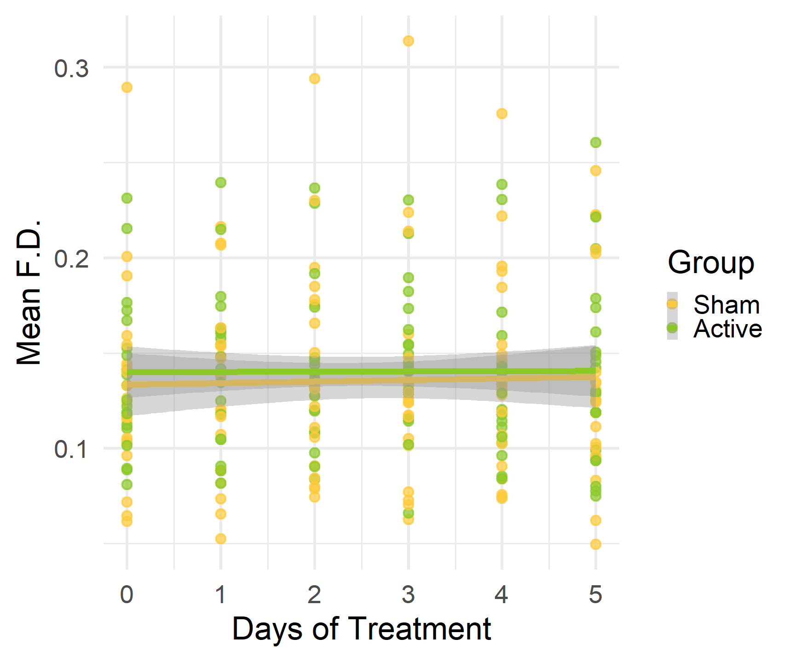<!-- -->

``` r
# evaluate if there's difference in FD by group
a_uncqd=FCMergedDemo_unqcd_daily[FCMergedDemo_unqcd_daily$Group=='X',]
s_uncqd=FCMergedDemo_unqcd_daily[FCMergedDemo_unqcd_daily$Group=='Y',]
# formal model
meanFDbygroup=lme(value~Group, random = ~ 1 | Subject, data=FCMergedDemo_unqcd_daily)
print(summary(meanFDbygroup))
```

    ## Linear mixed-effects model fit by REML
    ##   Data: FCMergedDemo_unqcd_daily 
    ##         AIC       BIC   logLik
    ##   -1015.524 -1001.585 511.7621
    ## 
    ## Random effects:
    ##  Formula: ~1 | Subject
    ##         (Intercept)  Residual
    ## StdDev:  0.04258655 0.0220004
    ## 
    ## Fixed effects:  value ~ Group 
    ##                  Value   Std.Error  DF   t-value p-value
    ## (Intercept) 0.13533013 0.009501399 202 14.243179  0.0000
    ## GroupX      0.00508641 0.013602602  39  0.373929  0.7105
    ##  Correlation: 
    ##        (Intr)
    ## GroupX -0.698
    ## 
    ## Standardized Within-Group Residuals:
    ##         Min          Q1         Med          Q3         Max 
    ## -2.25957989 -0.62922926 -0.02292578  0.48620754  2.90343038 
    ## 
    ## Number of Observations: 243
    ## Number of Groups: 41

``` r
# clarify group legend label
FCMergedDemo_unqcd_daily$Treatment=factor(x='Active',levels=c('Active','Sham'))
FCMergedDemo_unqcd_daily$Treatment[FCMergedDemo_unqcd_daily$Group=='Y']='Sham'
# saved at 1000 x 1000 
ggplot(FCMergedDemo_unqcd_daily,aes(x=Treatment,y=value))+geom_boxplot()+theme_minimal(base_size = 52)+ylab('Mean F.D.')+xlab('Group')
```

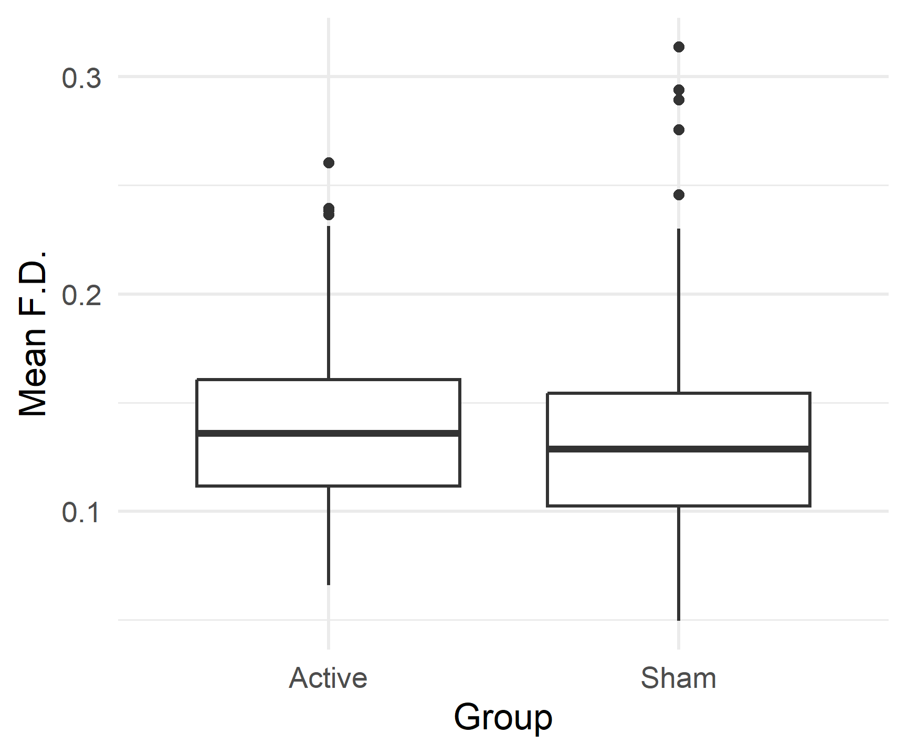<!-- -->

``` r
#print N active, N sham
a=FCMergedDemo[FCMergedDemo$Group=='X',]
s=FCMergedDemo[FCMergedDemo$Group=='Y',]
print(paste0('N active = ',length(unique(a$Subject))))
```

    ## [1] "N active = 20"

``` r
print(paste0('N sham = ',length(unique(s$Subject))))
```

    ## [1] "N sham = 20"

``` r
# print average age, sd (length 40, 20 active + 20 sham)
age=unique(FCMergedDemo$Age.at.screening.consent)
print(paste0('mean age = ',mean(age)))
```

    ## [1] "mean age = 45.83575"

``` r
print(paste0('sd = ', sd(age)))
```

    ## [1] "sd = 11.3699917433387"

``` r
# print sex breakdown, use duplicate to get one entry per subj
sex=FCMergedDemo$Gender[!duplicated(FCMergedDemo$Subject)]
print(table(sex))
```

    ## sex
    ## Female   Male 
    ##     20     20

``` r
# one row per subject indexing
subj <- FCMergedDemo[!duplicated(FCMergedDemo$Subject), ]
# contingency table: sex by group
tab <- table(Gender = subj$Gender, Group = subj$Group)
print(tab)
```

    ##         Group
    ## Gender    Y  X
    ##   Female  9 11
    ##   Male   11  9

``` r
# Pearson chi-square test of independence (no continuity correction)
chisq.test(tab, correct = FALSE)
```

    ## 
    ##  Pearson's Chi-squared test
    ## 
    ## data:  tab
    ## X-squared = 0.4, df = 1, p-value = 0.5271

``` r
# print mean scans per participant, s.d.
nscansvec=NULL
for (p in 1:length(unique(FCMergedDemo$Subject))){
  subjdf=FCMergedDemo[FCMergedDemo$Subject==unique(FCMergedDemo$Subject)[p],]
  nscans=dim(subjdf)[1]
  nscansvec[p]=nscans
}
print(paste0('mean scans per PT = ', mean(nscansvec)))
```

    ## [1] "mean scans per PT = 10.625"

``` r
print(paste0('sd scans per PT = ', sd(nscansvec)))
```

    ## [1] "sd scans per PT = 2.73334115070802"

``` r
# print more info for table 1: sex and age by condition group
sex_a=a$Gender[!duplicated(a$Subject)]
print(table(sex_a))
```

    ## sex_a
    ## Female   Male 
    ##     11      9

``` r
sex_s=s$Gender[!duplicated(s$Subject)]
print(table(sex_s))
```

    ## sex_s
    ## Female   Male 
    ##      9     11

``` r
age_a=a$Age.at.screening.consent[!duplicated(a$Subject)]
print(mean(age_a))
```

    ## [1] 44.2715

``` r
print(sd(age_a))
```

    ## [1] 10.77213

``` r
age_s=s$Age.at.screening.consent[!duplicated(s$Subject)]
print(mean(age_s))
```

    ## [1] 47.4

``` r
print(sd(age_s))
```

    ## [1] 12.00697

``` r
# ANOVA for group dif
age_df <- data.frame(
  Age   = c(age_a, age_s),
  Group = factor(rep(c("X", "Y"), times = c(length(age_a), length(age_s))))
)
fit <- aov(Age ~ Group, data = age_df)
summary(fit)
```

    ##             Df Sum Sq Mean Sq F value Pr(>F)
    ## Group        1     98   97.88   0.752  0.391
    ## Residuals   38   4944  130.10

``` r
### racial info
# white
print(table(a$White[!duplicated(a$Subject)]))
```

    ## 
    ##   Checked Unchecked 
    ##        18         2

``` r
print(table(s$White[!duplicated(s$Subject)]))
```

    ## 
    ##   Checked Unchecked 
    ##        14         6

``` r
# contingency table: white by group
tab <- table(Gender = subj$White, Group = subj$Group)
print(tab)
```

    ##            Group
    ## Gender       Y  X
    ##   Checked   14 18
    ##   Unchecked  6  2

``` r
# Pearson chi-square test of independence
chisq.test(tab, correct = FALSE)
```

    ## Warning in chisq.test(tab, correct = FALSE): Chi-squared approximation may be
    ## incorrect

    ## 
    ##  Pearson's Chi-squared test
    ## 
    ## data:  tab
    ## X-squared = 2.5, df = 1, p-value = 0.1138

``` r
# asian
print(table(a$Asian[!duplicated(a$Subject)]))
```

    ## 
    ##   Checked Unchecked 
    ##         1        19

``` r
print(table(s$Asian[!duplicated(s$Subject)]))
```

    ## 
    ##   Checked Unchecked 
    ##         6        14

``` r
# contingency table: asian by group
tab <- table(Gender = subj$Asian, Group = subj$Group)
print(tab)
```

    ##            Group
    ## Gender       Y  X
    ##   Checked    6  1
    ##   Unchecked 14 19

``` r
# Pearson chi-square test of independence
chisq.test(tab, correct = FALSE)
```

    ## Warning in chisq.test(tab, correct = FALSE): Chi-squared approximation may be
    ## incorrect

    ## 
    ##  Pearson's Chi-squared test
    ## 
    ## data:  tab
    ## X-squared = 4.329, df = 1, p-value = 0.03747

``` r
# AI/AA
print(table(a$American.Indian.Alaska.Native[!duplicated(a$Subject)]))
```

    ## 
    ## Unchecked 
    ##        20

``` r
print(table(s$American.Indian.Alaska.Native[!duplicated(s$Subject)]))
```

    ## 
    ##   Checked Unchecked 
    ##         1        19

``` r
# contingency table: Ai/AA by group
tab <- table(Gender = subj$American.Indian.Alaska.Native, Group = subj$Group)
print(tab)
```

    ##            Group
    ## Gender       Y  X
    ##   Checked    1  0
    ##   Unchecked 19 20

``` r
# Pearson chi-square test of independence
chisq.test(tab, correct = FALSE)
```

    ## Warning in chisq.test(tab, correct = FALSE): Chi-squared approximation may be
    ## incorrect

    ## 
    ##  Pearson's Chi-squared test
    ## 
    ## data:  tab
    ## X-squared = 1.0256, df = 1, p-value = 0.3112

``` r
# black
print(table(a$Black[!duplicated(a$Subject)]))
```

    ## 
    ## Unchecked 
    ##        20

``` r
print(table(s$Black[!duplicated(s$Subject)]))
```

    ## 
    ## Unchecked 
    ##        20

``` r
# other
print(table(a$Other[!duplicated(a$Subject)]))
```

    ## 
    ##   Checked Unchecked 
    ##         2        18

``` r
print(table(s$Other[!duplicated(s$Subject)]))
```

    ## 
    ## Unchecked 
    ##        20

``` r
# contingency table: other by group
tab <- table(Gender = subj$Other, Group = subj$Group)
print(tab)
```

    ##            Group
    ## Gender       Y  X
    ##   Checked    0  2
    ##   Unchecked 20 18

``` r
# Pearson chi-square test of independence
chisq.test(tab, correct = FALSE)
```

    ## Warning in chisq.test(tab, correct = FALSE): Chi-squared approximation may be
    ## incorrect

    ## 
    ##  Pearson's Chi-squared test
    ## 
    ## data:  tab
    ## X-squared = 2.1053, df = 1, p-value = 0.1468

``` r
# Ethnicity
print(table(a$Ethnicity[!duplicated(a$Subject)]))
```

    ## 
    ##     Hispanic or Latino Non-Hispanic or Latino 
    ##                      1                     19

``` r
print(table(s$Ethnicity[!duplicated(s$Subject)]))
```

    ## 
    ##     Hispanic or Latino Non-Hispanic or Latino 
    ##                      3                     17

``` r
# contingency table: ethinicity by group
tab <- table(Gender = subj$Ethnicity, Group = subj$Group)
print(tab)
```

    ##                         Group
    ## Gender                    Y  X
    ##   Hispanic or Latino      3  1
    ##   Non-Hispanic or Latino 17 19

``` r
# Pearson chi-square test of independence
chisq.test(tab, correct = FALSE)
```

    ## Warning in chisq.test(tab, correct = FALSE): Chi-squared approximation may be
    ## incorrect

    ## 
    ##  Pearson's Chi-squared test
    ## 
    ## data:  tab
    ## X-squared = 1.1111, df = 1, p-value = 0.2918

``` r
# number of past episodes
print(mean(a$Number.of.past.episodes..not.including.current.[!duplicated(a$Subject)]))
```

    ## [1] 3

``` r
print(sd(a$Number.of.past.episodes..not.including.current.[!duplicated(a$Subject)]))
```

    ## [1] 2.655679

``` r
print(mean(s$Number.of.past.episodes..not.including.current.[!duplicated(s$Subject)]))
```

    ## [1] 3.7

``` r
print(sd(s$Number.of.past.episodes..not.including.current.[!duplicated(s$Subject)]))
```

    ## [1] 2.473012

``` r
# ANOVA for group dif
ep_df <- data.frame(
  numEp   = c(a$Number.of.past.episodes..not.including.current.[!duplicated(a$Subject)], s$Number.of.past.episodes..not.including.current.[!duplicated(s$Subject)]),
  Group = factor(rep(c("X", "Y"), times = c(length(a$Number.of.past.episodes..not.including.current.[!duplicated(a$Subject)]), length(s$Number.of.past.episodes..not.including.current.[!duplicated(s$Subject)]))))
)
fit <- aov(numEp ~ Group, data = ep_df)
summary(fit)
```

    ##             Df Sum Sq Mean Sq F value Pr(>F)
    ## Group        1    4.9   4.900   0.744  0.394
    ## Residuals   38  250.2   6.584

``` r
# duration of current episode
print(mean(a$Duration.of.current.episode..months.[!duplicated(a$Subject)]))
```

    ## [1] 69.2

``` r
print(sd(a$Duration.of.current.episode..months.[!duplicated(a$Subject)]))
```

    ## [1] 66.38849

``` r
print(mean(s$Duration.of.current.episode..months.[!duplicated(s$Subject)]))
```

    ## [1] 46.2

``` r
print(sd(s$Duration.of.current.episode..months.[!duplicated(s$Subject)]))
```

    ## [1] 56.30051

``` r
# ANOVA for group dif
dur_df <- data.frame(
  DurEp   = c(a$Duration.of.current.episode..months.[!duplicated(a$Subject)], s$Duration.of.current.episode..months.[!duplicated(s$Subject)]),
  Group = factor(rep(c("X", "Y"), times = c(length(a$Duration.of.current.episode..months.[!duplicated(a$Subject)]), length(s$Duration.of.current.episode..months.[!duplicated(s$Subject)]))))
)
fit <- aov(DurEp ~ Group, data = dur_df)
summary(fit)
```

    ##             Df Sum Sq Mean Sq F value Pr(>F)
    ## Group        1   5290    5290   1.396  0.245
    ## Residuals   38 143966    3789

``` r
# past antidepressant failures
print(mean(a$Number.of.lifetime.adequate.antidepressant.failures[!duplicated(a$Subject)]))
```

    ## [1] 4.6

``` r
print(sd(a$Number.of.lifetime.adequate.antidepressant.failures[!duplicated(a$Subject)]))
```

    ## [1] 1.698296

``` r
print(mean(s$Number.of.lifetime.adequate.antidepressant.failures[!duplicated(s$Subject)]))
```

    ## [1] 4.45

``` r
print(sd(s$Number.of.lifetime.adequate.antidepressant.failures[!duplicated(s$Subject)]))
```

    ## [1] 1.959457

``` r
# ANOVA for group dif
Afail_df <- data.frame(
  Afail   = c(a$Number.of.lifetime.adequate.antidepressant.failures[!duplicated(a$Subject)], s$Number.of.lifetime.adequate.antidepressant.failures[!duplicated(s$Subject)]),
  Group = factor(rep(c("X", "Y"), times = c(length(a$Number.of.lifetime.adequate.antidepressant.failures[!duplicated(a$Subject)]), length(s$Number.of.lifetime.adequate.antidepressant.failures[!duplicated(s$Subject)]))))
)
fit <- aov(Afail ~ Group, data = Afail_df)
summary(fit)
```

    ##             Df Sum Sq Mean Sq F value Pr(>F)
    ## Group        1   0.22   0.225   0.067  0.797
    ## Residuals   38 127.75   3.362

``` r
# baseline maudsley is in demo file, note only one mauds measure was taken (baseline)
print(mean(a$Maudsley.Staging.Method.Score[!duplicated(a$Subject)]))
```

    ## [1] 8.5

``` r
print(sd(a$Maudsley.Staging.Method.Score[!duplicated(a$Subject)]))
```

    ## [1] 1.468977

``` r
print(mean(s$Maudsley.Staging.Method.Score[!duplicated(s$Subject)]))
```

    ## [1] 8.4

``` r
print(sd(s$Maudsley.Staging.Method.Score[!duplicated(s$Subject)]))
```

    ## [1] 1.500877

``` r
# ANOVA for group dif
Maud_df <- data.frame(
  Maud   = c(a$Maudsley.Staging.Method.Score[!duplicated(a$Subject)], s$Maudsley.Staging.Method.Score[!duplicated(s$Subject)]),
  Group = factor(rep(c("X", "Y"), times = c(length(a$Maudsley.Staging.Method.Score[!duplicated(a$Subject)]), length(s$Maudsley.Staging.Method.Score[!duplicated(s$Subject)]))))
)
fit <- aov(Maud ~ Group, data = Maud_df)
summary(fit)
```

    ##             Df Sum Sq Mean Sq F value Pr(>F)
    ## Group        1    0.1   0.100   0.045  0.833
    ## Residuals   38   83.8   2.205

``` r
#### hypothesis 1
# fisher's Z
FCMergedDemo$DM_sgAv_z=atanh(FCMergedDemo$DM_sgAv)

# average per-day for AR model
FC_daily <- FCMergedDemo %>%
  group_by(Subject, DaysSinceInit) %>%
  summarise(
    # average da FC
    DM_sgAv_z = if (all(is.na(DM_sgAv_z))) {
      NA_real_
    } else {
      mean(DM_sgAv_z, na.rm = TRUE)
    },
    # some days will only have 1 scan surviving QC
    n_scans = sum(!is.na(DM_sgAv_z)),
    # group is constant
    Group = first(Group),
    # gender constant
    Gender = first(Gender),
    # sex constant
    Sex = first(Biological.sex...i.e..sex.assigned.at.birth.),
    # fd is per scan
    Mean_FD = if (all(is.na(Mean_FD))) {
      NA_real_
    } else {
      mean(Mean_FD, na.rm = TRUE)
    },
    # constant
    Asian = first(Asian),
    .groups = "drop"
  ) %>%
  filter(!is.na(DM_sgAv_z)) %>%
  mutate(
    Subject = factor(Subject),
    Group = relevel(factor(Group), ref = "Y"),
    Gender = factor(Gender)
  ) %>%
  arrange(Subject, DaysSinceInit)

# pre-specified autoregressive model (unadjusted)
m_daily_AR_unadj <- lme(
  fixed = DM_sgAv_z ~ Group * DaysSinceInit, random = ~ 1 | Subject,
  correlation = corCAR1(
    form = ~ DaysSinceInit | Subject
  ), data = FC_daily)

print(summary(m_daily_AR_unadj))
```

    ## Linear mixed-effects model fit by REML
    ##   Data: FC_daily 
    ##         AIC       BIC   logLik
    ##   -916.1604 -892.5659 465.0802
    ## 
    ## Random effects:
    ##  Formula: ~1 | Subject
    ##         (Intercept)   Residual
    ## StdDev:  0.01784895 0.02339361
    ## 
    ## Correlation Structure: Continuous AR(1)
    ##  Formula: ~DaysSinceInit | Subject 
    ##  Parameter estimate(s):
    ##          Phi 
    ## 3.130545e-09 
    ## Fixed effects:  DM_sgAv_z ~ Group * DaysSinceInit 
    ##                             Value   Std.Error  DF   t-value p-value
    ## (Intercept)           0.024722960 0.005574658 177  4.434884  0.0000
    ## GroupX                0.010042776 0.008006657  38  1.254303  0.2174
    ## DaysSinceInit         0.000924232 0.001312324 177  0.704271  0.4822
    ## GroupX:DaysSinceInit -0.003911827 0.001870991 177 -2.090778  0.0380
    ##  Correlation: 
    ##                      (Intr) GroupX DysSnI
    ## GroupX               -0.696              
    ## DaysSinceInit        -0.568  0.395       
    ## GroupX:DaysSinceInit  0.398 -0.580 -0.701
    ## 
    ## Standardized Within-Group Residuals:
    ##         Min          Q1         Med          Q3         Max 
    ## -2.98607438 -0.63893683 -0.00446427  0.61528768  3.46336769 
    ## 
    ## Number of Observations: 219
    ## Number of Groups: 40

``` r
# technically pre-register calls for anova, but results identical
print(anova(m_daily_AR_unadj, type = "marginal"))
```

    ##                     numDF denDF   F-value p-value
    ## (Intercept)             1   177 19.668193  <.0001
    ## Group                   1    38  1.573277  0.2174
    ## DaysSinceInit           1   177  0.495997  0.4822
    ## Group:DaysSinceInit     1   177  4.371354  0.0380

``` r
# variance vibecheck
cat("\nVariance components:\n")
```

    ## 
    ## Variance components:

``` r
print(VarCorr(m_daily_AR_unadj))
```

    ## Subject = pdLogChol(1) 
    ##             Variance     StdDev    
    ## (Intercept) 0.0003185849 0.01784895
    ## Residual    0.0005472611 0.02339361

``` r
# low autocorrelation in FC values it seems
cat("\nAutoregressive parameter:\n")
```

    ## 
    ## Autoregressive parameter:

``` r
print(
  coef(
    m_daily_AR_unadj$modelStruct$corStruct,
    unconstrained = FALSE
  )
)
```

    ##          Phi 
    ## 3.130545e-09

``` r
# setting asian to 1 and unchecked to 0 for ease of interp
FC_daily$Asian=factor(FC_daily$Asian,levels=c('Unchecked','Checked'))
# adjusted for baseline differences
m_daily_AR_adj1 <- lme(
  fixed = DM_sgAv_z ~ Group * DaysSinceInit+Asian, random = ~ 1 | Subject,
  correlation = corCAR1(
    form = ~ DaysSinceInit | Subject
  ), data = FC_daily)

print(summary(m_daily_AR_adj1))
```

    ## Linear mixed-effects model fit by REML
    ##   Data: FC_daily 
    ##         AIC       BIC   logLik
    ##   -906.7603 -879.8325 461.3801
    ## 
    ## Random effects:
    ##  Formula: ~1 | Subject
    ##         (Intercept)   Residual
    ## StdDev:  0.01809912 0.02339616
    ## 
    ## Correlation Structure: Continuous AR(1)
    ##  Formula: ~DaysSinceInit | Subject 
    ##  Parameter estimate(s):
    ##          Phi 
    ## 3.166386e-09 
    ## Fixed effects:  DM_sgAv_z ~ Group * DaysSinceInit + Asian 
    ##                             Value   Std.Error  DF   t-value p-value
    ## (Intercept)           0.023589066 0.006240137 177  3.780216  0.0002
    ## GroupX                0.010983854 0.008369917  37  1.312301  0.1975
    ## DaysSinceInit         0.000918414 0.001312802 177  0.699583  0.4851
    ## AsianChecked          0.003785522 0.009078736  37  0.416966  0.6791
    ## GroupX:DaysSinceInit -0.003910623 0.001871653 177 -2.089396  0.0381
    ##  Correlation: 
    ##                      (Intr) GroupX DysSnI AsnChc
    ## GroupX               -0.721                     
    ## DaysSinceInit        -0.500  0.373              
    ## AsianChecked         -0.436  0.268 -0.018       
    ## GroupX:DaysSinceInit  0.350 -0.551 -0.701  0.013
    ## 
    ## Standardized Within-Group Residuals:
    ##          Min           Q1          Med           Q3          Max 
    ## -2.992991593 -0.633215035 -0.004854585  0.612187128  3.454959497 
    ## 
    ## Number of Observations: 219
    ## Number of Groups: 40

``` r
# adjust for head motion
m_daily_AR_adj2 <- lme(
  fixed = DM_sgAv_z ~ Group * DaysSinceInit+Mean_FD, random = ~ 1 | Subject,
  correlation = corCAR1(
    form = ~ DaysSinceInit | Subject
  ), data = FC_daily)

print(summary(m_daily_AR_adj2))
```

    ## Linear mixed-effects model fit by REML
    ##   Data: FC_daily 
    ##         AIC       BIC   logLik
    ##   -910.8344 -883.9066 463.4172
    ## 
    ## Random effects:
    ##  Formula: ~1 | Subject
    ##         (Intercept)   Residual
    ## StdDev:  0.01805249 0.02341293
    ## 
    ## Correlation Structure: Continuous AR(1)
    ##  Formula: ~DaysSinceInit | Subject 
    ##  Parameter estimate(s):
    ##          Phi 
    ## 3.065637e-09 
    ## Fixed effects:  DM_sgAv_z ~ Group * DaysSinceInit + Mean_FD 
    ##                             Value  Std.Error  DF    t-value p-value
    ## (Intercept)           0.026815826 0.01076574 176  2.4908475  0.0137
    ## GroupX                0.010189948 0.00808053  38  1.2610491  0.2150
    ## DaysSinceInit         0.000921098 0.00131378 176  0.7011066  0.4842
    ## Mean_FD              -0.016827639 0.07391108 176 -0.2276741  0.8202
    ## GroupX:DaysSinceInit -0.003911668 0.00187302 176 -2.0884239  0.0382
    ##  Correlation: 
    ##                      (Intr) GroupX DysSnI Men_FD
    ## GroupX               -0.296                     
    ## DaysSinceInit        -0.312  0.390              
    ## Mean_FD              -0.854 -0.077  0.020       
    ## GroupX:DaysSinceInit  0.221 -0.574 -0.701 -0.017
    ## 
    ## Standardized Within-Group Residuals:
    ##         Min          Q1         Med          Q3         Max 
    ## -3.00219432 -0.63072676 -0.01372013  0.60760343  3.43618836 
    ## 
    ## Number of Observations: 219
    ## Number of Groups: 40

``` r
# adjust for gender
m_daily_AR_adj3 <- lme(
  fixed = DM_sgAv_z ~ Group * DaysSinceInit+Gender, random = ~ 1 | Subject,
  correlation = corCAR1(
    form = ~ DaysSinceInit | Subject
  ), data = FC_daily)

print(summary(m_daily_AR_adj3))
```

    ## Linear mixed-effects model fit by REML
    ##   Data: FC_daily 
    ##         AIC       BIC   logLik
    ##   -916.3684 -889.4406 466.1842
    ## 
    ## Random effects:
    ##  Formula: ~1 | Subject
    ##         (Intercept)   Residual
    ## StdDev:     0.01505 0.02336898
    ## 
    ## Correlation Structure: Continuous AR(1)
    ##  Formula: ~DaysSinceInit | Subject 
    ##  Parameter estimate(s):
    ##          Phi 
    ## 3.031281e-09 
    ## Fixed effects:  DM_sgAv_z ~ Group * DaysSinceInit + Gender 
    ##                            Value   Std.Error  DF   t-value p-value
    ## (Intercept)           0.03585642 0.006072998 177  5.904238  0.0000
    ## GroupX                0.00854736 0.007401047  37  1.154886  0.2555
    ## DaysSinceInit         0.00097327 0.001309613 177  0.743175  0.4584
    ## GenderMale           -0.02002066 0.005804809  37 -3.448978  0.0014
    ## GroupX:DaysSinceInit -0.00409054 0.001867395 177 -2.190507  0.0298
    ##  Correlation: 
    ##                      (Intr) GroupX DysSnI GndrMl
    ## GroupX               -0.617                     
    ## DaysSinceInit        -0.510  0.426              
    ## GenderMale           -0.532  0.055 -0.022       
    ## GroupX:DaysSinceInit  0.341 -0.622 -0.702  0.046
    ## 
    ## Standardized Within-Group Residuals:
    ##         Min          Q1         Med          Q3         Max 
    ## -2.96744056 -0.60296048 -0.01679315  0.60913899  3.46660409 
    ## 
    ## Number of Observations: 219
    ## Number of Groups: 40

``` r
# adjust for sex
m_daily_AR_adj4 <- lme(
  fixed = DM_sgAv_z ~ Group * DaysSinceInit+Sex, random = ~ 1 | Subject,
  correlation = corCAR1(
    form = ~ DaysSinceInit | Subject
  ), data = FC_daily)

print(summary(m_daily_AR_adj4))
```

    ## Linear mixed-effects model fit by REML
    ##   Data: FC_daily 
    ##         AIC       BIC  logLik
    ##   -913.7579 -886.8301 464.879
    ## 
    ## Random effects:
    ##  Formula: ~1 | Subject
    ##         (Intercept)  Residual
    ## StdDev:   0.0158153 0.0233743
    ## 
    ## Correlation Structure: Continuous AR(1)
    ##  Formula: ~DaysSinceInit | Subject 
    ##  Parameter estimate(s):
    ##         Phi 
    ## 4.94836e-09 
    ## Fixed effects:  DM_sgAv_z ~ Group * DaysSinceInit + Sex 
    ##                            Value   Std.Error  DF   t-value p-value
    ## (Intercept)           0.03457717 0.006240540 177  5.540733  0.0000
    ## GroupX                0.00775438 0.007591168  37  1.021500  0.3137
    ## DaysSinceInit         0.00097210 0.001310384 177  0.741845  0.4592
    ## SexMale              -0.01772935 0.006047258  37 -2.931800  0.0058
    ## GroupX:DaysSinceInit -0.00404934 0.001868404 177 -2.167275  0.0315
    ##  Correlation: 
    ##                      (Intr) GroupX DysSnI SexMal
    ## GroupX               -0.637                     
    ## DaysSinceInit        -0.496  0.415              
    ## SexMale              -0.539  0.100 -0.021       
    ## GroupX:DaysSinceInit  0.334 -0.605 -0.702  0.040
    ## 
    ## Standardized Within-Group Residuals:
    ##         Min          Q1         Med          Q3         Max 
    ## -2.97831277 -0.60961602  0.02537691  0.60503840  3.46111782 
    ## 
    ## Number of Observations: 219
    ## Number of Groups: 40

``` r
# adjust for all
m_daily_AR_adj5 <- lme(
  fixed = DM_sgAv_z ~ Group * DaysSinceInit+Mean_FD+Gender+Sex+Asian, random = ~ 1 | Subject,
  correlation = corCAR1(
    form = ~ DaysSinceInit | Subject
  ), data = FC_daily)

print(summary(m_daily_AR_adj5))
```

    ## Linear mixed-effects model fit by REML
    ##   Data: FC_daily 
    ##         AIC       BIC   logLik
    ##   -894.0069 -857.1364 458.0034
    ## 
    ## Random effects:
    ##  Formula: ~1 | Subject
    ##         (Intercept)   Residual
    ## StdDev:  0.01570249 0.02336955
    ## 
    ## Correlation Structure: Continuous AR(1)
    ##  Formula: ~DaysSinceInit | Subject 
    ##  Parameter estimate(s):
    ##          Phi 
    ## 3.267239e-09 
    ## Fixed effects:  DM_sgAv_z ~ Group * DaysSinceInit + Mean_FD + Gender + Sex +      Asian 
    ##                            Value  Std.Error  DF   t-value p-value
    ## (Intercept)           0.04008685 0.01219660 176  3.286723  0.0012
    ## GroupX                0.00964973 0.00790397  35  1.220872  0.2303
    ## DaysSinceInit         0.00096393 0.00131057 176  0.735500  0.4630
    ## Mean_FD              -0.03543736 0.07282462 176 -0.486612  0.6271
    ## GenderMale           -0.03453375 0.01957159  35 -1.764484  0.0864
    ## SexMale               0.01487866 0.01974883  35  0.753395  0.4563
    ## AsianChecked         -0.00010880 0.00835530  35 -0.013022  0.9897
    ## GroupX:DaysSinceInit -0.00410990 0.00186889 176 -2.199114  0.0292
    ##  Correlation: 
    ##                      (Intr) GroupX DysSnI Men_FD GndrMl SexMal AsnChc
    ## GroupX               -0.363                                          
    ## DaysSinceInit        -0.263  0.393                                   
    ## Mean_FD              -0.827 -0.006  0.018                            
    ## GenderMale           -0.012 -0.111 -0.005 -0.042                     
    ## SexMale              -0.126  0.143 -0.002  0.095 -0.950              
    ## AsianChecked         -0.378  0.257 -0.018  0.177  0.032  0.015       
    ## GroupX:DaysSinceInit  0.175 -0.578 -0.702 -0.012  0.024 -0.011  0.017
    ## 
    ## Standardized Within-Group Residuals:
    ##          Min           Q1          Med           Q3          Max 
    ## -3.023447585 -0.634241351 -0.005698873  0.592198539  3.394494608 
    ## 
    ## Number of Observations: 219
    ## Number of Groups: 40

``` r
# evidence for autocorrelation limited, deploy mixed effects model with no AR
m_daily_noAR_unadj <- lme(
  fixed = DM_sgAv_z ~ Group * DaysSinceInit, random = ~ 1 | Subject, data = FC_daily)

summary(m_daily_noAR_unadj)
```

    ## Linear mixed-effects model fit by REML
    ##   Data: FC_daily 
    ##         AIC       BIC   logLik
    ##   -918.1604 -897.9366 465.0802
    ## 
    ## Random effects:
    ##  Formula: ~1 | Subject
    ##         (Intercept)   Residual
    ## StdDev:  0.01784895 0.02339361
    ## 
    ## Fixed effects:  DM_sgAv_z ~ Group * DaysSinceInit 
    ##                             Value   Std.Error  DF   t-value p-value
    ## (Intercept)           0.024722960 0.005574659 177  4.434883  0.0000
    ## GroupX                0.010042776 0.008006657  38  1.254303  0.2174
    ## DaysSinceInit         0.000924232 0.001312324 177  0.704271  0.4822
    ## GroupX:DaysSinceInit -0.003911827 0.001870991 177 -2.090778  0.0380
    ##  Correlation: 
    ##                      (Intr) GroupX DysSnI
    ## GroupX               -0.696              
    ## DaysSinceInit        -0.568  0.395       
    ## GroupX:DaysSinceInit  0.398 -0.580 -0.701
    ## 
    ## Standardized Within-Group Residuals:
    ##          Min           Q1          Med           Q3          Max 
    ## -2.986074574 -0.638936851 -0.004464301  0.615287630  3.463367639 
    ## 
    ## Number of Observations: 219
    ## Number of Groups: 40

``` r
# covariate adjust
m_daily_noAR_adj <- lme(
  fixed = DM_sgAv_z ~ Group * DaysSinceInit+Mean_FD+Gender+Sex+Asian, random = ~ 1 | Subject, data = FC_daily)

print(summary(m_daily_noAR_adj))
```

    ## Linear mixed-effects model fit by REML
    ##   Data: FC_daily 
    ##         AIC       BIC   logLik
    ##   -896.0069 -862.4883 458.0034
    ## 
    ## Random effects:
    ##  Formula: ~1 | Subject
    ##         (Intercept)   Residual
    ## StdDev:  0.01570257 0.02336954
    ## 
    ## Fixed effects:  DM_sgAv_z ~ Group * DaysSinceInit + Mean_FD + Gender + Sex +      Asian 
    ##                            Value  Std.Error  DF   t-value p-value
    ## (Intercept)           0.04008690 0.01219662 176  3.286721  0.0012
    ## GroupX                0.00964973 0.00790398  35  1.220869  0.2303
    ## DaysSinceInit         0.00096393 0.00131057 176  0.735501  0.4630
    ## Mean_FD              -0.03543766 0.07282469 176 -0.486616  0.6271
    ## GenderMale           -0.03453375 0.01957165  35 -1.764478  0.0864
    ## SexMale               0.01487865 0.01974889  35  0.753392  0.4563
    ## AsianChecked         -0.00010882 0.00835533  35 -0.013024  0.9897
    ## GroupX:DaysSinceInit -0.00410990 0.00186889 176 -2.199117  0.0292
    ##  Correlation: 
    ##                      (Intr) GroupX DysSnI Men_FD GndrMl SexMal AsnChc
    ## GroupX               -0.363                                          
    ## DaysSinceInit        -0.263  0.393                                   
    ## Mean_FD              -0.827 -0.006  0.018                            
    ## GenderMale           -0.012 -0.111 -0.005 -0.042                     
    ## SexMale              -0.126  0.143 -0.002  0.095 -0.950              
    ## AsianChecked         -0.378  0.257 -0.018  0.177  0.032  0.015       
    ## GroupX:DaysSinceInit  0.175 -0.578 -0.702 -0.012  0.024 -0.011  0.017
    ## 
    ## Standardized Within-Group Residuals:
    ##          Min           Q1          Med           Q3          Max 
    ## -3.023453289 -0.634241833 -0.005700236  0.592198744  3.394492828 
    ## 
    ## Number of Observations: 219
    ## Number of Groups: 40

``` r
# plot it by residualizing DMN-SGACC FC on other variables in the model, leaving only the relationships of interest
ReducedMod <- lme(
  fixed = DM_sgAv_z ~ DaysSinceInit, random = ~ 1 | Subject,
  correlation = corCAR1(
    form = ~ DaysSinceInit | Subject
  ), data = FC_daily)
FC_daily$Resids=ReducedMod$residuals[,2]+mean(FC_daily$DM_sgAv_z)
# clarify group legend label
FC_daily$Treatment=factor(x='Active',levels=c('Active','Sham'))
FC_daily$Treatment[FC_daily$Group=='Y']='Sham'
# saved at 2100 x 1600
ggplot(FC_daily,aes(x=DaysSinceInit,y=Resids,Group=Treatment,color=Treatment))+geom_point(alpha=.7,size=6)+geom_smooth(method='lm')+theme_minimal(base_size = 52)+ylab('DMN-sgACC FC')+xlab('Days of Treatment')+scale_color_manual(values=c('#8ac926','#ffca3a'))
```

    ## `geom_smooth()` using formula = 'y ~ x'

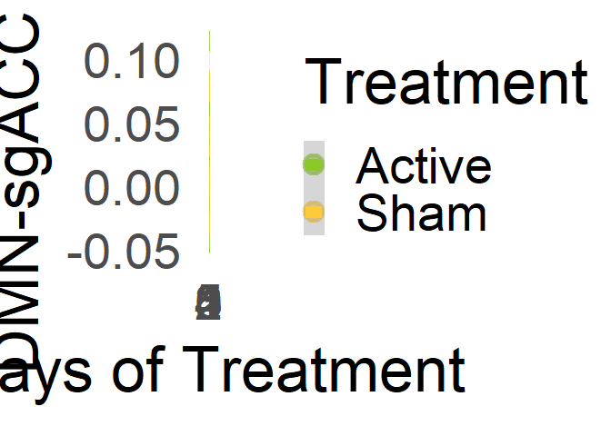<!-- -->

``` r
# sex
ggplot(FC_daily,aes(x=Sex,y=DM_sgAv_z))+geom_boxplot()+theme_minimal(base_size = 35)+ylab('DMN-sgACC FC')+xlab('Sex A.A.B.')
```

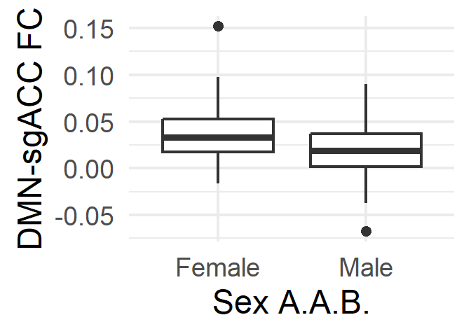<!-- -->

``` r
# Gender
ggplot(FC_daily,aes(x=Gender,y=DM_sgAv_z))+geom_boxplot()+theme_minimal(base_size = 35)+ylab('DMN-sgACC FC')+xlab('Self-identified Gender')
```

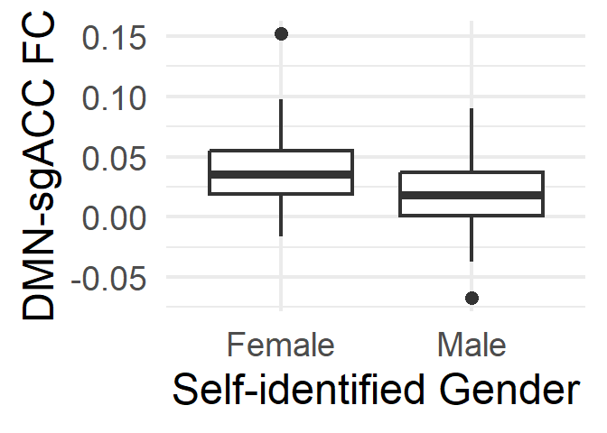<!-- -->

``` r
# FD
ggplot(FC_daily,aes(x=Mean_FD,y=DM_sgAv_z))+geom_point()+geom_smooth(method = 'lm')+theme_minimal(base_size = 35)+ylab('DMN-sgACC FC')+xlab('Mean F.D.')
```

    ## `geom_smooth()` using formula = 'y ~ x'

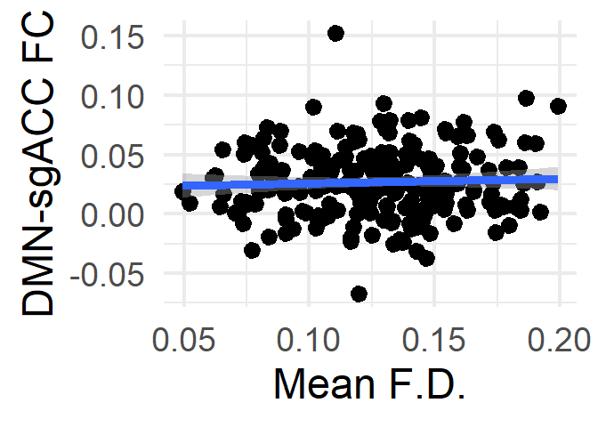<!-- -->

``` r
# Asian
ggplot(FC_daily,aes(x=Asian,y=DM_sgAv_z))+geom_boxplot()+theme_minimal(base_size = 35)+ylab('DMN-sgACC FC')+xlab('Self-Identified Asian')
```

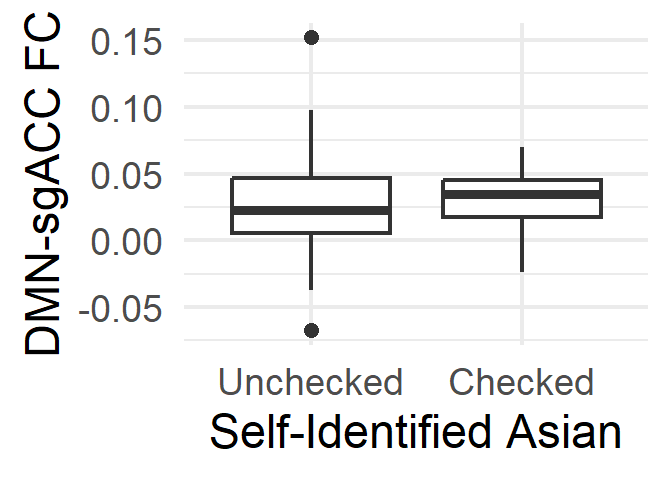<!-- -->

``` r
library(RColorBrewer)
# refit  model for representative random effects
Dif_TRx <- lme(
  fixed = DM_sgAv_z ~ Group * DaysSinceInit+Mean_FD+Gender+Sex+Asian, random = ~ 1 | Subject, data = FC_daily)


# random intercepts, one row per subject actually in the model
ranef_df <- data.frame(
  Subject = rownames(ranef(Dif_TRx)),
  RandomIntercept = ranef(Dif_TRx)[, 1],
  row.names = NULL
)

# keep original ID order (zero-padded IDs sort correctly), then number 1:n
ranef_df <- ranef_df[order(ranef_df$Subject), ]
n <- nrow(ranef_df)
ranef_df$SubjNum <- factor(seq_len(n))

# colors sized to the actual n, named by the sequential number
subj_colors <- setNames(
  colorRampPalette(brewer.pal(12, "Paired"))(n),
  levels(ranef_df$SubjNum)
)

ggplot(ranef_df, aes(x = SubjNum, y = RandomIntercept, color = SubjNum)) +
  geom_hline(yintercept = 0, color = "grey70", linewidth = 0.8) +
  geom_point(size = 5) +
  scale_color_manual(values = subj_colors) +
  labs(
    title = "Subject-specific random intercepts",
    x = NULL,
    y = "DMN-sgACC FC"
  ) +
  theme_minimal(base_size = 35) +
  theme(
    plot.title = element_text(face = "bold", size = 35),
    axis.text.x = element_text(angle = 90, hjust = 1, vjust = 0.5, size = 30),
    axis.text.y = element_text(size = 35),
    legend.position = "none",
    panel.grid.minor = element_blank()
  )
```

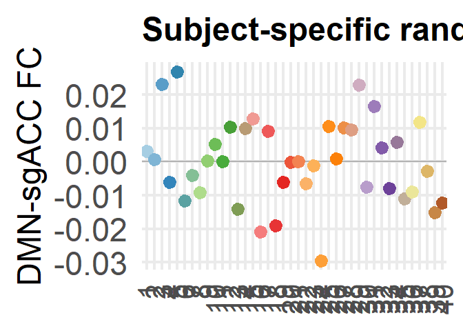<!-- -->

``` r
### secondary hypotheses
########## load in MADRS
# new version from chris sent 8/5/2025 at 12:11 pm
MADRSInfo=read.csv('E:/Downloads/madrs_data_for_brains/brains_madrs-cr.csv')
# set timepoint equivalence
tp_map1 <- c(
  "baseline_visit_2_arm_2"   = "V2",
  "study_day_1_visit_arm_2"  = "V3",
  "study_day_2_visit_arm_2"  = "V4",
  "study_day_3_visit_arm_2"  = "V5",
  "study_day_4_visit_arm_2"  = "V6",
  "study_day_5_visit_arm_2"  = "V7",
  "next_day_visit_vis_arm_2" = "V8",
  "immediate_post_vis_arm_2" = "V9",
  "1month_post_visit_arm_2"  = "V10"
)

# add new sesh column, others become NA
MADRSInfo$sesh <- tp_map1[MADRSInfo$redcap_event_name]

# make subject names equiv
MADRSInfo$Subject <- sub(".*_(s[0-9]+[a-z]?)", "\\1", MADRSInfo$record_id)
# remove trailing a's
MADRSInfo$Subject <- sub("a$", "", MADRSInfo$Subject)

# ok, now we need a session-wise key instead of subj/session/scan because we dont have a MADRS for each scan
FCMergedDemo$Key_Sess <- sub("_[0-9]+$", "", FCMergedDemo$key)

# cool, now we need an equivalent key column
MADRSInfo$Key_Sess <- paste(MADRSInfo$Subject, MADRSInfo$sesh, sep = "_")

# merge em
FCMergedMADRS=merge(FCMergedDemo,MADRSInfo,by=c("Key_Sess","Subject"))
FCMergedMADRS=FCMergedMADRS[!is.na(FCMergedMADRS$madrs_total_mentorrater),]
# retain FCMergedMADRS-CR for later
FCMergedMADRSCR=FCMergedMADRS

# report baseline MADRS CR
aSubjs_included=unique(a$Subject)
sSubjs_included=unique(s$Subject)
BV_madrs=MADRSInfo[MADRSInfo$redcap_event_name=='baseline_visit_2_arm_2',]
BV_madrs_active=BV_madrs[BV_madrs$Subject %in% aSubjs_included,]
BV_madrs_sham=BV_madrs[BV_madrs$Subject %in% sSubjs_included,]

# print mean, sd
print(paste0('Mean Madrs-CR, Active: ',mean(BV_madrs_active$madrs_total_mentorrater)))
```

    ## [1] "Mean Madrs-CR, Active: 28.05"

``` r
print(paste0('Madrs-CR s.d., Active: ',sd(BV_madrs_active$madrs_total_mentorrater)))
```

    ## [1] "Madrs-CR s.d., Active: 5.87120538148505"

``` r
print(paste0('Mean Madrs-CR, Sham: ',mean(BV_madrs_sham$madrs_total_mentorrater)))
```

    ## [1] "Mean Madrs-CR, Sham: 25.75"

``` r
print(paste0('Madrs-CR s.d., Sham: ',sd(BV_madrs_sham$madrs_total_mentorrater)))
```

    ## [1] "Madrs-CR s.d., Sham: 3.83714532048583"

``` r
# ANOVA for group dif
madrs_a <- BV_madrs_active$madrs_total_mentorrater
madrs_s <- BV_madrs_sham$madrs_total_mentorrater
MCR_df <- data.frame(
  Madrs = c(madrs_a, madrs_s),
  Group = factor(rep(c("X", "Y"), times = c(length(madrs_a), length(madrs_s))))
)
fit <- aov(Madrs ~ Group, data = MCR_df)
summary(fit)
```

    ##             Df Sum Sq Mean Sq F value Pr(>F)
    ## Group        1   52.9    52.9   2.151  0.151
    ## Residuals   38  934.7    24.6

``` r
# calculate change in FC (V8 - V3)
FCMergedMADRS_change <- FCMergedMADRS[FCMergedMADRS$sesh.x %in% c(3, 8), ]
FC_change <- FCMergedMADRS_change %>%
  group_by(Subject, Group, sesh.x) %>%
  summarise(DM_sgAv_mean = mean(DM_sgAv, na.rm = TRUE), .groups = "drop") %>%
  pivot_wider(names_from = sesh.x, 
              values_from = DM_sgAv_mean,
              names_prefix = "V") %>%
  mutate(FC_change = V8 - V3) %>%
  filter(!is.na(FC_change))

# calculate change in MADRS

MADRS_change <- FCMergedMADRS_change %>%
  group_by(Subject, sesh.x,Group) %>%
  summarise(MADRS_mean = mean(madrs_total_mentorrater, na.rm = TRUE), .groups = "drop") %>%
  pivot_wider(names_from = sesh.x, 
              values_from = MADRS_mean,
              names_prefix = "V") %>%
  mutate(MADRS_change = V8 - V3) %>%
  filter(!is.na(MADRS_change))# Remove subjects without both timepoints

# according to protocol, evaluate normality of change in FC and MADRS (shapiro-wilk)
shapiro.test(MADRS_change$MADRS_change)
```

    ## 
    ##  Shapiro-Wilk normality test
    ## 
    ## data:  MADRS_change$MADRS_change
    ## W = 0.96704, p-value = 0.4414

``` r
shapiro.test(FC_change$FC_change)
```

    ## 
    ##  Shapiro-Wilk normality test
    ## 
    ## data:  FC_change$FC_change
    ## W = 0.98151, p-value = 0.8532

``` r
# note neither meets criteria for non-normality, proceeding with pearsons
change_scores <- merge(MADRS_change, FC_change, by = "Subject")
# and subset by X and Y
Xchange=change_scores[change_scores$Group.x=='X',]
Ychange=change_scores[change_scores$Group.x=='Y',]

XchangeCor=cor.test(Xchange$MADRS_change,Xchange$FC_change)$estimate
YchangeCor=cor.test(Ychange$MADRS_change,Ychange$FC_change)$estimate

# test MADRS change scores
library(diffcor)
```

    ## Warning: package 'diffcor' was built under R version 4.5.2

    ## Loading required package: MASS

    ## 
    ## Attaching package: 'MASS'

    ## The following object is masked from 'package:dplyr':
    ## 
    ##     select

``` r
diffcor.two(XchangeCor,YchangeCor,16,15,alternative = 'two.sided')
```

    ##      r1     r2    LL1   UL1   LL2   UL2    z     p Cohen_q
    ## 1 0.379 -0.053 -0.143 0.737 -0.55 0.472 1.13 0.258   0.452

``` r
# plot it: 1500 x 1200
change_scores$Treatment=factor(x='Active',levels=c('Active','Sham'))
change_scores$Treatment[change_scores$Group.x=='Y']='Sham'
# - for reverse-scoring (harmonization with IMS change)
ggplot(data=change_scores,aes(x=FC_change,y=-MADRS_change,color=Treatment))+geom_point()+geom_smooth(method='lm')+ylab('MADRS-CR Improvement \n \n') + xlab('Change in DMN-sgACC FC')+theme_minimal(base_size=46)+scale_color_manual(values=c('#8ac926','#ffca3a'))
```

    ## `geom_smooth()` using formula = 'y ~ x'

<!-- -->

``` r
# now evaluate as group for comparison
change_scores_active=change_scores[change_scores$Group.x=='X',]
medianFC_delta=median(change_scores_active$FC_change)
# more than median change
change_scores_active_moreFCchange=change_scores_active[change_scores_active$FC_change<medianFC_delta,]
# less than median change (> because change is negative)
change_scores_active_lessFCchange=change_scores_active[change_scores_active$FC_change>medianFC_delta,]
```

``` r
# now repeating with MADRS-SR
# new version from chris sent 8/5/2025 at 12:11 pm
MADRSInfo=read.csv('E:/Downloads/madrs_data_for_brains/brains_madrs-s.csv')
# set timepoint equivalence
tp_map1 <- c(
  "baseline_visit_2_arm_2"   = "V2",
  "study_day_1_visit_arm_2"  = "V3",
  "study_day_2_visit_arm_2"  = "V4",
  "study_day_3_visit_arm_2"  = "V5",
  "study_day_4_visit_arm_2"  = "V6",
  "study_day_5_visit_arm_2"  = "V7",
  "next_day_visit_vis_arm_2" = "V8",
  "immediate_post_vis_arm_2" = "V9",
  "1month_post_visit_arm_2"  = "V10"
)

# add new sesh column, others become NA
MADRSInfo$sesh <- tp_map1[MADRSInfo$redcap_event_name]

# make subject names equiv
MADRSInfo$Subject <- sub(".*_(s[0-9]+[a-z]?)", "\\1", MADRSInfo$record_id)
# remove trailing a's
MADRSInfo$Subject <- sub("a$", "", MADRSInfo$Subject)

# ok, now we need a session-wise key instead of subj/session/scan because we dont have a MADRS for each scan
FCMergedDemo$Key_Sess <- sub("_[0-9]+$", "", FCMergedDemo$key)
FCMergedDemo_unqcd$Key_Sess <- sub("_[0-9]+$", "", FCMergedDemo_unqcd$key)
# cool, now we need an equivalent key column
MADRSInfo$Key_Sess <- paste(MADRSInfo$Subject, MADRSInfo$sesh, sep = "_")

# merge em
FCMergedMADRS=merge(FCMergedDemo,MADRSInfo,by=c("Key_Sess","Subject"))
FCMergedMADRS=FCMergedMADRS[!is.na(FCMergedMADRS$madrs_s_total),]
# and an unqc'd version for testing FD by treatment respone
FCMergedMADRS_unqcd=merge(FCMergedDemo_unqcd,MADRSInfo,by=c("Key_Sess","Subject"))
FCMergedMADRS_unqcd=FCMergedMADRS_unqcd[!is.na(FCMergedMADRS_unqcd$madrs_s_total),]
# collapse into an average FD per person so we can eval average mean FD and treatment response
mean_FD_unqcd <- FCMergedMADRS_unqcd %>%
  group_by(Subject, Group, sesh.x) %>%
  summarise(Mean_FD = mean(Mean_FD, na.rm = TRUE), .groups = "drop") %>%
  pivot_wider(names_from = sesh.x, 
              values_from = Mean_FD,
              names_prefix = "V")
# cross session mean
mean_FD_unqcd$Mean_MeanFD=rowMeans(mean_FD_unqcd[,3:8],na.rm=T)

# report baseline MADRS SR
BV_madrs=MADRSInfo[MADRSInfo$redcap_event_name=='baseline_visit_2_arm_2',]
BV_madrs_active=BV_madrs[BV_madrs$Subject %in% aSubjs_included,]
BV_madrs_sham=BV_madrs[BV_madrs$Subject %in% sSubjs_included,]

# print mean, sd
print(paste0('Mean Madrs-SR, Active: ',mean(BV_madrs_active$madrs_s_total)))
```

    ## [1] "Mean Madrs-SR, Active: 15.575"

``` r
print(paste0('Madrs-SR s.d., Active: ',sd(BV_madrs_active$madrs_s_total)))
```

    ## [1] "Madrs-SR s.d., Active: 3.37278192220263"

``` r
print(paste0('Mean Madrs-SR, Sham: ',mean(BV_madrs_sham$madrs_s_total)))
```

    ## [1] "Mean Madrs-SR, Sham: 14.6"

``` r
print(paste0('Madrs-SR s.d., Sham: ',sd(BV_madrs_sham$madrs_s_total)))
```

    ## [1] "Madrs-SR s.d., Sham: 2.55775394890867"

``` r
# ANOVA for group dif
madrs_a <- BV_madrs_active$madrs_s_total
madrs_s <- BV_madrs_sham$madrs_s_total
MSR_df <- data.frame(
  Madrs = c(madrs_a, madrs_s),
  Group = factor(rep(c("X", "Y"), times = c(length(madrs_a), length(madrs_s))))
)
fit <- aov(Madrs ~ Group, data = MSR_df)
summary(fit)
```

    ##             Df Sum Sq Mean Sq F value Pr(>F)
    ## Group        1    9.5   9.506   1.061  0.309
    ## Residuals   38  340.4   8.959

``` r
# calculate change in FC (V8 - V3)
FCMergedMADRS_change <- FCMergedMADRS[FCMergedMADRS$sesh.x %in% c(3, 8), ]
FC_change <- FCMergedMADRS_change %>%
  group_by(Subject, Group, sesh.x) %>%
  summarise(DM_sgAv_mean = mean(DM_sgAv, na.rm = TRUE), .groups = "drop") %>%
  pivot_wider(names_from = sesh.x, 
              values_from = DM_sgAv_mean,
              names_prefix = "V") %>%
  mutate(FC_change = V8 - V3) %>%
  filter(!is.na(FC_change))

# calculate change in MADRS
MADRS_change <- FCMergedMADRS_change %>%
  group_by(Subject, sesh.x,Group) %>%
  summarise(MADRS_mean = mean(madrs_s_total, na.rm = TRUE), .groups = "drop") %>%
  pivot_wider(names_from = sesh.x, 
              values_from = MADRS_mean,
              names_prefix = "V") %>%
  mutate(MADRS_change = V8 - V3) %>%
  filter(!is.na(MADRS_change))# Remove subjects without both timepoints

# long term change in MADRS: get one value per subject
Madrs_V3=MADRSInfo[MADRSInfo$sesh=='V3',]
Madrs_V10=MADRSInfo[MADRSInfo$sesh=='V10',]
#subset just useful columns
Madrs_V3=Madrs_V3[,c('Subject','Key_Sess','madrs_s_total')]
Madrs_V10=Madrs_V10[,c('Subject','Key_Sess','madrs_s_total')]
# rename to V3 for merging
colnames(Madrs_V3)[3]='madrs_s_total_v3'
#v10
colnames(Madrs_V10)[3]='madrs_s_total_v10'
Madrs_V3V10=merge(Madrs_V3,Madrs_V10,by='Subject')
Madrs_V3V10$LongTermChange=Madrs_V3V10$madrs_s_total_v3-Madrs_V3V10$madrs_s_total_v10
# now compare to in-trial FC changes
LT_madrs_FCchange=merge(FC_change,Madrs_V3V10,by='Subject')

# quick test for average Mean FD and trx response: need to create more inclusive version of madrs change
MadrsBV_all=MADRSInfo[MADRSInfo$redcap_event_name=='study_day_1_visit_arm_2',]
MadrsEnd_all=MADRSInfo[MADRSInfo$redcap_event_name=='next_day_visit_vis_arm_2',]
MadrsBV_End_all=merge(MadrsBV_all,MadrsEnd_all,by='record_id')
MadrsBV_End_all$Change=MadrsBV_End_all$madrs_s_total.y-MadrsBV_End_all$madrs_s_total.x
# merge with unqcd fd measures
MadrsBV_End_all$Subject=MadrsBV_End_all$Subject.x
FD_trxResp=merge(MadrsBV_End_all,mean_FD_unqcd,by='Subject')
# one value per subject so correlation is fine
cor.test(FD_trxResp$Change,FD_trxResp$Mean_MeanFD)
```

    ## 
    ##  Pearson's product-moment correlation
    ## 
    ## data:  FD_trxResp$Change and FD_trxResp$Mean_MeanFD
    ## t = -0.37362, df = 39, p-value = 0.7107
    ## alternative hypothesis: true correlation is not equal to 0
    ## 95 percent confidence interval:
    ##  -0.3607432  0.2525702
    ## sample estimates:
    ##         cor 
    ## -0.05972078

``` r
# just for plotting (S3)
FD_trxResp$Treatment=factor(x='Active',levels=c('Active','Sham'))
FD_trxResp$Treatment[FC_daily$Group.x=='Y']='Sham'
```

    ## Warning: Unknown or uninitialised column: `Group.x`.

``` r
# saved at 1000 x 1000 
ggplot(FD_trxResp,aes(y=Mean_MeanFD,x=Change))+geom_point()+geom_smooth(method='lm')+theme_minimal(base_size = 52)+xlab('MADRS-S Change')+ylab('Mean F.D.')
```

    ## `geom_smooth()` using formula = 'y ~ x'

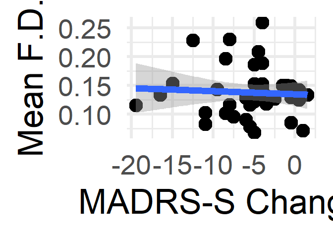<!-- -->

``` r
# need lme for group int value per subject so correlation is fine
anotherCheckModel=lm(Mean_MeanFD~Change*Group,data=FD_trxResp)
print(summary(anotherCheckModel))
```

    ## 
    ## Call:
    ## lm(formula = Mean_MeanFD ~ Change * Group, data = FD_trxResp)
    ## 
    ## Residuals:
    ##      Min       1Q   Median       3Q      Max 
    ## -0.07305 -0.02598 -0.00324  0.01583  0.12257 
    ## 
    ## Coefficients:
    ##                Estimate Std. Error t value Pr(>|t|)    
    ## (Intercept)    0.121592   0.013782   8.822 1.24e-10 ***
    ## Change        -0.003844   0.002805  -1.371    0.179    
    ## GroupX         0.026929   0.021514   1.252    0.219    
    ## Change:GroupX  0.004965   0.003361   1.478    0.148    
    ## ---
    ## Signif. codes:  0 '***' 0.001 '**' 0.01 '*' 0.05 '.' 0.1 ' ' 1
    ## 
    ## Residual standard error: 0.04338 on 37 degrees of freedom
    ## Multiple R-squared:  0.0606, Adjusted R-squared:  -0.01557 
    ## F-statistic: 0.7956 on 3 and 37 DF,  p-value: 0.5042

``` r
# last plot before returning to more interesting analyses
# saved at 1500 x 1000 
ggplot(FD_trxResp,aes(y=Mean_MeanFD,x=Change,group=Group,color=Group))+geom_point()+geom_smooth(method='lm')+theme_minimal(base_size = 52)+xlab('MADRS-S Change')+ylab('Mean F.D.')+scale_color_manual(labels=c('Sham','Active'),values=c('#ffca3a','#8ac926'))+labs(color='Group')
```

    ## `geom_smooth()` using formula = 'y ~ x'

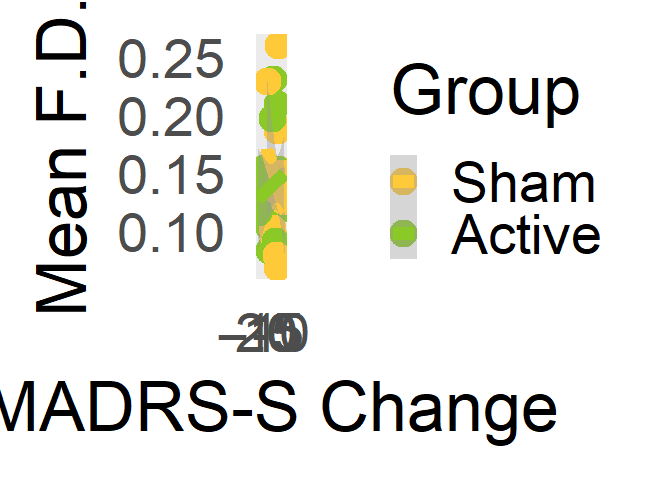<!-- -->

``` r
# according to protocol, evaluate normality of change in FC and MADRS (shapiro-wilk)
shapiro.test(MADRS_change$MADRS_change)
```

    ## 
    ##  Shapiro-Wilk normality test
    ## 
    ## data:  MADRS_change$MADRS_change
    ## W = 0.90664, p-value = 0.0069

``` r
shapiro.test(FC_change$FC_change)
```

    ## 
    ##  Shapiro-Wilk normality test
    ## 
    ## data:  FC_change$FC_change
    ## W = 0.98326, p-value = 0.8685

``` r
# madrs s meets criteria for non-normality, use spearmans
change_scores <- merge(MADRS_change, FC_change, by = "Subject")
# and subset by X and Y
Xchange=change_scores[change_scores$Group.x=='X',]
Ychange=change_scores[change_scores$Group.x=='Y',]

#Long term
XchangeLT=LT_madrs_FCchange[LT_madrs_FCchange$Group=='X',]
YchangeLT=LT_madrs_FCchange[LT_madrs_FCchange$Group=='Y',]

# corrs
XchangeCor=cor.test(Xchange$MADRS_change,Xchange$FC_change,method='spearman')$estimate
```

    ## Warning in cor.test.default(Xchange$MADRS_change, Xchange$FC_change, method =
    ## "spearman"): Cannot compute exact p-value with ties

``` r
YchangeCor=cor.test(Ychange$MADRS_change,Ychange$FC_change,method='spearman')$estimate
```

    ## Warning in cor.test.default(Ychange$MADRS_change, Ychange$FC_change, method =
    ## "spearman"): Cannot compute exact p-value with ties

``` r
# test MADRS change scores
library(diffcor)
diffcor.two(XchangeCor,YchangeCor,16,15,alternative = 'two.sided')
```

    ##      r1     r2    LL1   UL1    LL2   UL2     z     p Cohen_q
    ## 1 0.475 -0.169 -0.027 0.786 -0.627 0.376 1.715 0.086   0.686

``` r
# plot it - saved at 1500x1200
change_scores$Treatment=factor(x='Active',levels=c('Active','Sham'))
change_scores$Treatment[change_scores$Group.x=='Y']='Sham'
# - for reverse-scoring (harmonization with IMS change)
ggplot(data=change_scores,aes(x=FC_change,y=-MADRS_change,color=Treatment))+geom_point()+geom_smooth(method='lm')+ylab('MADRS-SR Improvement \n \n') + xlab('Change in DMN-sgACC FC')+theme_minimal(base_size=46)+scale_color_manual(values=c('#8ac926','#ffca3a'))
```

    ## `geom_smooth()` using formula = 'y ~ x'

<!-- -->

``` r
# load in IMS 12
# add IMS
IMS=read.csv('E:\\Downloads/Brains_IMS.csv')
# add new sesh column, others become NA
IMS$sesh <- tp_map1[IMS$redcap_event_name]
# make subject names equiv
IMS$Subject <- sub(".*_(s[0-9]+[a-z]?)", "\\1", IMS$record_id)
# remove trailing a's
IMS$Subject <- sub("a$", "", IMS$Subject)

#merge
IMS$Key_Sess <- paste(IMS$Subject, IMS$sesh, sep = "_")
FCMergedIMS=merge(FCMergedDemo,IMS,by=c("Key_Sess","Subject"))
# omit NAs
FCMergedIMS=FCMergedIMS[!is.na(FCMergedIMS$ims12_totalscore),]
FCMergedIMS_Change <- FCMergedIMS[FCMergedIMS$sesh.x %in% c(3, 8), ]

# report baseline IMS
BV_ims=IMS[IMS$redcap_event_name=='baseline_visit_2_arm_2',]
BV_ims_active=BV_ims[BV_ims$Subject %in% aSubjs_included,]
BV_ims_sham=BV_ims[BV_ims$Subject %in% sSubjs_included,]

# print mean, sd
print(paste0('Mean IMS, Active: ',mean(na.omit(BV_ims_active$ims12_totalscore))))
```

    ## [1] "Mean IMS, Active: 34.4"

``` r
print(paste0('IMS s.d., Active: ',sd(na.omit(BV_ims_active$ims12_totalscore))))
```

    ## [1] "IMS s.d., Active: 9.24178155529492"

``` r
print(paste0('Mean IMS, Sham: ',mean(na.omit(BV_ims_sham$ims12_totalscore))))
```

    ## [1] "Mean IMS, Sham: 39.45"

``` r
print(paste0('IMS s.d., Sham: ',sd(na.omit(BV_ims_sham$ims12_totalscore))))
```

    ## [1] "IMS s.d., Sham: 11.1849287695071"

``` r
# ANOVA for group dif
ims_a <- BV_ims_active$ims12_totalscore
ims_s <- BV_ims_sham$ims12_totalscore
IMS_df <- data.frame(
  IMS = c(ims_a, ims_s),
  Group = factor(rep(c("X", "Y"), times = c(length(ims_a), length(ims_s))))
)
fit <- aov(IMS ~ Group, data = IMS_df)
summary(fit)
```

    ##             Df Sum Sq Mean Sq F value Pr(>F)
    ## Group        1    255   255.0   2.423  0.128
    ## Residuals   38   4000   105.3               
    ## 1 observation deleted due to missingness

``` r
# FC Change
FC_change <- FCMergedIMS_Change %>%
  group_by(Subject, Group, sesh.x) %>%
  summarise(DM_sgAv_mean = mean(DM_sgAv, na.rm = TRUE), .groups = "drop") %>%
  pivot_wider(names_from = sesh.x, 
              values_from = DM_sgAv_mean,
              names_prefix = "V") %>%
  mutate(FC_change = V8 - V3) %>%
  filter(!is.na(FC_change))


# calculate change in IMS
IMS_Change <- FCMergedIMS_Change %>%
  group_by(Subject, sesh.x, Group) %>%
  summarise(IMS_mean = mean(ims12_totalscore, na.rm = TRUE), .groups = "drop") %>%
  pivot_wider(names_from = sesh.x, 
              values_from = IMS_mean,
              names_prefix = "V") %>%
  mutate(IMS_Change = V8 - V3) %>%
  filter(!is.na(IMS_Change))# Remove subjects without both timepoints

# according to protocol, evaluate normality of change  in IMS (shapiro-wilk)
shapiro.test(IMS_Change$IMS_Change)
```

    ## 
    ##  Shapiro-Wilk normality test
    ## 
    ## data:  IMS_Change$IMS_Change
    ## W = 0.90078, p-value = 0.00481

``` r
shapiro.test(FC_change$FC_change)
```

    ## 
    ##  Shapiro-Wilk normality test
    ## 
    ## data:  FC_change$FC_change
    ## W = 0.98326, p-value = 0.8685

``` r
# IMS meets criteria for non-normality. Proceed with spearmans
change_scores <- merge(IMS_Change, FC_change, by = "Subject")
# and subset by X and Y
Xchange=change_scores[change_scores$Group.x=='X',]
Ychange=change_scores[change_scores$Group.x=='Y',]

XchangeCor=cor.test(Xchange$IMS_Change,Xchange$FC_change,method='spearman')$estimate
```

    ## Warning in cor.test.default(Xchange$IMS_Change, Xchange$FC_change, method =
    ## "spearman"): Cannot compute exact p-value with ties

``` r
YchangeCor=cor.test(Ychange$IMS_Change,Ychange$FC_change,method='spearman')$estimate
```

    ## Warning in cor.test.default(Ychange$IMS_Change, Ychange$FC_change, method =
    ## "spearman"): Cannot compute exact p-value with ties

``` r
# test IMS change scores
diffcor.two(XchangeCor,YchangeCor,17,17,alternative = 'two.sided')
```

    ##       r1    r2    LL1    UL1    LL2   UL2      z    p Cohen_q
    ## 1 -0.484 0.208 -0.783 -0.005 -0.303 0.626 -1.956 0.05  -0.739

``` r
# plot it - saved at 1500x1200
change_scores$Treatment=factor(x='Active',levels=c('Active','Sham'))
change_scores$Treatment[change_scores$Group.x=='Y']='Sham'
ggplot(data=change_scores,aes(x=FC_change,y=IMS_Change,color=Treatment))+geom_point()+geom_smooth(method='lm')+ylab('IMS Improvement \n \n') + xlab('Change in DMN-sgACC FC')+theme_minimal(base_size=46)+scale_color_manual(values=c('#8ac926','#ffca3a'))
```

    ## `geom_smooth()` using formula = 'y ~ x'

<!-- -->

``` r
#### follow-up with more straightforward symptom - sgacc assoc: use timepoints intead of collapsed treatment change brain change

# IMS daily
FC_IMS_daily <- FCMergedIMS %>%
  group_by(Subject, DaysSinceInit) %>%
  summarise(
    DM_sgAv_z = if (all(is.na(DM_sgAv_z))) {
      NA_real_
      # if there's data
    } else {
      mean(DM_sgAv_z, na.rm = TRUE)
    },
    ims12_totalscore = if (all(is.na(ims12_totalscore))) {
      NA_real_
      # if there's data
    } else {
      first(na.omit(ims12_totalscore))
    },
    n_scans = sum(!is.na(DM_sgAv_z)),
    # group is fixed so first is sufficient to summarize
    Group = first(Group),
    .groups = "drop"
)

# model daily IMS-sgacc FC association by group
model_daily <- lme(
    fixed = ims12_totalscore ~ DM_sgAv_z*Group,
    random = ~ 1 | Subject,
    data = FC_IMS_daily)
print(summary(model_daily))
```

    ## Linear mixed-effects model fit by REML
    ##   Data: FC_IMS_daily 
    ##       AIC      BIC    logLik
    ##   1665.21 1685.434 -826.6048
    ## 
    ## Random effects:
    ##  Formula: ~1 | Subject
    ##         (Intercept) Residual
    ## StdDev:    9.425957 9.550613
    ## 
    ## Fixed effects:  ims12_totalscore ~ DM_sgAv_z * Group 
    ##                       Value Std.Error  DF   t-value p-value
    ## (Intercept)        41.47803   2.53049 177 16.391282  0.0000
    ## DM_sgAv_z          41.86830  38.66941 177  1.082724  0.2804
    ## GroupX              6.13362   3.61296  38  1.697672  0.0977
    ## DM_sgAv_z:GroupX -170.16698  56.74161 177 -2.998980  0.0031
    ##  Correlation: 
    ##                  (Intr) DM_sA_ GroupX
    ## DM_sgAv_z        -0.415              
    ## GroupX           -0.700  0.290       
    ## DM_sgAv_z:GroupX  0.282 -0.681 -0.425
    ## 
    ## Standardized Within-Group Residuals:
    ##         Min          Q1         Med          Q3         Max 
    ## -4.39116355 -0.47660144 -0.08102924  0.48700097  2.74419923 
    ## 
    ## Number of Observations: 219
    ## Number of Groups: 40

``` r
# Create daily-averaged dataset for MADRS-S
FC_MADRS_daily <- FCMergedMADRS %>%
  group_by(Subject, DaysSinceInit) %>%
  summarise(
    # Average Fisher-Z FC across scans
    DM_sgAv_z = if (all(is.na(DM_sgAv_z))) {
      NA_real_
    } else {
      mean(DM_sgAv_z, na.rm = TRUE)
    },
    # One MADRS score per day
    madrs_s_total = if (all(is.na(madrs_s_total))) {
      NA_real_
    } else {
      first(na.omit(madrs_s_total))
    },
    # Preserve treatment group
    Group = first(Group),
    # Number of valid FC scans
    n_scans = sum(!is.na(DM_sgAv_z)),
    .groups = "drop"
  )

# Create daily-averaged dataset for MADRS-CR
FC_MADRSCR_daily <- FCMergedMADRSCR %>%
  group_by(Subject, DaysSinceInit) %>%
  summarise(
    # average FC across scans
    DM_sgAv_z = if (all(is.na(DM_sgAv_z))) {
      NA_real_
    } else {
      mean(DM_sgAv_z, na.rm = TRUE)
    },
    # One MADRS score per day
    madrs_total_mentorrater = if (all(is.na(madrs_total_mentorrater))) {
      NA_real_
    } else {
      first(na.omit(madrs_total_mentorrater))
    },
    # Preserve treatment group
    Group = first(Group),
    # Number of valid FC scans
    n_scans = sum(!is.na(DM_sgAv_z)),
    .groups = "drop"
  )


# tests for madrs~brain
model_MADRS_interaction <- lme(
  fixed = madrs_s_total ~ DM_sgAv_z * Group,
  random = ~ 1 | Subject,
  data = FC_MADRS_daily,
  method = "REML"
)
print(summary(model_MADRS_interaction))
```

    ## Linear mixed-effects model fit by REML
    ##   Data: FC_MADRS_daily 
    ##        AIC      BIC    logLik
    ##   1192.752 1212.975 -590.3758
    ## 
    ## Random effects:
    ##  Formula: ~1 | Subject
    ##         (Intercept) Residual
    ## StdDev:    3.646107 3.100649
    ## 
    ## Fixed effects:  madrs_s_total ~ DM_sgAv_z * Group 
    ##                     Value Std.Error  DF   t-value p-value
    ## (Intercept)      11.14489  0.935871 177 11.908569  0.0000
    ## DM_sgAv_z        -7.09308 12.725453 177 -0.557393  0.5780
    ## GroupX           -3.57394  1.333659  38 -2.679797  0.0108
    ## DM_sgAv_z:GroupX 56.16668 18.716223 177  3.000962  0.0031
    ##  Correlation: 
    ##                  (Intr) DM_sA_ GroupX
    ## DM_sgAv_z        -0.370              
    ## GroupX           -0.702  0.260       
    ## DM_sgAv_z:GroupX  0.252 -0.680 -0.380
    ## 
    ## Standardized Within-Group Residuals:
    ##         Min          Q1         Med          Q3         Max 
    ## -2.49356007 -0.54622733 -0.01844767  0.47080322  4.30540793 
    ## 
    ## Number of Observations: 219
    ## Number of Groups: 40

``` r
model_MADRS_CR_interaction <- lme(
  fixed = madrs_total_mentorrater ~ DM_sgAv_z * Group,
  random = ~ 1 | Subject,
  data = FC_MADRSCR_daily,
  method = "REML"
)
print(summary(model_MADRS_CR_interaction))
```

    ## Linear mixed-effects model fit by REML
    ##   Data: FC_MADRSCR_daily 
    ##        AIC      BIC    logLik
    ##   1353.518 1373.095 -670.7592
    ## 
    ## Random effects:
    ##  Formula: ~1 | Subject
    ##         (Intercept) Residual
    ## StdDev:    7.039407  6.52048
    ## 
    ## Fixed effects:  madrs_total_mentorrater ~ DM_sgAv_z * Group 
    ##                      Value Std.Error  DF   t-value p-value
    ## (Intercept)       20.46129   2.00493 159 10.205477  0.0000
    ## DM_sgAv_z        -25.97893  28.64992 159 -0.906771  0.3659
    ## GroupX            -8.09674   2.76768  34 -2.925464  0.0061
    ## DM_sgAv_z:GroupX 123.56737  40.73437 159  3.033492  0.0028
    ##  Correlation: 
    ##                  (Intr) DM_sA_ GroupX
    ## DM_sgAv_z        -0.397              
    ## GroupX           -0.724  0.288       
    ## DM_sgAv_z:GroupX  0.279 -0.703 -0.394
    ## 
    ## Standardized Within-Group Residuals:
    ##          Min           Q1          Med           Q3          Max 
    ## -1.900488130 -0.597880186  0.002388929  0.537842221  3.189765594 
    ## 
    ## Number of Observations: 197
    ## Number of Groups: 36

``` r
# plot it out!
library(patchwork)
```

    ## Warning: package 'patchwork' was built under R version 4.5.1

    ## 
    ## Attaching package: 'patchwork'

    ## The following object is masked from 'package:MASS':
    ## 
    ##     area

``` r
# this function is for subject-centering for plotting, works to match the subject-level intercepts instituted for models (random effects)
make_subject_adjusted <- function(data, outcome) {
  data %>%
    group_by(Group, Subject) %>%
    mutate(
      # subject means
      FC_subject_mean = mean(DM_sgAv_z, na.rm = TRUE),
      Y_subject_mean  = mean(.data[[outcome]], na.rm = TRUE),
      # subject-centered values
      FC_within = DM_sgAv_z - FC_subject_mean,
      Y_within  = .data[[outcome]] - Y_subject_mean
    ) %>%
    ungroup() %>%
    group_by(Group) %>%
    mutate(
      # back to group means for interpretable axes in fig
      FC_adjusted = FC_within + mean(DM_sgAv_z, na.rm = TRUE),
      Y_adjusted  = Y_within + mean(.data[[outcome]], na.rm = TRUE)
    ) %>%
    ungroup()
}

# now apply the functions for interpretable plots

IMS_adjusted <- make_subject_adjusted(
  FC_IMS_daily,
  "ims12_totalscore"
)

MADRS_adjusted <- make_subject_adjusted(
  FC_MADRS_daily,
  "madrs_s_total"
)

MADRS_CR_adjusted <- make_subject_adjusted(
  FC_MADRSCR_daily,
  "madrs_total_mentorrater"
)

###########
# IMS plot
###########

p_IMS <- ggplot(
  IMS_adjusted,
  aes(
    x = FC_adjusted,
    y = Y_adjusted,
    color = Group
  )
) +
  geom_point(alpha = 0.7, size = 5) +
  geom_smooth(
    method = "lm",
    se = TRUE,
    linewidth = 2
  ) +
  scale_color_manual(
    values = c(
      "X" = "#8ac926",
      "Y" = "#ffca3a"
    ),
    labels = c(
      "X" = "Active",
      "Y" = "Sham"
    )
  ) +
  labs(
    title = "IMS",
    x = "Centered DMN–sgACC FC",
    y = "Centered IMS score",
    color = NULL
  ) +
  theme_minimal(base_size = 24)+ theme(legend.position="none")

######################
# 4. MADRS-SR plot
######################

p_MADRS <- ggplot(
  MADRS_adjusted,
  aes(
    x = FC_adjusted,
    y = Y_adjusted,
    color = Group
  )
) + geom_point(alpha = 0.7, size = 5) +
  geom_smooth(method='lm',linewidth = 2) +
  scale_color_manual(
    values = c(
      "X" = "#8ac926",
      "Y" = "#ffca3a"
    ),
    labels = c(
      "X" = "Active",
      "Y" = "Sham"
    )
  ) +
  labs(title = "MADRS-SR", x = "Centered DMN–sgACC FC", y = "Centered MADRS-SR score") +
  theme_minimal(base_size = 24)+ theme(legend.position="none")

######################
# 4. MADRS-CR plot
######################

p_MADRSCR <- ggplot(
  MADRS_CR_adjusted,
  aes(
    x = FC_adjusted,
    y = Y_adjusted,
    color = Group
  )
) +
  geom_point(alpha = 0.7, size = 5) +
  geom_smooth(method = "lm",linewidth = 2) +
  scale_color_manual(
    values = c(
      "X" = "#8ac926",
      "Y" = "#ffca3a"
    ),
    labels = c(
      "X" = "Active",
      "Y" = "Sham"
    )
  ) +
  labs(
    title = "MADRS-CR",
    x = "Centered DMN–sgACC FC",
    y = "Centered MADRS-CR score",) +
  theme_minimal(base_size = 24)


# Display
######################

p_IMS
```

    ## `geom_smooth()` using formula = 'y ~ x'

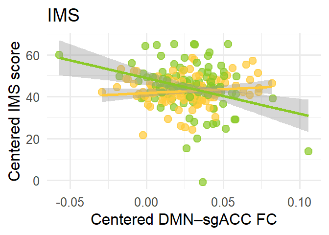<!-- -->

``` r
p_MADRS
```

    ## `geom_smooth()` using formula = 'y ~ x'

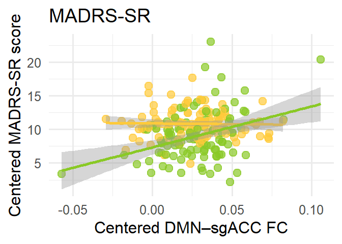<!-- -->

``` r
p_MADRSCR
```

    ## `geom_smooth()` using formula = 'y ~ x'

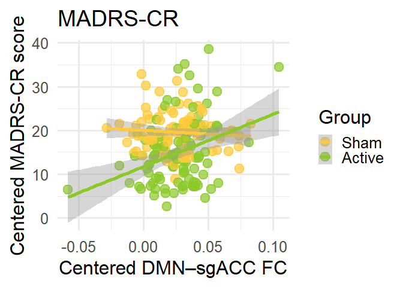<!-- -->

``` r
#  combined figure: 2200 x 1000
p_IMS | p_MADRS | p_MADRSCR
```

    ## `geom_smooth()` using formula = 'y ~ x'

    ## `geom_smooth()` using formula = 'y ~ x'
    ## `geom_smooth()` using formula = 'y ~ x'

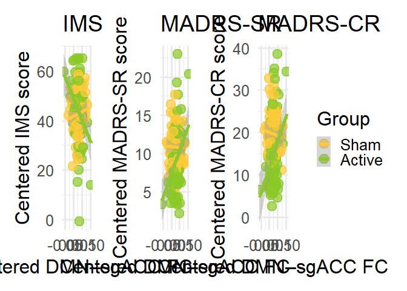<!-- -->

``` r
# avoid scale to isolate within-person effects
# ---- 1. Collapse FC to one value per subject per session ----

FC_persession <- aggregate(
    DM_sgAv ~ Subject + Key_Sess + Group,
    data = FCMergedDemo,
    FUN = mean
)


FC_persession$SessNum <- as.numeric(
    sub(".*_V", "", FC_persession$Key_Sess)
)


# ---- Function to create TRUE consecutive-day lag pairs ----
# Also creates within-person centered predictors.

make_lag_pairs <- function(d, symptom_var) {

    d <- d[, c(
        "Subject",
        "Group",
        "SessNum",
        "DM_sgAv",
        symptom_var
    )]
    names(d)[names(d) == symptom_var] <- "Symptom"
    d <- d[!is.na(d$DM_sgAv) & !is.na(d$Symptom), ]
    d <- d[order(d$Subject, d$SessNum), ]
    # Person means
    d$FC_mean <- ave(
        d$DM_sgAv,
        d$Subject,
        FUN = mean
    )
    d$Symptom_mean <- ave(
        d$Symptom,
        d$Subject,
        FUN = mean
    )
    # Create next-day values (t +1)
    d$FC_t1 <- ave(
        d$DM_sgAv,
        d$Subject,
        FUN = function(x) c(x[-1], NA)
    )
    d$Symptom_t1 <- ave(
        d$Symptom,
        d$Subject,
        FUN = function(x) c(x[-1], NA)
    )
    d$Sess_t1 <- ave(
        d$SessNum,
        d$Subject,
        FUN = function(x) c(x[-1], NA)
    )
    # Keep ONLY true consecutive sessions
    d <- d[
    !is.na(d$Sess_t1) &
    d$Sess_t1 == d$SessNum + 1,
    ]

    # Rename current-day variables
    d$FC_t <- d$DM_sgAv
    d$Symptom_t <- d$Symptom

    # Within-person predictors
    d$FC_t_within <-
        d$FC_t - d$FC_mean
    d$Symptom_t_within <-
        d$Symptom_t - d$Symptom_mean

    d
}

# ---- 2A. MADRS-SR ----

FC_SR <- merge(
    FC_persession,
    MADRSInfo[, c(
        "Subject",
        "Key_Sess",
        "madrs_s_total"
    )],
    by = c("Subject", "Key_Sess")
)

lagged_FC_SR <- make_lag_pairs(
    FC_SR,
    "madrs_s_total"
)


# ---- 2B. IMS ----

FC_IMS <- merge(
    FC_persession,
    IMS[, c(
        "Subject",
        "Key_Sess",
        "ims12_totalscore"
    )],
    by = c("Subject", "Key_Sess")
)

lagged_FC_IMS <- make_lag_pairs(
    FC_IMS,
    "ims12_totalscore"
)

# ---- 2C. MADRS-CR ----

MADRSInfo_CR <- read.csv(
    'E:/Downloads/madrs_data_for_brains/brains_madrs-cr.csv'
)

MADRSInfo_CR$sesh <-
    tp_map1[MADRSInfo_CR$redcap_event_name]

MADRSInfo_CR$Subject <-
    sub(
        ".*_(s[0-9]+[a-z]?)",
        "\\1",
        MADRSInfo_CR$record_id
    )

MADRSInfo_CR$Subject <-
    sub("a$", "", MADRSInfo_CR$Subject)

MADRSInfo_CR$Key_Sess <-
    paste(
        MADRSInfo_CR$Subject,
        MADRSInfo_CR$sesh,
        sep = "_"
    )

FC_CR <- merge(
    FC_persession,
    MADRSInfo_CR[, c(
        "Subject",
        "Key_Sess",
        "madrs_total_mentorrater"
    )],
    by = c("Subject", "Key_Sess")
)

lagged_FC_CR <- make_lag_pairs(
    FC_CR,
    "madrs_total_mentorrater"
)


# ---- 3A. MADRS-SR CROSS-LAGGED MODELS ----

lagged_FC_SR$Subject <-
    factor(lagged_FC_SR$Subject)

# FC(t) -> MADRS-SR(t+1)
mod_sr_next_from_fc <- lmer(
    Symptom_t1 ~
        Symptom_t_within +
        FC_t_within +
        (1 | Subject),
    data = lagged_FC_SR,
    REML = FALSE
)

# MADRS-SR(t) -> FC(t+1)
mod_fc_next_from_sr <- lmer(
    FC_t1 ~
        FC_t_within +
        Symptom_t_within +
        (1 | Subject),
    data = lagged_FC_SR,
    REML = FALSE
)

cat("\n=== FC(t) -> MADRS-SR(t+1) ===\n")
```

    ## 
    ## === FC(t) -> MADRS-SR(t+1) ===

``` r
print(summary(mod_sr_next_from_fc)$coefficients)
```

    ##                   Estimate Std. Error   t value
    ## (Intercept)      9.1728762 0.67114626 13.667477
    ## Symptom_t_within 0.3708048 0.05146242  7.205350
    ## FC_t_within      9.6204694 7.45365304  1.290705

``` r
cat("\n=== MADRS-SR(t) -> FC(t+1) ===\n")
```

    ## 
    ## === MADRS-SR(t) -> FC(t+1) ===

``` r
print(summary(mod_fc_next_from_sr)$coefficients)
```

    ##                       Estimate   Std. Error   t value
    ## (Intercept)       0.0262011063 0.0033102557  7.915131
    ## FC_t_within      -0.2735977467 0.0852001268 -3.211236
    ## Symptom_t_within  0.0009398096 0.0005923236  1.586649

``` r
# ---- 3B. IMS CROSS-LAGGED MODELS ----

lagged_FC_IMS$Subject <-
    factor(lagged_FC_IMS$Subject)

# FC(t) -> IMS(t+1)
mod_ims_next_from_fc <- lmer(
    Symptom_t1 ~
        Symptom_t_within +
        FC_t_within +
        (1 | Subject),
    data = lagged_FC_IMS,
    REML = FALSE
)

# IMS(t) -> FC(t+1)
mod_fc_next_from_ims <- lmer(
    FC_t1 ~
        FC_t_within +
        Symptom_t_within +
        (1 | Subject),
    data = lagged_FC_IMS,
    REML = FALSE
)

cat("\n=== FC(t) -> IMS(t+1) ===\n")
```

    ## 
    ## === FC(t) -> IMS(t+1) ===

``` r
print(summary(mod_ims_next_from_fc)$coefficients)
```

    ##                     Estimate  Std. Error   t value
    ## (Intercept)       45.2412520  1.83082894 24.710802
    ## Symptom_t_within   0.4576444  0.05569805  8.216525
    ## FC_t_within      -93.3689852 23.62597695 -3.951963

``` r
cat("\n=== IMS(t) -> FC(t+1) ===\n")
```

    ## 
    ## === IMS(t) -> FC(t+1) ===

``` r
print(summary(mod_fc_next_from_ims)$coefficients)
```

    ##                       Estimate   Std. Error    t value
    ## (Intercept)       0.0264005687 0.0033184607  7.9556672
    ## FC_t_within      -0.2496041177 0.0844641421 -2.9551489
    ## Symptom_t_within -0.0001132776 0.0001999816 -0.5664401

``` r
# ---- 3C. MADRS-CR CROSS-LAGGED MODELS ----

lagged_FC_CR$Subject <-
    factor(lagged_FC_CR$Subject)

# FC(t) -> MADRS-CR(t+1)
mod_cr_next_from_fc <- lmer(
    Symptom_t1 ~
        Symptom_t_within +
        FC_t_within +
        (1 | Subject),
    data = lagged_FC_CR,
    REML = FALSE
)

# MADRS-CR(t) -> FC(t+1)
mod_fc_next_from_cr <- lmer(
    FC_t1 ~
        FC_t_within +
        Symptom_t_within +
        (1 | Subject),
    data = lagged_FC_CR,
    REML = FALSE
)

cat("\n=== FC(t) -> MADRS-CR(t+1) ===\n")
```

    ## 
    ## === FC(t) -> MADRS-CR(t+1) ===

``` r
print(summary(mod_cr_next_from_fc)$coefficients)
```

    ##                    Estimate  Std. Error   t value
    ## (Intercept)      15.7346958  1.48219362 10.615817
    ## Symptom_t_within  0.4157767  0.05389657  7.714344
    ## FC_t_within      20.5261324 15.78845870  1.300072

``` r
cat("\n=== MADRS-CR(t) -> FC(t+1) ===\n")
```

    ## 
    ## === MADRS-CR(t) -> FC(t+1) ===

``` r
print(summary(mod_fc_next_from_cr)$coefficients)
```

    ##                       Estimate   Std. Error   t value
    ## (Intercept)       0.0263195498 0.0036101560  7.290419
    ## FC_t_within      -0.2794232655 0.0884783788 -3.158097
    ## Symptom_t_within  0.0003271582 0.0003033525  1.078475

``` r
############################################################
# TIME SERIES: FC AND IMS12 FOR EACH PARTICIPANT
############################################################

# Make sure data are sorted
FC_IMS <- FC_IMS[
    order(FC_IMS$Subject, FC_IMS$SessNum),
]

FC_IMS$ims12_totalscore=-FC_IMS$ims12_totalscore

# Get participant IDs, just active for now
PTs <- unique(FC_IMS$Subject[FC_IMS$Group=='X'])

############################################################
# GROUP-LEVEL TIME SERIES: FC AND IMS12
# Active group only
############################################################
### plot z score

# Active group only
d <- FC_IMS[FC_IMS$Group == "X", ]

# Reverse IMS direction
d$ims12_totalscore <- -d$ims12_totalscore

# Sort
d <- d[order(d$Subject, d$SessNum), ]


############################################################
# WITHIN-SUBJECT Z-SCORES
############################################################
# FC within-person z
d$FC_within_z <- ave(
    d$DM_sgAv,
    d$Subject,
    FUN = function(x) {
        (x - mean(x, na.rm = TRUE)) /
            sd(x, na.rm = TRUE)
    }
)

# IMS12 within-person z
d$IMS_within_z <- ave(
    d$ims12_totalscore,
    d$Subject,
    FUN = function(x) {
        (x - mean(x, na.rm = TRUE)) /
            sd(x, na.rm = TRUE)
    }
)


############################################################
# GROUP MEAN OF WITHIN-SUBJECT Z-SCORES
###########################################################
group_ts <- aggregate(
    cbind(FC_within_z, IMS_within_z) ~ SessNum,
    data = d,
    FUN = mean,
    na.rm = TRUE
)

group_ts <- group_ts[
    order(group_ts$SessNum),
]

# Range of the two within-subject z-scores
fc_range <- range(group_ts$FC_within_z, na.rm = TRUE)
ims_range <- range(group_ts$IMS_within_z, na.rm = TRUE)

# Transform IMS z-score onto FC plotting scale
ims_scale <- function(x) {
    (x - ims_range[1]) /
        diff(ims_range) *
        diff(fc_range) +
        fc_range[1]
}

# Inverse transformation for right-hand axis
ims_inverse <- function(x) {
    (x - fc_range[1]) /
        diff(fc_range) *
        diff(ims_range) +
        ims_range[1]
}

# Create plotting version of IMS
group_ts$IMS_plot <- ims_scale(group_ts$IMS_within_z)

############################################################
# SHARED HLINES BASED ON FULL PLOT RANGE
############################################################
plot_min <- min(
    group_ts$FC_within_z,
    na.rm = TRUE
)

plot_max <- max(
    group_ts$FC_within_z,
    na.rm = TRUE
)

hline_33  <- plot_max - 0.333 * (plot_max - plot_min)
hline_66  <- plot_max - 0.666 * (plot_max - plot_min)
hline_100 <- plot_min

############################################################
# PLOT saved at 1250 1350
############################################################

ggplot(
    group_ts,
    aes(x = SessNum-3)
) +

    # FC
    geom_line(
        aes(y = FC_within_z),
        color = "#f57e31",
        linewidth = 5
    ) +

    geom_point(
        aes(y = FC_within_z),
        color = "#233d4c",
        size = 12
    ) +

    # IMS12
    geom_line(
        aes(y = IMS_plot),
        color = "#b739b7",
        linewidth = 5
    ) +

    geom_point(
        aes(y = IMS_plot),
        color = "#b739b7",
        size = 12
    ) +

# ---- Shared reference lines ----
geom_hline(
    yintercept = hline_33,
    color = "grey40",
    linetype = "dotted",
    linewidth = 2,
) +

geom_hline(
    yintercept = hline_66,
    color = "grey40",
    linetype = "dashed",
    linewidth = 2,
) +

geom_hline(
    yintercept = hline_100,
    color = "grey30",
    linetype = "solid",
    linewidth = 2,
) +
    scale_y_continuous(
        name = "DMN-sgACC FC (z)",
        sec.axis = sec_axis(
            ~ ims_inverse(.),
            name = "Symptoms (IMS, z)"
        )
    ) +

    scale_x_continuous(
        breaks = sort(unique(group_ts$SessNum-3))
    ) +

    labs(
       # title = "Active Group: Within-Subject FC and IMS12 Over Time",
        x = "Days of treatment \n (Active Arm)"
    ) +

    theme_minimal(base_size = 52)
```

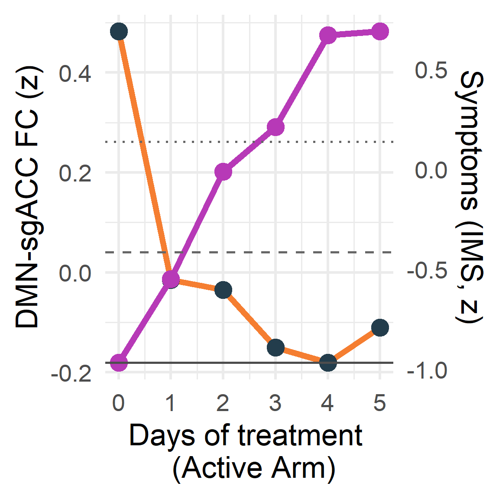<!-- -->

``` r
############################################################
# SHAM GROUP: WITHIN-SUBJECT FC + IMS12 OVER TIME
############################################################

# Sham group only
d <- FC_IMS[FC_IMS$Group == "Y", ]

# Reverse IMS direction
d$ims12_totalscore <- -d$ims12_totalscore


############################################################
# WITHIN-SUBJECT Z-SCORES
############################################################

d$FC_within_z <- ave(
    d$DM_sgAv,
    d$Subject,
    FUN = function(x) {
        (x - mean(x, na.rm = TRUE)) /
            sd(x, na.rm = TRUE)
    }
)

d$IMS_within_z <- ave(
    d$ims12_totalscore,
    d$Subject,
    FUN = function(x) {
        (x - mean(x, na.rm = TRUE)) /
            sd(x, na.rm = TRUE)
    }
)

############################################################
# GROUP MEAN OF WITHIN-SUBJECT Z-SCORES
############################################################

group_ts <- aggregate(
    cbind(FC_within_z, IMS_within_z) ~ SessNum,
    data = d,
    FUN = mean,
    na.rm = TRUE
)

group_ts <- group_ts[
    order(group_ts$SessNum),
]


############################################################
# PUT IMS ON SECONDARY AXIS
############################################################

fc_range <- range(
    group_ts$FC_within_z,
    na.rm = TRUE
)

ims_range <- range(
    group_ts$IMS_within_z,
    na.rm = TRUE
)

ims_scale <- function(x) {
    (x - ims_range[1]) /
        diff(ims_range) *
        diff(fc_range) +
        fc_range[1]
}

ims_inverse <- function(x) {
    (x - fc_range[1]) /
        diff(fc_range) *
        diff(ims_range) +
        ims_range[1]
}

group_ts$IMS_plot <- ims_scale(
    group_ts$IMS_within_z
)


############################################################
# SHARED HLINES BASED ON FULL PLOT RANGE
############################################################

plot_min <- min(
    group_ts$FC_within_z,
    na.rm = TRUE
)

plot_max <- max(
    group_ts$FC_within_z,
    na.rm = TRUE
)

hline_33  <- plot_max - 0.333 * (plot_max - plot_min)
hline_66  <- plot_max - 0.666 * (plot_max - plot_min)
hline_100 <- plot_min


############################################################
# PLOT
############################################################
ggplot(
    group_ts,
    aes(x = SessNum-3)
) +

    # FC
    geom_line(
        aes(y = FC_within_z),
        color = "#f57e31",
        linewidth = 5
    ) +

    geom_point(
        aes(y = FC_within_z),
        color = "#233d4c",
        size = 12
    ) +

    # IMS12
    geom_line(
        aes(y = IMS_plot),
        color = "#b739b7",
        linewidth = 5
    ) +

    geom_point(
        aes(y = IMS_plot),
        color = "#b739b7",
        size = 12
    ) +
    # ---- Shared reference lines ----
    geom_hline(
        yintercept = hline_33,
        color = "grey40",
        linetype = "dotted",
        linewidth = 2,
        alpha = 1
    ) +

    geom_hline(
        yintercept = hline_66,
        color = "grey40",
        linetype = "dashed",
        linewidth = 2,
        alpha = 1
    ) +

    geom_hline(
        yintercept = hline_100,
        color = "grey30",
        linetype = "solid",
        linewidth = 2,
        alpha = 1
    ) +

    scale_y_continuous(
        name = "FC — within-subject z-score",
        sec.axis = sec_axis(
            ~ ims_inverse(.),
            name = "IMS — within-subject z-score"
        )
    ) +

    scale_x_continuous(
        breaks = sort(unique(group_ts$SessNum-3))
    ) +

    labs(
        #title = "Sham Group: Within-Subject FC and IMS12 Over Time",
        x = "Days of treatment \n (Sham Arm)"
    ) +

    theme_minimal(base_size = 52)
```

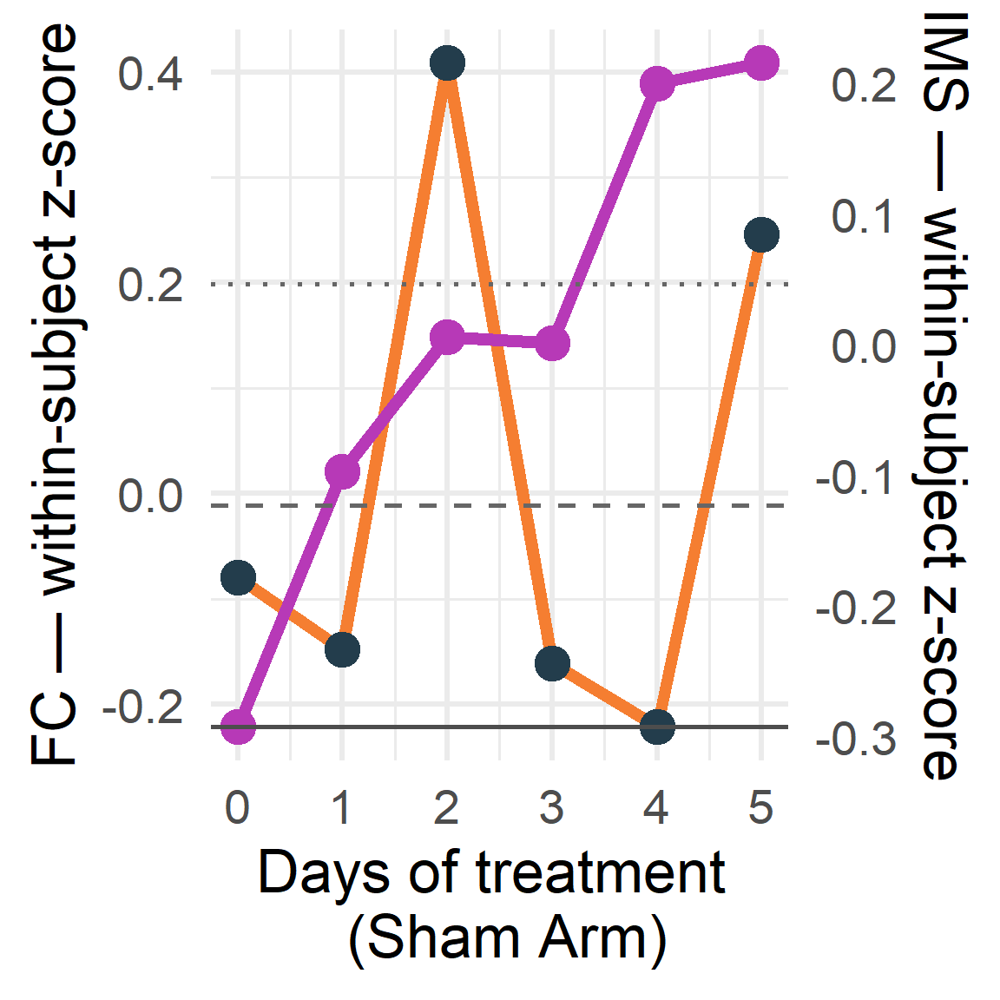<!-- -->

``` r
# plot SR with burst breathers annotated. Repeating same exact code for each symptom measure, but adding in burst breathers
BBs=read.csv('E:/Downloads/BurstBreathersvec.csv')
# MADRS CR
MADRSInfo=read.csv('E:/Downloads/madrs_data_for_brains/brains_madrs-cr.csv')
# set timepoint equivalence
tp_map1 <- c(
  "baseline_visit_2_arm_2"   = "V2",
  "study_day_1_visit_arm_2"  = "V3",
  "study_day_2_visit_arm_2"  = "V4",
  "study_day_3_visit_arm_2"  = "V5",
  "study_day_4_visit_arm_2"  = "V6",
  "study_day_5_visit_arm_2"  = "V7",
  "next_day_visit_vis_arm_2" = "V8",
  "immediate_post_vis_arm_2" = "V9",
  "1month_post_visit_arm_2"  = "V10"
)

# add new sesh column, others become NA
MADRSInfo$sesh <- tp_map1[MADRSInfo$redcap_event_name]

# make subject names equiv
MADRSInfo$Subject <- sub(".*_(s[0-9]+[a-z]?)", "\\1", MADRSInfo$record_id)
# remove trailing a's
MADRSInfo$Subject <- sub("a$", "", MADRSInfo$Subject)

# ok, now we need a session-wise key instead of subj/session/scan because we dont have a MADRS for each scan
FCMergedDemo$Key_Sess <- sub("_[0-9]+$", "", FCMergedDemo$key)

# cool, now we need an equivalent key column
MADRSInfo$Key_Sess <- paste(MADRSInfo$Subject, MADRSInfo$sesh, sep = "_")

# merge em
FCMergedMADRS=merge(FCMergedDemo,MADRSInfo,by=c("Key_Sess","Subject"))
FCMergedMADRS=FCMergedMADRS[!is.na(FCMergedMADRS$madrs_total_mentorrater),]


# calculate change in FC (V8 - V3)
FCMergedMADRS_change <- FCMergedMADRS[FCMergedMADRS$sesh.x %in% c(3, 8), ]
FC_change <- FCMergedMADRS_change %>%
  group_by(Subject, Group, sesh.x) %>%
  summarise(DM_sgAv_mean = mean(DM_sgAv, na.rm = TRUE), .groups = "drop") %>%
  pivot_wider(names_from = sesh.x, 
              values_from = DM_sgAv_mean,
              names_prefix = "V") %>%
  mutate(FC_change = V8 - V3) %>%
  filter(!is.na(FC_change))

# calculate change in MADRS

MADRS_change <- FCMergedMADRS_change %>%
  group_by(Subject, sesh.x,Group) %>%
  summarise(MADRS_mean = mean(madrs_total_mentorrater, na.rm = TRUE), .groups = "drop") %>%
  pivot_wider(names_from = sesh.x, 
              values_from = MADRS_mean,
              names_prefix = "V") %>%
  mutate(MADRS_change = V8 - V3) %>%
  filter(!is.na(MADRS_change))# Remove subjects without both timepoints

# according to protocol, evaluate normality of change in FC and MADRS (shapiro-wilk)
shapiro.test(MADRS_change$MADRS_change)
```

    ## 
    ##  Shapiro-Wilk normality test
    ## 
    ## data:  MADRS_change$MADRS_change
    ## W = 0.96704, p-value = 0.4414

``` r
shapiro.test(FC_change$FC_change)
```

    ## 
    ##  Shapiro-Wilk normality test
    ## 
    ## data:  FC_change$FC_change
    ## W = 0.98151, p-value = 0.8532

``` r
# note neither meets criteria for non-normality, proceeding with pearsons
change_scores <- merge(MADRS_change, FC_change, by = "Subject")
# and subset by X and Y
Xchange=change_scores[change_scores$Group.x=='X',]
Ychange=change_scores[change_scores$Group.x=='Y',]

XchangeCor=cor.test(Xchange$MADRS_change,Xchange$FC_change)$estimate
YchangeCor=cor.test(Ychange$MADRS_change,Ychange$FC_change)$estimate

# test MADRS change scores
library(diffcor)
diffcor.two(XchangeCor,YchangeCor,16,15)
```

    ##      r1     r2    LL1   UL1   LL2   UL2    z     p Cohen_q
    ## 1 0.379 -0.053 -0.143 0.737 -0.55 0.472 1.13 0.129   0.452

``` r
# plot it
change_scores$Treatment=factor(x='Active',levels=c('Active','Sham'))
change_scores$Treatment[change_scores$Group.x=='Y']='Sham'
ggplot(data=change_scores,aes(x=FC_change,y=MADRS_change,color=Treatment))+geom_point()+geom_smooth(method='lm')+ylab('MADRS Change \n \n') + xlab('Change in DMN-sgACC FC')+theme_minimal(base_size=46)+scale_color_manual(values=c('#8ac926','#ffca3a'))
```

    ## `geom_smooth()` using formula = 'y ~ x'

<!-- -->

``` r
# Add burst breather flag
change_scores$burst_breather <- change_scores$Subject %in% BBs$x
change_scores$Treatment <- factor(ifelse(change_scores$Group.x == 'X', 'Active', 'Sham'), 
                                  levels = c('Active', 'Sham'))

# Create combined group for coloring
change_scores$group_type <- factor(
  paste(change_scores$Treatment, ifelse(change_scores$burst_breather, 'Burst', 'Non-Burst')),
  levels = c('Active Non-Burst', 'Active Burst', 'Sham Non-Burst', 'Sham Burst')
)

# Plot
ggplot(data=change_scores, aes(x=FC_change, y=MADRS_change, color=group_type)) +
  geom_point(size=6) +
  geom_smooth(method='lm', se=TRUE, aes(group=Treatment, color=Treatment, fill=Treatment), alpha=0.15) +
  ylab('MADRS-C Change \n \n') + 
  xlab('Change in DMN-sgACC FC') +
  theme_minimal(base_size=46) +
  scale_color_manual(
    values=c(
      'Active Non-Burst' = '#8ac926',
      'Active Burst' = '#3d6b1f',
      'Sham Non-Burst' = '#ffca3a',
      'Sham Burst' = '#cc9900',
      'Active' = '#8ac926',
      'Sham' = '#ffca3a'
    ),
    breaks=c('Active Non-Burst', 'Active Burst', 'Sham Non-Burst', 'Sham Burst'),
    name = 'Treatment & Phenotype'
  ) +
  scale_fill_manual(
    values=c(
      'Active' = '#8ac926',
      'Sham' = '#ffca3a'
    ),
    guide='none'
  ) +
  theme(legend.position='right')
```

    ## `geom_smooth()` using formula = 'y ~ x'

<!-- -->

\`\`\`
