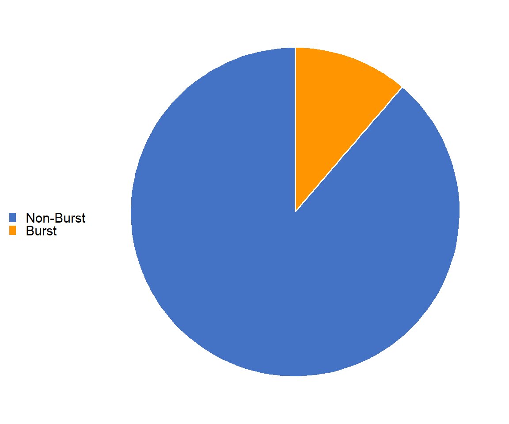
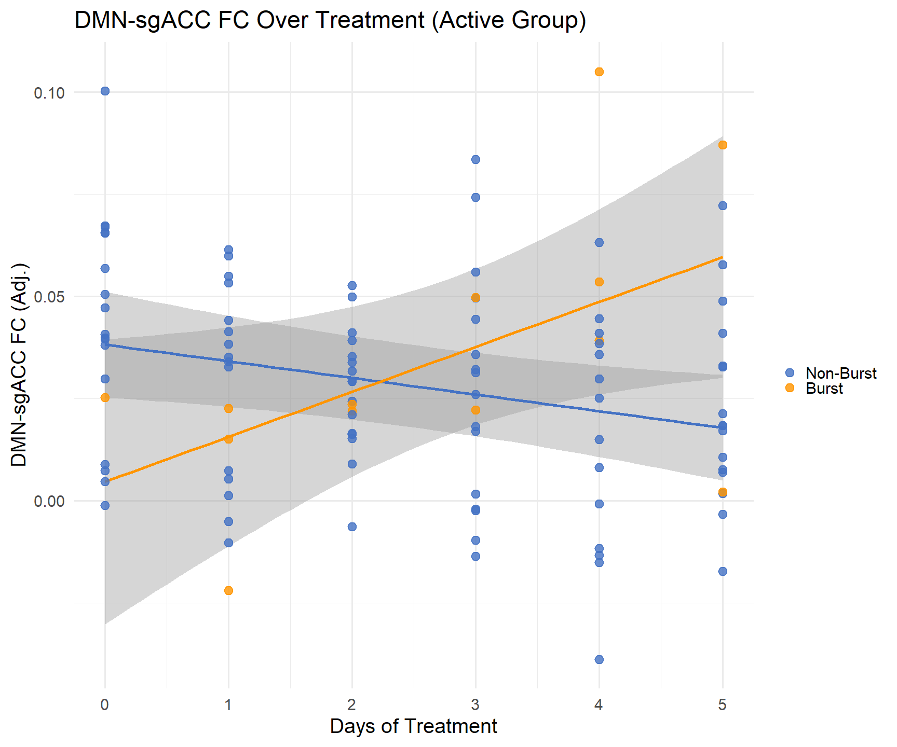

Fig3
================
2026-06-21

``` r
library(dplyr)
```

    ## 
    ## Attaching package: 'dplyr'

    ## The following objects are masked from 'package:stats':
    ## 
    ##     filter, lag

    ## The following objects are masked from 'package:base':
    ## 
    ##     intersect, setdiff, setequal, union

``` r
library(nlme)
```

    ## 
    ## Attaching package: 'nlme'

    ## The following object is masked from 'package:dplyr':
    ## 
    ##     collapse

``` r
library(tidyr)
library(ggplot2)
```

    ## Warning: package 'ggplot2' was built under R version 4.5.3

``` r
library(lme4)
```

    ## Warning: package 'lme4' was built under R version 4.5.1

    ## Loading required package: Matrix

    ## 
    ## Attaching package: 'Matrix'

    ## The following objects are masked from 'package:tidyr':
    ## 
    ##     expand, pack, unpack

    ## 
    ## Attaching package: 'lme4'

    ## The following object is masked from 'package:nlme':
    ## 
    ##     lmList

``` r
# ── Load FCs and apply exclusions ─────────────────────────────────────────────
FCs <- read.csv('E://Downloads/AllSubjects_FC(10).csv')
FCs <- FCs[!FCs$Var1 %in% c('s00x','s005','s008','s013','s014','s020','s021','s023','s053'), ]
# failed QC
FCs <- FCs[!(FCs$Var1 == "s016" & FCs$Var2 == 4), ]
# Fieldmap problems
FCs <- FCs[!(FCs$Var1 == "s005" & FCs$Var2 == 2), ]
# Targeting scans accidentally administered in non-targeting sessions
FCs <- FCs[!(FCs$Var1 == "s030" & FCs$Var2 == 9 & FCs$Var3 %in% c(1, 2)), ]
FCs <- FCs[!(FCs$Var1 == "s031" & FCs$Var2 == 9 & FCs$Var3 == 1), ]

FCs$key <- paste(FCs$Var1, paste0('V', FCs$Var2), FCs$Var3, sep="_")

# ── Load and key head motion ───────────────────────────────────────────────────
BRAINS_headmotion <- read.csv('E://Downloads/fd_summary_per_scan.csv', stringsAsFactors=FALSE)
BRAINS_headmotion$Subject <- sub("^sub-", "", BRAINS_headmotion$Subject)
BRAINS_headmotion$Subject <- sub("_.*$",  "", BRAINS_headmotion$Subject)
BRAINS_headmotion$Session <- sub("^ses-V", "", BRAINS_headmotion$Session)
BRAINS_headmotion$ScanNum <- as.numeric(sub(".*Resting([0-9]+).*", "\\1", BRAINS_headmotion$Scan))
```

    ## Warning: NAs introduced by coercion

``` r
BRAINS_headmotion$key     <- paste0(BRAINS_headmotion$Subject, "_V", BRAINS_headmotion$Session, "_", BRAINS_headmotion$ScanNum)
BRAINS_headmotion         <- BRAINS_headmotion[!duplicated(BRAINS_headmotion$key), ]

# ── Load demographics ─────────────────────────────────────────────────────────
demo <- read.csv('E:\\Downloads/Demo_All_TP_Long.csv')
demo$Subject <- sub(".*_(s[0-9]+[a-z]?)", "\\1", demo$record_id)
demo$Subject <- sub("a$", "", demo$Subject)
demo$Subject <- gsub("\u00A0", " ", demo$Subject, fixed=TRUE)
demo$Subject <- trimws(demo$Subject)

# ── Merge FC + headmotion, FD QC, then demo ───────────────────────────────────
merged <- merge(FCs, BRAINS_headmotion, by='key')
merged <- merged[merged$Mean_FD <= 0.2, ]
merged$Subject <- merged$Var1
merged$Group   <- NULL
merged$Gender  <- NULL
merged <- merge(merged, demo, by='Subject')

# ── Session exclusions (match hypothesis 1) ────────────────────────────────────
merged$Group        <- as.factor(merged$Group)
merged$Group        <- relevel(merged$Group, ref='Y')
merged$DaysSinceInit <- as.numeric(merged$Session) - 3
merged              <- merged[merged$DaysSinceInit >= 0, ]
merged              <- merged[as.numeric(merged$Session) < 9, ]

# rename FC columns
colnames(merged)[3:6] <- c('subj','sesh','scan','DM_sgAv')

# set sham group as reference for interpretability 
merged$Group<-as.factor(merged$Group)
merged$Group=relevel(merged$Group,ref='Y')

cat('Rows:', nrow(merged), '\n')
```

    ## Rows: 425

``` r
cat('Subjects:', length(unique(merged$Subject)), '\n')
```

    ## Subjects: 40

``` r
# ── Load and parse respiration ─────────────────────────────────────────────
resp_qc <- read.csv('E:/Downloads/BrainsRespQC.csv', stringsAsFactors=FALSE)

resp_long <- resp_qc %>%
    pivot_longer(cols=c(BurstsMinor, BurstsMajor, DBMajor, DBMinor),
                 names_to='artifact_type', values_to='sessions') %>%
    filter(sessions != '') %>%
    mutate(sessions = strsplit(sessions, ',')) %>%
    unnest(sessions) %>%
    mutate(Session = trimws(sub('V', '', sessions)))

burst_sessions <- resp_long %>%
    filter(artifact_type %in% c('BurstsMinor','BurstsMajor')) %>%
    dplyr::select(Subject, Session) %>% distinct()

db_sessions <- resp_long %>%
    filter(artifact_type %in% c('DBMinor','DBMajor')) %>%
    dplyr::select(Subject, Session) %>% distinct()

# JUST scan num 2 where we have resp. traces
merged2=merged[merged$ScanNum==2,]

# respiration QC only measured on ScanNum=2 — only flag/exclude those rows
merged2$resp_burst <- paste(merged2$Subject, merged2$Session) %in% paste(burst_sessions$Subject, burst_sessions$Session)

merged_burst <- merged2[merged2$resp_burst, ]
merged_no_burst <- merged2[!merged2$resp_burst, ]

cat('Rows full:',       nrow(merged),          '\n')
```

    ## Rows full: 425

``` r
cat('Rows no burst:',   nrow(merged_no_burst), '\n')
```

    ## Rows no burst: 189

``` r
cat('Rows burst:',      nrow(merged_burst),    '\n')
```

    ## Rows burst: 24

``` r
cat('Burst flags set:', sum(merged2$resp_burst), '\n')
```

    ## Burst flags set: 24

``` r
cat('DB flags set:',    sum(merged2$resp_db),    '\n')
```

    ## DB flags set: 0

``` r
# save out
analysis_qc <- merged2 %>%
    dplyr::select(Subject, Session, ScanNum)

write.csv(
    analysis_qc,
    "E:/Downloads/analysis_qc.csv",
    row.names = FALSE
)
```

``` r
# plot bursts per subject as histogram
# dplyr magic
bursts_per_subject <- merged2 %>%
  distinct(Subject) %>%
  left_join(
    burst_sessions %>%
      semi_join(merged2, by = c("Subject", "Session")) %>%
      count(Subject, name = "n_bursts"),
    by = "Subject"
  ) %>%
  # coalesce is a fancy one
  mutate(n_bursts = coalesce(n_bursts, 0L))


# 1200 x 600
ggplot(bursts_per_subject, aes(x = n_bursts)) +
    geom_histogram(binwidth = 1, boundary = -0.5, fill = 'gray', color = 'black') +
    scale_x_continuous(breaks = 0:max(bursts_per_subject$n_bursts)) +
    labs(title = 'Burst sessions per subject',
         x = 'Number of sessions with bursts',
         y = 'Number of subjects') +
    theme_minimal(base_size=38)
```

<!-- -->

``` r
# pie chart: % of scans labeled burst vs non-burst, relative to OG active sample
# commented out active-only: potentially more representative to show full instances
merged_burst_act=merged_burst#[merged_burst$Group=='X',]
merged_no_burst_act=merged_no_burst#[merged_no_burst$Group=='X',]
merged_active_all=rbind(merged_burst_act,merged_no_burst_act)
n_burst    <- nrow(merged_burst_act)
n_nonburst <- nrow(merged_no_burst_act)
n_total    <- nrow(merged_active_all)
# check these actually add up -- if merged_burst/merged_no_burst don't
# partition merged_active_all cleanly (e.g. some rows dropped, duplicated,
# or excluded by an NA in a covariate before the lme fit), this warns you
if ((n_burst + n_nonburst) != n_total) {
cat('WARNING: burst + non-burst rows (', n_burst + n_nonburst,
') do not match total active rows (', n_total, ') -- check for dropped rows\n\n')
}
pct_burst    <- (n_burst / n_total) * 100
pct_nonburst <- (n_nonburst / n_total) * 100
cat('n_burst:', n_burst, ' n_nonburst:', n_nonburst, ' n_total:', n_total, '\n')
```

    ## n_burst: 24  n_nonburst: 189  n_total: 213

``` r
cat('pct_burst:', pct_burst, '  pct_nonburst:', pct_nonburst, '\n\n')
```

    ## pct_burst: 11.26761   pct_nonburst: 88.73239

``` r
pie2_data <- data.frame(
label = c('Burst', 'Non-Burst'),
pct   = c(pct_burst, pct_nonburst)
)
# ============================================================
# Force legend order: Non-Burst first, then Burst.
# ggplot's legend order follows factor level order of the fill
# variable, not the order values appear in scale_fill_manual --
# alphabetical default puts 'Burst' before 'Non-Burst', which is
# why this needs an explicit factor() call, not just a reordering
# in scale_fill_manual.
# ============================================================
pie2_data$label <- factor(pie2_data$label, levels = c('Non-Burst', 'Burst'))

# ============================================================
# margin(l = -X) inside element_text shifts the title's own text
# box to the left by X points, independent of hjust. Negative
# values are allowed here even though it looks unusual. Try this
# instead of, or combined with, hjust -- hardcoded value below is
# a starting guess, check the render and adjust.
# ============================================================
# saved at 575x 575
ggplot(pie2_data, aes(x = '', y = pct, fill = label)) +
    geom_bar(stat = 'identity', width = 1, color = 'white') +
    coord_polar(theta = 'y') +
    theme_void(base_size = 24) +
    theme(plot.margin = unit(c(10, 10, 10, 10), 'pt'),
          legend.position = 'right') +
    ggtitle('% Burst vs. Non-Burst Scans') +
    scale_fill_manual(name = '', values = c('Burst' = '#FF9500', 'Non-Burst' = '#4472C4')) +
    geom_text(aes(label = paste0(round(pct, 1), '%')),
              position = position_stack(vjust = 0.5), size = 7, color = 'white')
```

<!-- -->

``` r
# need version without % labels for illustrator
ggplot(pie2_data, aes(x = '', y = pct, fill = label)) +
    geom_bar(stat = 'identity', width = 1, color = 'white') +
    coord_polar(theta = 'y') +
    theme_void(base_size = 28) +
    theme(plot.margin = unit(c(10, 10, 10, 10), 'pt'),
          legend.position = 'left') +
    #ggtitle('% Burst vs. Non-Burst Scans') +
    # easier to just manipulate title properties in illustrator
    scale_fill_manual(name = '', values = c('Burst' = '#FF9500', 'Non-Burst' = '#4472C4'))
```

<!-- -->

``` r
#### sex difference


# Create contingency table: rows=gender, cols=burst status
# First, check what your gender column is called (might be 'Gender' or similar)
# Adjust the column name below if needed

gender_burst_table <- table(merged2$Gender, merged2$resp_burst)
#        FALSE  TRUE
# F       X      X
# M       X      X

# Calculate proportions: what % of each gender has burst breathing
total_by_gender <- rowSums(gender_burst_table)
prop_burst_by_gender <- gender_burst_table[, 2] / total_by_gender


cat("Female:", round(prop_burst_by_gender['Female'], 3), 
    "(", gender_burst_table['Female', 2], "/", total_by_gender['Female'], ")\n")
```

    ## Female: 0.06 ( 6 / 100 )

``` r
cat("Male:  ", round(prop_burst_by_gender['Male'], 3), 
    "(", gender_burst_table['Male', 2], "/", total_by_gender['Male'], ")\n")
```

    ## Male:   0.159 ( 18 / 113 )

``` r
cat("\n")
```

``` r
# Chi-square test of independence
chisq_result <- chisq.test(gender_burst_table)
cat("Chi-square test:\n")
```

    ## Chi-square test:

``` r
print(chisq_result)
```

    ## 
    ##  Pearson's Chi-squared test with Yates' continuity correction
    ## 
    ## data:  gender_burst_table
    ## X-squared = 4.2854, df = 1, p-value = 0.03844

``` r
cat("p-value:", round(chisq_result$p.value, 4), "\n")
```

    ## p-value: 0.0384

``` r
library(ggplot2)

# Prepare data for ggplot
plot_data <- data.frame(
  Gender = c('Female', 'Male'),
  Proportion = prop_burst_by_gender * 100,
  Count = gender_burst_table[, 2],
  Total = rowSums(gender_burst_table)
)

# Create ggplot : 900 x 900
ggplot(plot_data, aes(x = Gender, y = Proportion, fill = Gender)) +
  geom_col(width = 0.6,color = 'black') +
  geom_text(aes(label = paste0('n=', Count)), 
            vjust = -0.5, size = 8) +
  scale_fill_manual(values = c('Female' = 'grey', 'Male' = 'grey')) +
  scale_y_continuous(limits = c(0, 45), expand = expansion(mult = c(0, 0.1))) +
  labs(
    title = 'Burst Breathing by Sex',
    y = '% of scans with burst breathing',
    x = NULL
  ) +
  theme_minimal(base_size=32) +
  theme(
    legend.position = 'none')
```

<!-- -->

``` r
# same fisher z score approach in main model
merged$DM_sgAv_z=atanh(merged$DM_sgAv)
merged_no_burst$DM_sgAv_z=atanh(merged_no_burst$DM_sgAv)
merged_burst$DM_sgAv_z=atanh(merged_burst$DM_sgAv)

# ── Model formula ──────────────────────────────────────────────────────────────
formula_fc <- DM_sgAv_z ~ DaysSinceInit * Group

# need DaysSinceInit in merged (session number - 3, same as original)
merged$DaysSinceInit          <- as.numeric(merged$Session) - 3
merged_no_burst$DaysSinceInit <- as.numeric(merged_no_burst$Session) - 3

# ── Fit all three versions ─────────────────────────────────────────────────────
fit_full     <- lme(formula_fc, random = ~1|Subject, data = merged)
fit_no_burst <- lme(formula_fc, random = ~1|Subject, data = merged_no_burst)
fit_burst    <- lme(formula_fc, random = ~1|Subject, data = merged_burst)

# ── Extract key treatment term across versions ─────────────────────────────────
extract_key <- function(fit, label) {
    tt  <- summary(fit)$tTable
    row <- tt['DaysSinceInit:GroupX', ]
    data.frame(model    = label,
               estimate = round(row['Value'],     4),
               se       = round(row['Std.Error'], 4),
               tstat    = round(row['t-value'],   4),
               pval     = round(row['p-value'],   4))
}


# get effect fit on full model as "before"
contrast_before <- rep(0, length(fixef(fit_full)))
names(contrast_before) <- names(fixef(fit_full))
contrast_before['DaysSinceInit']        <- 1
contrast_before['DaysSinceInit:GroupX'] <- 1

beta_before <- sum(contrast_before * fixef(fit_full))
se_before   <- sqrt(as.numeric(t(contrast_before) %*% vcov(fit_full) %*% contrast_before))


comparison <- rbind(
    extract_key(fit_full,     'DM_sgAv — full'),
    extract_key(fit_no_burst, 'DM_sgAv — no burst'),
    extract_key(fit_burst,    'DM_sgAv — burst')
)
print(comparison)
```

    ##                     model estimate     se   tstat   pval
    ## Value      DM_sgAv — full  -0.0041 0.0017 -2.4176 0.0161
    ## Value1 DM_sgAv — no burst  -0.0050 0.0024 -2.0986 0.0376
    ## Value2    DM_sgAv — burst   0.0103 0.0037  2.7818 0.0272

``` r
# same fisher z score approach in main model
merged2$DM_sgAv_z=atanh(merged2$DM_sgAv)

# unadjusted to match primary model
Dif_TRx <- lme(DM_sgAv_z ~  DaysSinceInit*Group*resp_burst,random = ~1 | Subject, data = merged2)

print(summary(Dif_TRx)$tTable)
```

    ##                                            Value   Std.Error  DF    t-value
    ## (Intercept)                          0.021999679 0.006334117 167  3.4732037
    ## DaysSinceInit                        0.001183068 0.001748426 167  0.6766473
    ## GroupX                               0.016174328 0.009138119  38  1.7699844
    ## resp_burstTRUE                       0.023117345 0.024719866 167  0.9351727
    ## DaysSinceInit:GroupX                -0.005254157 0.002405318 167 -2.1843916
    ## DaysSinceInit:resp_burstTRUE        -0.004466529 0.005909885 167 -0.7557726
    ## GroupX:resp_burstTRUE               -0.056676269 0.030768920 167 -1.8419974
    ## DaysSinceInit:GroupX:resp_burstTRUE  0.019541678 0.008128893 167  2.4039778
    ##                                          p-value
    ## (Intercept)                         0.0006550137
    ## DaysSinceInit                       0.4995659020
    ## GroupX                              0.0847534712
    ## resp_burstTRUE                      0.3510495655
    ## DaysSinceInit:GroupX                0.0303273655
    ## DaysSinceInit:resp_burstTRUE        0.4508502519
    ## GroupX:resp_burstTRUE               0.0672490455
    ## DaysSinceInit:GroupX:resp_burstTRUE 0.0173123709

``` r
# adjusted to match prev. figure 1 models
# (need to make asian "unchecked" the reference level for equivalence)
merged2$Asian=factor(merged2$Asian,levels=c('Unchecked','Checked'))

Dif_TRx <- lme(DM_sgAv_z ~ Gender + Mean_FD + DaysSinceInit*Group*resp_burst + Asian +
                 Biological.sex...i.e..sex.assigned.at.birth.,
               random = ~1 | Subject, data = merged2)

print(summary(Dif_TRx)$tTable)
```

    ##                                                          Value   Std.Error  DF
    ## (Intercept)                                       0.0348814320 0.013558388 166
    ## GenderMale                                       -0.0467415436 0.021227973  35
    ## Mean_FD                                          -0.0224523518 0.081515830 166
    ## DaysSinceInit                                     0.0012236707 0.001745846 166
    ## GroupX                                            0.0162500786 0.009109503  35
    ## resp_burstTRUE                                    0.0241648991 0.024632747 166
    ## AsianChecked                                      0.0008204091 0.009170093  35
    ## Biological.sex...i.e..sex.assigned.at.birth.Male  0.0282935022 0.021507731  35
    ## DaysSinceInit:GroupX                             -0.0054569361 0.002403441 166
    ## DaysSinceInit:resp_burstTRUE                     -0.0046125058 0.005906138 166
    ## GroupX:resp_burstTRUE                            -0.0532587384 0.030613058 166
    ## DaysSinceInit:GroupX:resp_burstTRUE               0.0188197246 0.008098361 166
    ##                                                      t-value    p-value
    ## (Intercept)                                       2.57268283 0.01096675
    ## GenderMale                                       -2.20188440 0.03435580
    ## Mean_FD                                          -0.27543548 0.78332424
    ## DaysSinceInit                                     0.70090396 0.48434427
    ## GroupX                                            1.78386002 0.08311928
    ## resp_burstTRUE                                    0.98100708 0.32801684
    ## AsianChecked                                      0.08946574 0.92922179
    ## Biological.sex...i.e..sex.assigned.at.birth.Male  1.31550383 0.19689345
    ## DaysSinceInit:GroupX                             -2.27046804 0.02446485
    ## DaysSinceInit:resp_burstTRUE                     -0.78096820 0.43593350
    ## GroupX:resp_burstTRUE                            -1.73973923 0.08375827
    ## DaysSinceInit:GroupX:resp_burstTRUE               2.32389298 0.02134317

``` r
# unadjusted to match primary model
Dif_TRx <- lme(DM_sgAv_z ~  DaysSinceInit*Group*resp_burst,random = ~1 | Subject, data = merged2)

print(summary(Dif_TRx)$tTable)
```

    ##                                            Value   Std.Error  DF    t-value
    ## (Intercept)                          0.021999679 0.006334117 167  3.4732037
    ## DaysSinceInit                        0.001183068 0.001748426 167  0.6766473
    ## GroupX                               0.016174328 0.009138119  38  1.7699844
    ## resp_burstTRUE                       0.023117345 0.024719866 167  0.9351727
    ## DaysSinceInit:GroupX                -0.005254157 0.002405318 167 -2.1843916
    ## DaysSinceInit:resp_burstTRUE        -0.004466529 0.005909885 167 -0.7557726
    ## GroupX:resp_burstTRUE               -0.056676269 0.030768920 167 -1.8419974
    ## DaysSinceInit:GroupX:resp_burstTRUE  0.019541678 0.008128893 167  2.4039778
    ##                                          p-value
    ## (Intercept)                         0.0006550137
    ## DaysSinceInit                       0.4995659020
    ## GroupX                              0.0847534712
    ## resp_burstTRUE                      0.3510495655
    ## DaysSinceInit:GroupX                0.0303273655
    ## DaysSinceInit:resp_burstTRUE        0.4508502519
    ## GroupX:resp_burstTRUE               0.0672490455
    ## DaysSinceInit:GroupX:resp_burstTRUE 0.0173123709

``` r
################
# Pull fixed effects + full covariance matrix, matched by name
fixef_TRx <- fixef(Dif_TRx)
vcov_TRx  <- vcov(Dif_TRx)
cat('term names in this model:\n')
```

    ## term names in this model:

``` r
print(names(fixef_TRx))
```

    ## [1] "(Intercept)"                         "DaysSinceInit"                      
    ## [3] "GroupX"                              "resp_burstTRUE"                     
    ## [5] "DaysSinceInit:GroupX"                "DaysSinceInit:resp_burstTRUE"       
    ## [7] "GroupX:resp_burstTRUE"               "DaysSinceInit:GroupX:resp_burstTRUE"

``` r
cat('\n')
```

``` r
################
# Confirm residuals(Dif_TRx) row order matches merged2 row order
# before using it positionally below.

resid_order_ok <- identical(names(residuals(Dif_TRx)), as.character(merged2$Subject))
cat('residuals(Dif_TRx) row order matches merged2 row order:', resid_order_ok, '\n\n')
```

    ## residuals(Dif_TRx) row order matches merged2 row order: TRUE

``` r
level1_resid_TRx <- residuals(Dif_TRx)  # default level = subject-level residual

################
# Two contrast vectors -- slope + SE for each condition, as single
# numbers, useful to report alongside the plot

# active, non-burst slope: DaysSinceInit + DaysSinceInit:GroupX
contrast_active_nonburst <- rep(0, length(fixef_TRx))
names(contrast_active_nonburst) <- names(fixef_TRx)
contrast_active_nonburst['DaysSinceInit']        <- 1
contrast_active_nonburst['DaysSinceInit:GroupX'] <- 1

# calculat slope and SE
slope_active_nonburst <- sum(contrast_active_nonburst * fixef_TRx)
se_active_nonburst    <- sqrt(as.numeric(t(contrast_active_nonburst) %*% vcov_TRx %*% contrast_active_nonburst))

# active, burst slope: DaysSinceInit + DaysSinceInit:GroupX
#   + DaysSinceInit:resp_burstTRUE + DaysSinceInit:GroupX:resp_burstTRUE
contrast_active_burst <- rep(0, length(fixef_TRx))
names(contrast_active_burst) <- names(fixef_TRx)
contrast_active_burst['DaysSinceInit']                       <- 1
contrast_active_burst['DaysSinceInit:GroupX']                <- 1
contrast_active_burst['DaysSinceInit:resp_burstTRUE']        <- 1
contrast_active_burst['DaysSinceInit:GroupX:resp_burstTRUE'] <- 1

slope_active_burst <- sum(contrast_active_burst * fixef_TRx)
# se formula
se_active_burst     <- sqrt(as.numeric(t(contrast_active_burst) %*% vcov_TRx %*% contrast_active_burst))

cat('active, non-burst slope:', slope_active_nonburst, ' SE:', se_active_nonburst, '\n')
```

    ## active, non-burst slope: -0.004071089  SE: 0.001651836

``` r
cat('active, burst slope:    ', slope_active_burst, ' SE:', se_active_burst, '\n\n')
```

    ## active, burst slope:     0.01100406  SE: 0.00530026

``` r
#############
# Subset to active group, split by burst status, for x-ranges only

active_nonburst_data <- merged2[merged2$Group == 'X' & merged2$resp_burst == FALSE, ]
active_burst_data    <- merged2[merged2$Group == 'X' & merged2$resp_burst == TRUE, ]

cat('n rows, active non-burst:', nrow(active_nonburst_data), '\n')
```

    ## n rows, active non-burst: 94

``` r
cat('n rows, active burst:    ', nrow(active_burst_data), '\n\n')
```

    ## n rows, active burst:     13

``` r
x_seq_nonburst <- seq(min(active_nonburst_data$DaysSinceInit), max(active_nonburst_data$DaysSinceInit), length.out = 50)
x_seq_burst    <- seq(min(active_burst_data$DaysSinceInit),    max(active_burst_data$DaysSinceInit),    length.out = 50)

# ============================================================
# Build the active, non-burst prediction line + ribbon.
# Explicit loop, one row of computation per x value, no apply/sapply.
# ============================================================
pred_center_nonburst <- numeric(length(x_seq_nonburst))
pred_se_nonburst     <- numeric(length(x_seq_nonburst))
for (i in 1:length(x_seq_nonburst)) {
    x_val <- x_seq_nonburst[i]

    cv <- rep(0, length(fixef_TRx))
    names(cv) <- names(fixef_TRx)
    cv['(Intercept)']                         <- 1
    cv['DaysSinceInit']                       <- x_val
    cv['GroupX']                              <- 1     # Group = X
    cv['resp_burstTRUE']                      <- 0     # resp_burst = FALSE
    cv['DaysSinceInit:GroupX']                <- x_val * 1
    cv['DaysSinceInit:resp_burstTRUE']        <- x_val * 0
    cv['GroupX:resp_burstTRUE']               <- 1 * 0
    cv['DaysSinceInit:GroupX:resp_burstTRUE'] <- x_val * 1 * 0

    pred_center_nonburst[i] <- sum(cv * fixef_TRx)
    pred_se_nonburst[i]     <- sqrt(as.numeric(t(cv) %*% vcov_TRx %*% cv))
}
ribbon_active_nonburst <- data.frame(
    x = x_seq_nonburst,
    y_center = pred_center_nonburst,
    y_upper  = pred_center_nonburst + 1.96 * pred_se_nonburst,
    y_lower  = pred_center_nonburst - 1.96 * pred_se_nonburst
)

################
# Build the active, burst prediction line + ribbon. Same construction,
# resp_burst = TRUE this time.

pred_center_burst <- numeric(length(x_seq_burst))
pred_se_burst     <- numeric(length(x_seq_burst))
for (i in 1:length(x_seq_burst)) {
    x_val <- x_seq_burst[i]

    cv <- rep(0, length(fixef_TRx))
    names(cv) <- names(fixef_TRx)
    cv['(Intercept)']                         <- 1
    cv['DaysSinceInit']                       <- x_val
    cv['GroupX']                              <- 1     # Group = X
    cv['resp_burstTRUE']                      <- 1     # resp_burst = TRUE
    cv['DaysSinceInit:GroupX']                <- x_val * 1
    cv['DaysSinceInit:resp_burstTRUE']        <- x_val * 1
    cv['GroupX:resp_burstTRUE']               <- 1 * 1
    cv['DaysSinceInit:GroupX:resp_burstTRUE'] <- x_val * 1 * 1

    pred_center_burst[i] <- sum(cv * fixef_TRx)
    pred_se_burst[i]     <- sqrt(as.numeric(t(cv) %*% vcov_TRx %*% cv))
}
ribbon_active_burst <- data.frame(
    x = x_seq_burst,
    y_center = pred_center_burst,
    y_upper  = pred_center_burst + 1.96 * pred_se_burst,
    y_lower  = pred_center_burst - 1.96 * pred_se_burst
)

################
# Build adjusted scatter points: subject-level residual from Dif_TRx
# + fixed-effect prediction at each row's ACTUAL DaysSinceInit/burst
# status reference values as the lines above. This keeps points and lines
# on one consistent scale, using ONE model throughout.

active_data <- merged2[merged2$Group == 'X', ]
level1_resid_active <- level1_resid_TRx[merged2$Group == 'X']

adjusted_y <- numeric(nrow(active_data))
for (i in 1:nrow(active_data)) {

    days_i      <- active_data$DaysSinceInit[i]
    burstTRUE_i <- ifelse(active_data$resp_burst[i], 1, 0)  # actual burst status for this row

    pred_at_fixed <-
        fixef_TRx['(Intercept)'] +
        fixef_TRx['DaysSinceInit'] * days_i +
        fixef_TRx['GroupX'] * 1 +
        fixef_TRx['resp_burstTRUE'] * burstTRUE_i +
        fixef_TRx['DaysSinceInit:GroupX'] * days_i * 1 +
        fixef_TRx['DaysSinceInit:resp_burstTRUE'] * days_i * burstTRUE_i +
        fixef_TRx['GroupX:resp_burstTRUE'] * 1 * burstTRUE_i +
        fixef_TRx['DaysSinceInit:GroupX:resp_burstTRUE'] * days_i * 1 * burstTRUE_i

    adjusted_y[i] <- level1_resid_active[i] + pred_at_fixed
}

active_data$Resids_adj    <- adjusted_y
active_data$Session_Type  <- ifelse(active_data$resp_burst, 'Burst', 'Non-Burst')
active_data$Session_Type  <- factor(active_data$Session_Type, levels = c('Non-Burst', 'Burst'))

n_nonburst <- sum(active_data$Session_Type == 'Non-Burst')
n_burst    <- sum(active_data$Session_Type == 'Burst')

# ============================================================
# Plot. Ribbons set to gray (matching ggplot2's own default
# geom_smooth() ribbon color, grey60), instead of colored by group.
# Points and lines still colored by Session_Type so the two
# conditions remain visually distinguishable.
# saved at 1000 x 1000
# ============================================================
ggplot() +
    geom_ribbon(data = ribbon_active_nonburst, aes(x = x, ymin = y_lower, ymax = y_upper),
                fill = 'grey60', alpha = 0.4) +
    geom_ribbon(data = ribbon_active_burst, aes(x = x, ymin = y_lower, ymax = y_upper),
                fill = 'grey60', alpha = 0.4) +
    geom_line(data = ribbon_active_nonburst, aes(x = x, y = y_center), color = '#4472C4', linewidth = 2) +
    geom_line(data = ribbon_active_burst, aes(x = x, y = y_center), color = '#FF9500', linewidth = 2) +
    geom_point(data = active_data, aes(x = DaysSinceInit, y = Resids_adj, color = Session_Type),
               size = 5, alpha = 0.8) +
    theme_minimal(base_size = 28) +
    ylab('DMN-sgACC FC (Adj.)') +
    xlab('Days of Treatment') +
    ggtitle('DMN-sgACC FC Over Treatment (Active Group)') +
    scale_color_manual(name = '',
                        values = c('Non-Burst' = '#4472C4', 'Burst' = '#FF9500'))
```

<!-- -->

``` r
# separate plot just for legend

ggplot() +
    geom_ribbon(data = ribbon_active_nonburst, aes(x = x, ymin = y_lower, ymax = y_upper),
                fill = 'grey60', alpha = 0.4) +
    geom_ribbon(data = ribbon_active_burst, aes(x = x, ymin = y_lower, ymax = y_upper),
                fill = 'grey60', alpha = 0.4) +
    geom_line(data = ribbon_active_nonburst, aes(x = x, y = y_center), color = '#4472C4', linewidth = 2) +
    geom_line(data = ribbon_active_burst, aes(x = x, y = y_center), color = '#FF9500', linewidth = 2) +
    geom_point(data = active_data, aes(x = DaysSinceInit, y = Resids_adj, color = Session_Type),
               size = 5, alpha = 0.8) +
    theme_minimal(base_size = 29) +
    ylab('DMN-sgACC FC (Adj.)') +
    xlab('Days of Treatment') +
    ggtitle('DMN-sgACC FC Over Treatment (Active Group)') +
    scale_color_manual(name = '',
                        values = c('Non-Burst' = '#4472C4', 'Burst' = '#FF9500'))
```

<!-- -->

``` r
# ============================================================
# Label with a line break after "Combined" and before "(Burst-Naïve)".
# "\n" inside a string forces a line break wherever ggplot renders
# multi-line text (axis labels, titles, legends all support this).
# The umlaut character itself: typing ï directly works fine if your
# script is saved as UTF-8 (RStudio defaults to this). If you ever
# hit encoding issues (e.g. the character displays as garbled bytes
# after saving/reopening), the safer fallback is the escape sequence
# "\u00EF" instead of typing the character directly.
# ============================================================

slope_data <- data.frame(
    condition = c('Combined\n(Burst-Naïve)', 'Non-Burst', 'Burst'),
    beta      = c(beta_before,                slope_active_nonburst, slope_active_burst),
    se        = c(se_before,                  se_active_nonburst,   se_active_burst)
)

# factor levels updated to match the new multi-line label exactly --
# has to be character-for-character identical, including the \n
slope_data$condition <- factor(slope_data$condition,
                                levels = c('Combined\n(Burst-Naïve)', 'Non-Burst', 'Burst'))
# 950 x 1000
ggplot(slope_data, aes(x = condition, y = beta, fill = condition)) +
    geom_bar(stat = 'identity', width = 0.6, color = 'black') +
    geom_errorbar(aes(ymin = beta - se, ymax = beta + se), width = 0.15) +
    geom_hline(yintercept = 0, linetype = 'dashed', color = 'gray40') +
    # fill values also updated to match the new label exactly
    scale_fill_manual(values = c('Combined\n(Burst-Naïve)' = '#999999',
                                  'Non-Burst'               = '#4472C4',
                                  'Burst'                   = '#FF9500')) +
    labs(title = 'Effect Size by Subset',
         x = '', y = expression(beta ~ '(Per Day FC Change)')) +
    theme_minimal(base_size = 28) +
    theme(legend.position = 'none',
          axis.text.x = element_text(angle = 45, hjust = 1))
```

<!-- -->
