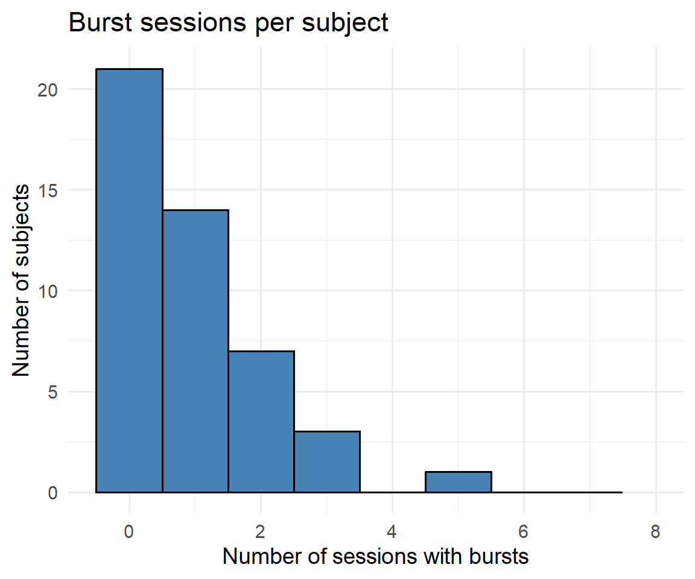
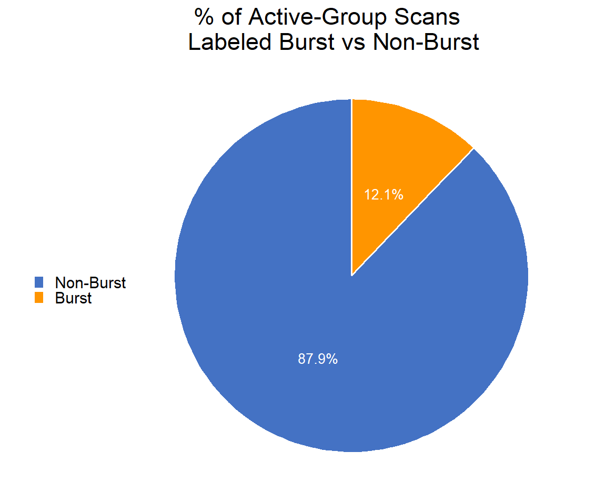
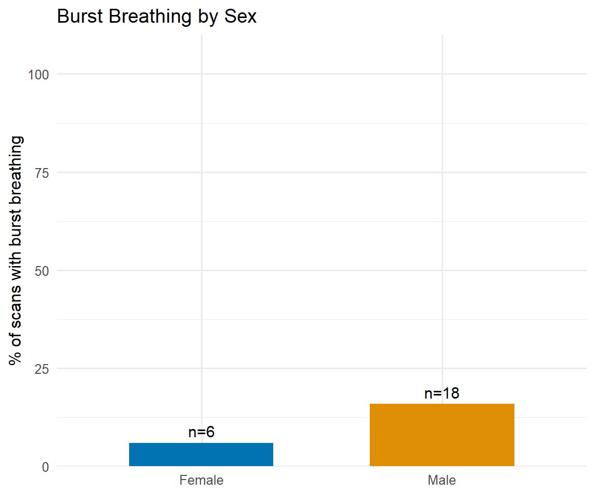
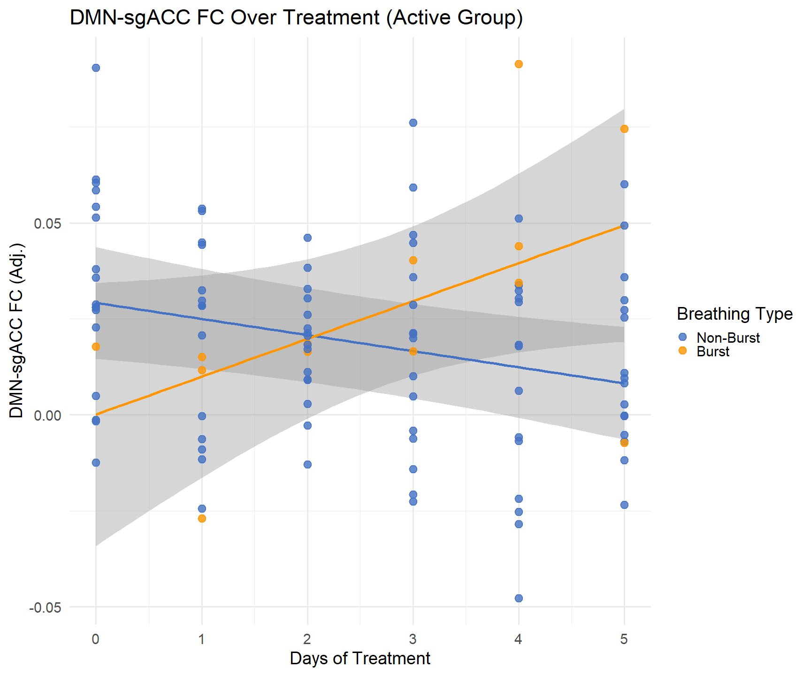
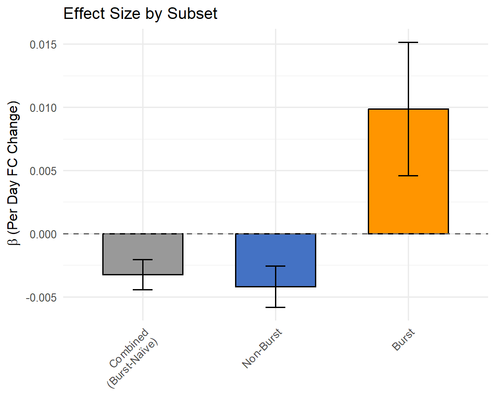
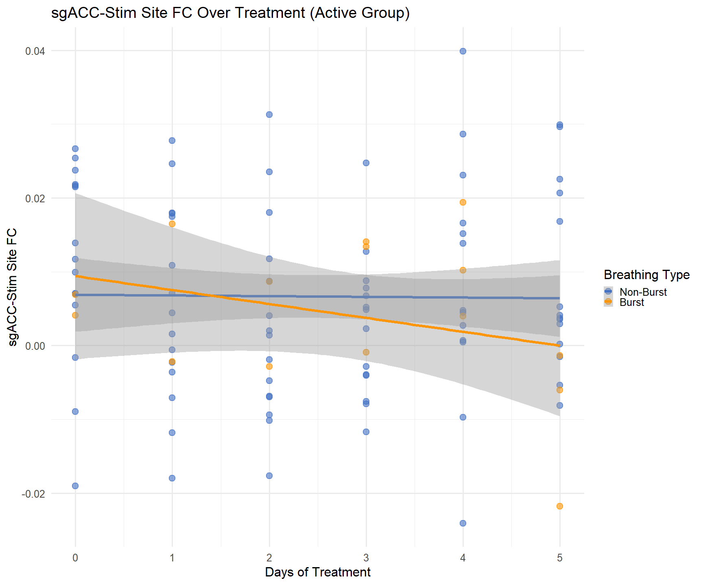
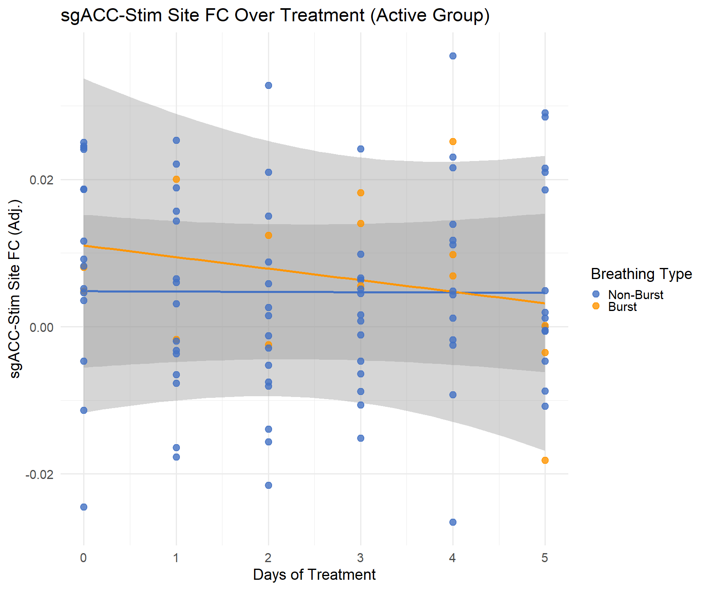

Fig3
================
2026-06-21

``` r
library(dplyr)
```

    ## 
    ## Attaching package: 'dplyr'

    ## The following objects are masked from 'package:stats':
    ## 
    ##     filter, lag

    ## The following objects are masked from 'package:base':
    ## 
    ##     intersect, setdiff, setequal, union

``` r
library(nlme)
```

    ## 
    ## Attaching package: 'nlme'

    ## The following object is masked from 'package:dplyr':
    ## 
    ##     collapse

``` r
library(tidyr)
library(ggplot2)
```

    ## Warning: package 'ggplot2' was built under R version 4.5.3

``` r
# ── Load FCs and apply exclusions ─────────────────────────────────────────────
FCs <- read.csv('E://Downloads/AllSubjects_FC(10).csv')
FCs <- FCs[!FCs$Var1 %in% c('s00x','s005','s008','s013','s014','s020','s021','s023','s053'), ]
# failed QC
FCs <- FCs[!(FCs$Var1 == "s016" & FCs$Var2 == 4), ]
# Fieldmap problems
FCs <- FCs[!(FCs$Var1 == "s005" & FCs$Var2 == 2), ]
# Targeting scans accidentally administered in non-targeting sessions
FCs <- FCs[!(FCs$Var1 == "s030" & FCs$Var2 == 9 & FCs$Var3 %in% c(1, 2)), ]
FCs <- FCs[!(FCs$Var1 == "s031" & FCs$Var2 == 9 & FCs$Var3 == 1), ]

FCs$key <- paste(FCs$Var1, paste0('V', FCs$Var2), FCs$Var3, sep="_")

# ── Load and key head motion ───────────────────────────────────────────────────
BRAINS_headmotion <- read.csv('E://Downloads/fd_summary_per_scan.csv', stringsAsFactors=FALSE)
BRAINS_headmotion$Subject <- sub("^sub-", "", BRAINS_headmotion$Subject)
BRAINS_headmotion$Subject <- sub("_.*$",  "", BRAINS_headmotion$Subject)
BRAINS_headmotion$Session <- sub("^ses-V", "", BRAINS_headmotion$Session)
BRAINS_headmotion$ScanNum <- as.numeric(sub(".*Resting([0-9]+).*", "\\1", BRAINS_headmotion$Scan))
```

    ## Warning: NAs introduced by coercion

``` r
BRAINS_headmotion$key     <- paste0(BRAINS_headmotion$Subject, "_V", BRAINS_headmotion$Session, "_", BRAINS_headmotion$ScanNum)
BRAINS_headmotion         <- BRAINS_headmotion[!duplicated(BRAINS_headmotion$key), ]

# ── Load demographics ─────────────────────────────────────────────────────────
demo <- read.csv('E:\\Downloads/Demo_All_TP_Long.csv')
demo$Subject <- sub(".*_(s[0-9]+[a-z]?)", "\\1", demo$record_id)
demo$Subject <- sub("a$", "", demo$Subject)
demo$Subject <- gsub("\u00A0", " ", demo$Subject, fixed=TRUE)
demo$Subject <- trimws(demo$Subject)

# ── Merge FC + headmotion, FD QC, then demo ───────────────────────────────────
merged <- merge(FCs, BRAINS_headmotion, by='key')
merged <- merged[merged$Mean_FD <= 0.2, ]
merged$Subject <- merged$Var1
merged$Group   <- NULL
merged$Gender  <- NULL
merged <- merge(merged, demo, by='Subject')

# ── Session exclusions (match hypothesis 1) ────────────────────────────────────
merged$Group        <- as.factor(merged$Group)
merged$Group        <- relevel(merged$Group, ref='Y')
merged$DaysSinceInit <- as.numeric(merged$Session) - 3
merged              <- merged[merged$DaysSinceInit >= 0, ]
merged              <- merged[as.numeric(merged$Session) < 9, ]

# rename FC columns
colnames(merged)[3:6] <- c('subj','sesh','scan','DM_sgAv')

# set sham group as reference for interpretability 
merged$Group<-as.factor(merged$Group)
merged$Group=relevel(merged$Group,ref='Y')

cat('Rows:', nrow(merged), '\n')
```

    ## Rows: 425

``` r
cat('Subjects:', length(unique(merged$Subject)), '\n')
```

    ## Subjects: 40

``` r
# ── Load and parse respiration ─────────────────────────────────────────────
resp_qc <- read.csv('E:/Downloads/BrainsRespQC.csv', stringsAsFactors=FALSE)

resp_long <- resp_qc %>%
    pivot_longer(cols=c(BurstsMinor, BurstsMajor, DBMajor, DBMinor),
                 names_to='artifact_type', values_to='sessions') %>%
    filter(sessions != '') %>%
    mutate(sessions = strsplit(sessions, ',')) %>%
    unnest(sessions) %>%
    mutate(Session = trimws(sub('V', '', sessions)))

burst_sessions <- resp_long %>%
    filter(artifact_type %in% c('BurstsMinor','BurstsMajor')) %>%
    dplyr::select(Subject, Session) %>% distinct()

db_sessions <- resp_long %>%
    filter(artifact_type %in% c('DBMinor','DBMajor')) %>%
    dplyr::select(Subject, Session) %>% distinct()

# JUST scan num 2 where we have resp. traces
merged2=merged[merged$ScanNum==2,]

# respiration QC only measured on ScanNum=2 — only flag/exclude those rows
merged2$resp_burst <- paste(merged2$Subject, merged2$Session) %in% paste(burst_sessions$Subject, burst_sessions$Session)

merged_burst <- merged2[merged2$resp_burst, ]
merged_no_burst <- merged2[!merged2$resp_burst, ]

cat('Rows full:',       nrow(merged),          '\n')
```

    ## Rows full: 425

``` r
cat('Rows no burst:',   nrow(merged_no_burst), '\n')
```

    ## Rows no burst: 189

``` r
cat('Rows burst:',      nrow(merged_burst),    '\n')
```

    ## Rows burst: 24

``` r
cat('Burst flags set:', sum(merged2$resp_burst), '\n')
```

    ## Burst flags set: 24

``` r
cat('DB flags set:',    sum(merged2$resp_db),    '\n')
```

    ## DB flags set: 0

``` r
# plot bursts per subject as histogram
# ── count how many burst-flagged sessions each subject has ────────────────
bursts_per_subject <- burst_sessions %>%
    group_by(Subject) %>%
    summarise(n_bursts = n())

# subjects in merged2 with zero bursts won't appear in burst_sessions at all,
# so add them back in as n_bursts = 0 if you want the full subject pool represented
all_subjects <- unique(merged2$Subject)
missing_subjects <- setdiff(all_subjects, bursts_per_subject$Subject)
if (length(missing_subjects) > 0) {
    bursts_per_subject <- rbind(
        bursts_per_subject,
        data.frame(Subject = missing_subjects, n_bursts = 0)
    )
}

ggplot(bursts_per_subject, aes(x = n_bursts)) +
    geom_histogram(binwidth = 1, boundary = -0.5, fill = 'steelblue', color = 'black') +
    scale_x_continuous(breaks = 0:max(bursts_per_subject$n_bursts)) +
    labs(title = 'Burst sessions per subject',
         x = 'Number of sessions with bursts',
         y = 'Number of subjects') + xlim(c(-.5,8)) +
    theme_minimal(base_size=28)
```

    ## Scale for x is already present.
    ## Adding another scale for x, which will replace the existing scale.

    ## Warning: Removed 1 row containing missing values or values outside the scale range
    ## (`geom_bar()`).

<!-- -->

``` r
# pie chart: % of scans labeled burst vs non-burst, relative to OG active sample
merged_burst_act=merged_burst[merged_burst$Group=='X',]
merged_no_burst_act=merged_no_burst[merged_no_burst$Group=='X',]
merged_active_all=rbind(merged_burst_act,merged_no_burst_act)
n_burst    <- nrow(merged_burst_act)
n_nonburst <- nrow(merged_no_burst_act)
n_total    <- nrow(merged_active_all)
# check these actually add up -- if merged_burst/merged_no_burst don't
# partition merged_active_all cleanly (e.g. some rows dropped, duplicated,
# or excluded by an NA in a covariate before the lme fit), this warns you
if ((n_burst + n_nonburst) != n_total) {
cat('WARNING: burst + non-burst rows (', n_burst + n_nonburst,
') do not match total active rows (', n_total, ') -- check for dropped rows\n\n')
}
pct_burst    <- (n_burst / n_total) * 100
pct_nonburst <- (n_nonburst / n_total) * 100
cat('n_burst:', n_burst, ' n_nonburst:', n_nonburst, ' n_total:', n_total, '\n')
```

    ## n_burst: 13  n_nonburst: 94  n_total: 107

``` r
cat('pct_burst:', pct_burst, '  pct_nonburst:', pct_nonburst, '\n\n')
```

    ## pct_burst: 12.14953   pct_nonburst: 87.85047

``` r
pie2_data <- data.frame(
label = c('Burst', 'Non-Burst'),
pct   = c(pct_burst, pct_nonburst)
)
# ============================================================
# Force legend order: Non-Burst first, then Burst.
# ggplot's legend order follows factor level order of the fill
# variable, not the order values appear in scale_fill_manual --
# alphabetical default puts 'Burst' before 'Non-Burst', which is
# why this needs an explicit factor() call, not just a reordering
# in scale_fill_manual.
# ============================================================
pie2_data$label <- factor(pie2_data$label, levels = c('Non-Burst', 'Burst'))

# ============================================================
# margin(l = -X) inside element_text shifts the title's own text
# box to the left by X points, independent of hjust. Negative
# values are allowed here even though it looks unusual. Try this
# instead of, or combined with, hjust -- hardcoded value below is
# a starting guess, check the render and adjust.
# ============================================================

ggplot(pie2_data, aes(x = '', y = pct, fill = label)) +
    geom_bar(stat = 'identity', width = 1, color = 'white') +
    coord_polar(theta = 'y') +
    theme_void(base_size = 28) +
    theme(plot.title = element_text(hjust = 0.5, margin = margin(l = -60)),
          plot.margin = unit(c(10, 10, 10, 10), 'pt'),
          legend.position = 'left') +
    ggtitle('% of Active-Group Scans \n Labeled Burst vs Non-Burst') +
    scale_fill_manual(name = '', values = c('Burst' = '#FF9500', 'Non-Burst' = '#4472C4')) +
    geom_text(aes(label = paste0(round(pct, 1), '%')),
              position = position_stack(vjust = 0.5), size = 7, color = 'white')
```

<!-- -->

``` r
#### sex difference


# Create contingency table: rows=gender, cols=burst status
# First, check what your gender column is called (might be 'Gender' or similar)
# Adjust the column name below if needed

gender_burst_table <- table(merged2$Gender, merged2$resp_burst)
#        FALSE  TRUE
# F       X      X
# M       X      X

# Calculate proportions: what % of each gender has burst breathing
total_by_gender <- rowSums(gender_burst_table)
prop_burst_by_gender <- gender_burst_table[, 2] / total_by_gender


cat("Female:", round(prop_burst_by_gender['Female'], 3), 
    "(", gender_burst_table['Female', 2], "/", total_by_gender['Female'], ")\n")
```

    ## Female: 0.06 ( 6 / 100 )

``` r
cat("Male:  ", round(prop_burst_by_gender['Male'], 3), 
    "(", gender_burst_table['Male', 2], "/", total_by_gender['Male'], ")\n")
```

    ## Male:   0.159 ( 18 / 113 )

``` r
cat("\n")
```

``` r
# Chi-square test of independence
chisq_result <- chisq.test(gender_burst_table)
cat("Chi-square test:\n")
```

    ## Chi-square test:

``` r
print(chisq_result)
```

    ## 
    ##  Pearson's Chi-squared test with Yates' continuity correction
    ## 
    ## data:  gender_burst_table
    ## X-squared = 4.2854, df = 1, p-value = 0.03844

``` r
cat("p-value:", round(chisq_result$p.value, 4), "\n")
```

    ## p-value: 0.0384

``` r
library(ggplot2)

# Prepare data for ggplot
plot_data <- data.frame(
  Gender = c('Female', 'Male'),
  Proportion = prop_burst_by_gender * 100,
  Count = gender_burst_table[, 2],
  Total = rowSums(gender_burst_table)
)

# Create ggplot
ggplot(plot_data, aes(x = Gender, y = Proportion, fill = Gender)) +
  geom_col(width = 0.6) +
  geom_text(aes(label = paste0('n=', Count)), 
            vjust = -0.5, size = 8) +
  scale_fill_manual(values = c('Female' = '#0173B2', 'Male' = '#DE8F05')) +
  scale_y_continuous(limits = c(0, 100), expand = expansion(mult = c(0, 0.1))) +
  labs(
    title = 'Burst Breathing by Sex',
    y = '% of scans with burst breathing',
    x = NULL
  ) +
  theme_minimal(base_size=24) +
  theme(
    legend.position = 'none')
```

<!-- -->

``` r
# Save if desired
ggsave('burst_by_gender.png', width = 6, height = 5, dpi = 150)
```

``` r
# ── Model formula ──────────────────────────────────────────────────────────────
formula_fc <- DM_sgAv ~ Gender + Mean_FD + DaysSinceInit * Group + 
              Age.at.screening.consent + Maudsley.Staging.Method.Score

# need DaysSinceInit in merged (session number - 3, same as original)
merged$DaysSinceInit          <- as.numeric(merged$Session) - 3
merged_no_burst$DaysSinceInit <- as.numeric(merged_no_burst$Session) - 3
#merged_no_db$DaysSinceInit    <- as.numeric(merged_no_db$Session) - 3

# ── Fit all three versions ─────────────────────────────────────────────────────
fit_full     <- lme(formula_fc, random = ~1|Subject, data = merged)
fit_no_burst <- lme(formula_fc, random = ~1|Subject, data = merged_no_burst)
fit_burst    <- lme(formula_fc, random = ~1|Subject, data = merged_burst)

# ── Extract key treatment term across versions ─────────────────────────────────
extract_key <- function(fit, label) {
    tt  <- summary(fit)$tTable
    row <- tt['DaysSinceInit:GroupX', ]
    data.frame(model    = label,
               estimate = round(row['Value'],     4),
               se       = round(row['Std.Error'], 4),
               tstat    = round(row['t-value'],   4),
               pval     = round(row['p-value'],   4))
}


# get effect fit on full model as "before"
contrast_before <- rep(0, length(fixef(fit_full)))
names(contrast_before) <- names(fixef(fit_full))
contrast_before['DaysSinceInit']        <- 1
contrast_before['DaysSinceInit:GroupX'] <- 1

beta_before <- sum(contrast_before * fixef(fit_full))
se_before   <- sqrt(as.numeric(t(contrast_before) %*% vcov(fit_full) %*% contrast_before))


comparison <- rbind(
    extract_key(fit_full,     'DM_sgAv — full'),
    extract_key(fit_no_burst, 'DM_sgAv — no burst'),
    extract_key(fit_burst,    'DM_sgAv — burst')
)
print(comparison)
```

    ##                     model estimate     se   tstat   pval
    ## Value      DM_sgAv — full  -0.0043 0.0017 -2.5166 0.0123
    ## Value1 DM_sgAv — no burst  -0.0051 0.0024 -2.1453 0.0336
    ## Value2    DM_sgAv — burst   0.0113 0.0036  3.1199 0.0206

``` r
# ============================================================
# Fit the full model: triple interaction of DaysSinceInit, Group,
# and resp_burst, with Gender/Mean_FD/Age/Maudsley as covariates.
# Single model, single set of random intercepts per subject --
# no separate refits per subgroup.
# ============================================================
Dif_TRx <- lme(DM_sgAv ~ Gender + Mean_FD + DaysSinceInit*Group*resp_burst +
                 Age.at.screening.consent + Maudsley.Staging.Method.Score,
               random = ~1 | Subject, data = merged2)

print(summary(Dif_TRx)$tTable)
```

    ##                                             Value    Std.Error  DF    t-value
    ## (Intercept)                          0.0165816707 0.0245338812 166  0.6758682
    ## GenderMale                          -0.0184610331 0.0068893476  35 -2.6796489
    ## Mean_FD                             -0.0567379859 0.0805730927 166 -0.7041803
    ## DaysSinceInit                        0.0012124420 0.0017423461 166  0.6958675
    ## GroupX                               0.0161277443 0.0088633393  35  1.8196014
    ## resp_burstTRUE                       0.0237729266 0.0245966314 166  0.9665115
    ## Age.at.screening.consent             0.0004073625 0.0003038838  35  1.3405205
    ## Maudsley.Staging.Method.Score        0.0004169283 0.0023367265  35  0.1784241
    ## DaysSinceInit:GroupX                -0.0054031617 0.0023951085 166 -2.2559153
    ## DaysSinceInit:resp_burstTRUE        -0.0045873477 0.0059016069 166 -0.7773049
    ## GroupX:resp_burstTRUE               -0.0528561887 0.0305073137 166 -1.7325743
    ## DaysSinceInit:GroupX:resp_burstTRUE  0.0186409112 0.0080682601 166  2.3104004
    ##                                        p-value
    ## (Intercept)                         0.50006481
    ## GenderMale                          0.01115671
    ## Mean_FD                             0.48230716
    ## DaysSinceInit                       0.48748492
    ## GroupX                              0.07738225
    ## resp_burstTRUE                      0.33519429
    ## Age.at.screening.consent            0.18871307
    ## Maudsley.Staging.Method.Score       0.85941870
    ## DaysSinceInit:GroupX                0.02538155
    ## DaysSinceInit:resp_burstTRUE        0.43808525
    ## GroupX:resp_burstTRUE               0.08502863
    ## DaysSinceInit:GroupX:resp_burstTRUE 0.02209660

``` r
# ============================================================
# Pull fixed effects + full covariance matrix, matched by NAME
# ============================================================
fixef_TRx <- fixef(Dif_TRx)
vcov_TRx  <- vcov(Dif_TRx)

cat('term names in this model:\n')
```

    ## term names in this model:

``` r
print(names(fixef_TRx))
```

    ##  [1] "(Intercept)"                         "GenderMale"                         
    ##  [3] "Mean_FD"                             "DaysSinceInit"                      
    ##  [5] "GroupX"                              "resp_burstTRUE"                     
    ##  [7] "Age.at.screening.consent"            "Maudsley.Staging.Method.Score"      
    ##  [9] "DaysSinceInit:GroupX"                "DaysSinceInit:resp_burstTRUE"       
    ## [11] "GroupX:resp_burstTRUE"               "DaysSinceInit:GroupX:resp_burstTRUE"

``` r
cat('\n')
```

``` r
# ============================================================
# Confirm residuals(Dif_TRx) row order matches merged2 row order
# before using it positionally below.
# ============================================================
resid_order_ok <- identical(names(residuals(Dif_TRx)), as.character(merged2$Subject))
cat('residuals(Dif_TRx) row order matches merged2 row order:', resid_order_ok, '\n\n')
```

    ## residuals(Dif_TRx) row order matches merged2 row order: TRUE

``` r
level1_resid_TRx <- residuals(Dif_TRx)  # default level = subject-level residual

# ============================================================
# Two contrast vectors -- slope + SE for each condition, as single
# numbers, useful to report alongside the plot
# ============================================================

# active, non-burst slope: DaysSinceInit + DaysSinceInit:GroupX
contrast_active_nonburst <- rep(0, length(fixef_TRx))
names(contrast_active_nonburst) <- names(fixef_TRx)
contrast_active_nonburst['DaysSinceInit']        <- 1
contrast_active_nonburst['DaysSinceInit:GroupX'] <- 1

slope_active_nonburst <- sum(contrast_active_nonburst * fixef_TRx)
se_active_nonburst    <- sqrt(as.numeric(t(contrast_active_nonburst) %*% vcov_TRx %*% contrast_active_nonburst))

# active, burst slope: DaysSinceInit + DaysSinceInit:GroupX
#   + DaysSinceInit:resp_burstTRUE + DaysSinceInit:GroupX:resp_burstTRUE
contrast_active_burst <- rep(0, length(fixef_TRx))
names(contrast_active_burst) <- names(fixef_TRx)
contrast_active_burst['DaysSinceInit']                       <- 1
contrast_active_burst['DaysSinceInit:GroupX']                <- 1
contrast_active_burst['DaysSinceInit:resp_burstTRUE']        <- 1
contrast_active_burst['DaysSinceInit:GroupX:resp_burstTRUE'] <- 1

slope_active_burst <- sum(contrast_active_burst * fixef_TRx)
# se formula
se_active_burst     <- sqrt(as.numeric(t(contrast_active_burst) %*% vcov_TRx %*% contrast_active_burst))

cat('active, non-burst slope:', slope_active_nonburst, ' SE:', se_active_nonburst, '\n')
```

    ## active, non-burst slope: -0.00419072  SE: 0.001645889

``` r
cat('active, burst slope:    ', slope_active_burst, ' SE:', se_active_burst, '\n\n')
```

    ## active, burst slope:     0.009862844  SE: 0.005275574

``` r
# ============================================================
# Fixed reference values for covariates not being plotted --
# held constant across both lines/points so everything sits on
# the same scale
# ============================================================
gender_fixed   <- 1  # GenderMale = 1, better represented in burst group
mean_fd_fixed  <- mean(merged2$Mean_FD)
age_fixed      <- mean(merged2$Age.at.screening.consent)
maudsley_fixed <- mean(merged2$Maudsley.Staging.Method.Score)

# ============================================================
# Subset to active group, split by burst status, for x-ranges only
# ============================================================
active_nonburst_data <- merged2[merged2$Group == 'X' & merged2$resp_burst == FALSE, ]
active_burst_data    <- merged2[merged2$Group == 'X' & merged2$resp_burst == TRUE, ]

cat('n rows, active non-burst:', nrow(active_nonburst_data), '\n')
```

    ## n rows, active non-burst: 94

``` r
cat('n rows, active burst:    ', nrow(active_burst_data), '\n\n')
```

    ## n rows, active burst:     13

``` r
x_seq_nonburst <- seq(min(active_nonburst_data$DaysSinceInit), max(active_nonburst_data$DaysSinceInit), length.out = 50)
x_seq_burst    <- seq(min(active_burst_data$DaysSinceInit),    max(active_burst_data$DaysSinceInit),    length.out = 50)

# ============================================================
# Build the active, non-burst prediction line + ribbon.
# Explicit loop, one row of computation per x value, no apply/sapply.
# ============================================================
pred_center_nonburst <- numeric(length(x_seq_nonburst))
pred_se_nonburst     <- numeric(length(x_seq_nonburst))
for (i in 1:length(x_seq_nonburst)) {
    x_val <- x_seq_nonburst[i]

    cv <- rep(0, length(fixef_TRx))
    names(cv) <- names(fixef_TRx)
    cv['(Intercept)']                         <- 1
    cv['GenderMale']                          <- gender_fixed
    cv['Mean_FD']                             <- mean_fd_fixed
    cv['DaysSinceInit']                       <- x_val
    cv['GroupX']                              <- 1     # Group = X
    cv['resp_burstTRUE']                      <- 0     # resp_burst = FALSE
    cv['Age.at.screening.consent']            <- age_fixed
    cv['Maudsley.Staging.Method.Score']       <- maudsley_fixed
    cv['DaysSinceInit:GroupX']                <- x_val * 1
    cv['DaysSinceInit:resp_burstTRUE']        <- x_val * 0
    cv['GroupX:resp_burstTRUE']               <- 1 * 0
    cv['DaysSinceInit:GroupX:resp_burstTRUE'] <- x_val * 1 * 0

    pred_center_nonburst[i] <- sum(cv * fixef_TRx)
    pred_se_nonburst[i]     <- sqrt(as.numeric(t(cv) %*% vcov_TRx %*% cv))
}
ribbon_active_nonburst <- data.frame(
    x = x_seq_nonburst,
    y_center = pred_center_nonburst,
    y_upper  = pred_center_nonburst + 1.96 * pred_se_nonburst,
    y_lower  = pred_center_nonburst - 1.96 * pred_se_nonburst
)

# ============================================================
# Build the active, burst prediction line + ribbon. Same construction,
# resp_burst = TRUE this time.
# ============================================================
pred_center_burst <- numeric(length(x_seq_burst))
pred_se_burst     <- numeric(length(x_seq_burst))
for (i in 1:length(x_seq_burst)) {
    x_val <- x_seq_burst[i]

    cv <- rep(0, length(fixef_TRx))
    names(cv) <- names(fixef_TRx)
    cv['(Intercept)']                         <- 1
    cv['GenderMale']                          <- gender_fixed
    cv['Mean_FD']                             <- mean_fd_fixed
    cv['DaysSinceInit']                       <- x_val
    cv['GroupX']                              <- 1     # Group = X
    cv['resp_burstTRUE']                      <- 1     # resp_burst = TRUE
    cv['Age.at.screening.consent']            <- age_fixed
    cv['Maudsley.Staging.Method.Score']       <- maudsley_fixed
    cv['DaysSinceInit:GroupX']                <- x_val * 1
    cv['DaysSinceInit:resp_burstTRUE']        <- x_val * 1
    cv['GroupX:resp_burstTRUE']               <- 1 * 1
    cv['DaysSinceInit:GroupX:resp_burstTRUE'] <- x_val * 1 * 1

    pred_center_burst[i] <- sum(cv * fixef_TRx)
    pred_se_burst[i]     <- sqrt(as.numeric(t(cv) %*% vcov_TRx %*% cv))
}
ribbon_active_burst <- data.frame(
    x = x_seq_burst,
    y_center = pred_center_burst,
    y_upper  = pred_center_burst + 1.96 * pred_se_burst,
    y_lower  = pred_center_burst - 1.96 * pred_se_burst
)

# ============================================================
# Build adjusted scatter points: subject-level residual from Dif_TRx
# + fixed-effect prediction at each row's ACTUAL DaysSinceInit/burst
# status, with Gender/Mean_FD/Age/Maudsley pinned to the same
# reference values as the lines above. This keeps points and lines
# on one consistent scale, using ONE model throughout.
# ============================================================
active_data <- merged2[merged2$Group == 'X', ]
level1_resid_active <- level1_resid_TRx[merged2$Group == 'X']

adjusted_y <- numeric(nrow(active_data))
for (i in 1:nrow(active_data)) {

    days_i      <- active_data$DaysSinceInit[i]
    burstTRUE_i <- ifelse(active_data$resp_burst[i], 1, 0)  # actual burst status for this row

    pred_at_fixed <-
        fixef_TRx['(Intercept)'] +
        fixef_TRx['GenderMale'] * gender_fixed +
        fixef_TRx['Mean_FD'] * mean_fd_fixed +
        fixef_TRx['DaysSinceInit'] * days_i +
        fixef_TRx['GroupX'] * 1 +
        fixef_TRx['resp_burstTRUE'] * burstTRUE_i +
        fixef_TRx['Age.at.screening.consent'] * age_fixed +
        fixef_TRx['Maudsley.Staging.Method.Score'] * maudsley_fixed +
        fixef_TRx['DaysSinceInit:GroupX'] * days_i * 1 +
        fixef_TRx['DaysSinceInit:resp_burstTRUE'] * days_i * burstTRUE_i +
        fixef_TRx['GroupX:resp_burstTRUE'] * 1 * burstTRUE_i +
        fixef_TRx['DaysSinceInit:GroupX:resp_burstTRUE'] * days_i * 1 * burstTRUE_i

    adjusted_y[i] <- level1_resid_active[i] + pred_at_fixed
}

active_data$Resids_adj    <- adjusted_y
active_data$Session_Type  <- ifelse(active_data$resp_burst, 'Burst', 'Non-Burst')
active_data$Session_Type  <- factor(active_data$Session_Type, levels = c('Non-Burst', 'Burst'))

n_nonburst <- sum(active_data$Session_Type == 'Non-Burst')
n_burst    <- sum(active_data$Session_Type == 'Burst')

# ============================================================
# Plot. Ribbons set to gray (matching ggplot2's own default
# geom_smooth() ribbon color, grey60), instead of colored by group.
# Points and lines still colored by Session_Type so the two
# conditions remain visually distinguishable.
# saved at 1100 x 1100
# ============================================================
ggplot() +
    geom_ribbon(data = ribbon_active_nonburst, aes(x = x, ymin = y_lower, ymax = y_upper),
                fill = 'grey60', alpha = 0.4) +
    geom_ribbon(data = ribbon_active_burst, aes(x = x, ymin = y_lower, ymax = y_upper),
                fill = 'grey60', alpha = 0.4) +
    geom_line(data = ribbon_active_nonburst, aes(x = x, y = y_center), color = '#4472C4', linewidth = 2) +
    geom_line(data = ribbon_active_burst, aes(x = x, y = y_center), color = '#FF9500', linewidth = 2) +
    geom_point(data = active_data, aes(x = DaysSinceInit, y = Resids_adj, color = Session_Type),
               size = 5, alpha = 0.8) +
    theme_minimal(base_size = 28) +
    ylab('DMN-sgACC FC (Adj.)') +
    xlab('Days of Treatment') +
    ggtitle('DMN-sgACC FC Over Treatment (Active Group)') +
    scale_color_manual(name = 'Breathing Type',
                        values = c('Non-Burst' = '#4472C4', 'Burst' = '#FF9500'))
```

<!-- -->

``` r
# ============================================================
# Label with a line break after "Combined" and before "(Burst-Naïve)".
# "\n" inside a string forces a line break wherever ggplot renders
# multi-line text (axis labels, titles, legends all support this).
# The umlaut character itself: typing ï directly works fine if your
# script is saved as UTF-8 (RStudio defaults to this). If you ever
# hit encoding issues (e.g. the character displays as garbled bytes
# after saving/reopening), the safer fallback is the escape sequence
# "\u00EF" instead of typing the character directly.
# ============================================================

slope_data <- data.frame(
    condition = c('Combined\n(Burst-Naïve)', 'Non-Burst', 'Burst'),
    beta      = c(beta_before,                slope_active_nonburst, slope_active_burst),
    se        = c(se_before,                  se_active_nonburst,   se_active_burst)
)

# factor levels updated to match the new multi-line label exactly --
# has to be character-for-character identical, including the \n
slope_data$condition <- factor(slope_data$condition,
                                levels = c('Combined\n(Burst-Naïve)', 'Non-Burst', 'Burst'))

ggplot(slope_data, aes(x = condition, y = beta, fill = condition)) +
    geom_bar(stat = 'identity', width = 0.6, color = 'black') +
    geom_errorbar(aes(ymin = beta - se, ymax = beta + se), width = 0.15) +
    geom_hline(yintercept = 0, linetype = 'dashed', color = 'gray40') +
    # fill values also updated to match the new label exactly
    scale_fill_manual(values = c('Combined\n(Burst-Naïve)' = '#999999',
                                  'Non-Burst'               = '#4472C4',
                                  'Burst'                   = '#FF9500')) +
    labs(title = 'Effect Size by Subset',
         x = '', y = expression(beta ~ '(Per Day FC Change)')) +
    theme_minimal(base_size = 24) +
    theme(legend.position = 'none',
          axis.text.x = element_text(angle = 45, hjust = 1))
```

<!-- -->

``` r
# export merged2 burst labels to CSV
burst_labels <- merged2[, c("subj", "sesh", "scan", "resp_burst")]
write.csv(burst_labels, "E:/Downloads/burst_labels.csv", row.names = FALSE)

# ── Flag burst breathers (>0 burst session) ───────────────────────────────────
burst_counts <- as.data.frame(table(burst_sessions$Subject))
colnames(burst_counts) <- c('Subject', 'n_burst_sessions')
```

``` r
# ── Load stimFC ────────────────────────────────────────────────────────────────
stimFC <- read.csv('E:/Downloads/ALL_EfieldSgACC_FC.csv', stringsAsFactors=FALSE)

# clean Subject to match merged (strip "sub-" prefix)
stimFC$Subject <- sub("^sub-", "", stimFC$Subject)

# clean Visit to numeric session to match merged$Session
stimFC$Session <- sub("^ses-V", "", stimFC$Session)

# build key to match merged
stimFC$key <- paste0(stimFC$Subject, "_V", stimFC$Session, "_", stimFC$Scan)

# ── Merge with merged (gets Group, DaysSinceInit, burst flags etc.) ────────────
stimFC_merged <- merge(stimFC, merged[, c('key','Subject','Session','Group',
                                          'DaysSinceInit','Mean_FD','Gender',
                                          'Age.at.screening.consent',
                                          'Maudsley.Staging.Method.Score')], 
                       by='key')

stimFC_merged$Subject <- stimFC_merged$Subject.x

cat('Rows:', nrow(stimFC_merged), '\n')
```

    ## Rows: 401

``` r
cat('Subjects:', length(unique(stimFC_merged$Subject)), '\n')
```

    ## Subjects: 38

``` r
cat('FC_sgACC present:', 'FC_sgACC' %in% colnames(stimFC_merged), '\n')
```

    ## FC_sgACC present: TRUE

``` r
# flag burst breathers in stimFC_merged
stimFC_merged <- merge(stimFC_merged, burst_counts, by='Subject', all.x=TRUE)
stimFC_merged$n_burst_sessions[is.na(stimFC_merged$n_burst_sessions)] <- 0
stimFC_merged$burst_breather <- stimFC_merged$n_burst_sessions > 1

# session exclusions to match merged (V3-V8, DaysSinceInit >= 0)
stimFC_merged$DaysSinceInit <- as.numeric(stimFC_merged$Session.y) - 3
stimFC_merged <- stimFC_merged[!is.na(stimFC_merged$DaysSinceInit) & stimFC_merged$DaysSinceInit >= 0, ]
stimFC_merged <- stimFC_merged[as.numeric(stimFC_merged$Session.y) < 9, ]

# now split
stimFC_merged2  <- stimFC_merged[stimFC_merged$Scan == 2, ]
stimFC_no_burst <- stimFC_merged2[!stimFC_merged2$burst_breather, ]
stimFC_burst    <- stimFC_merged2[stimFC_merged2$burst_breather, ]

cat('stimFC_merged rows:', nrow(stimFC_merged), '\n')
```

    ## stimFC_merged rows: 401

``` r
cat('stimFC_merged2 rows:', nrow(stimFC_merged2), '\n')
```

    ## stimFC_merged2 rows: 201

``` r
cat('no burst rows:', nrow(stimFC_no_burst), '\n')
```

    ## no burst rows: 159

``` r
cat('burst rows:', nrow(stimFC_burst), '\n')
```

    ## burst rows: 42

``` r
fit_burst     <- lme(FC_sgACC ~ Mean_FD + Gender + Age.at.screening.consent + Maudsley.Staging.Method.Score+DaysSinceInit*Group, random = ~1|Subject, data = stimFC_burst)

# Residualize and plot active only, split by burst status
reduced_formula <- FC_sgACC ~ Mean_FD + Gender + Age.at.screening.consent + Maudsley.Staging.Method.Score

# Process no burst (active only)
stimFC_no_burst_act <- stimFC_no_burst[stimFC_no_burst$Group == 'X', ]
reduced_no_burst <- lme(reduced_formula, random = ~1|Subject, data = stimFC_no_burst_act)
stimFC_no_burst_act$Resids <- reduced_no_burst$residuals[, 2] + mean(stimFC_no_burst_act$FC_sgACC)
stimFC_no_burst_act$Session_Type <- 'Non-Burst'

# Process no burst (active only)
stimFC_no_burst_act <- stimFC_no_burst[stimFC_no_burst$Group == 'X', ]
reduced_no_burst <- lme(reduced_formula, random = ~1|Subject, data = stimFC_no_burst_act)
stimFC_no_burst_act$Resids <- residuals(reduced_no_burst) + mean(stimFC_no_burst_act$FC_sgACC, na.rm=TRUE)
stimFC_no_burst_act$Session_Type <- 'Non-Burst'

# Process burst (active only) - no random intercept with only 3 subjects
stimFC_burst_act <- stimFC_burst[stimFC_burst$Group == 'X', ]
reduced_burst <- lm(reduced_formula, data = stimFC_burst_act)  # Use lm instead of lme
stimFC_burst_act$Resids <- residuals(reduced_burst) + mean(stimFC_burst_act$FC_sgACC, na.rm=TRUE)
stimFC_burst_act$Session_Type <- 'Burst'

# Combine and plot
plot_data <- rbind(stimFC_no_burst_act, stimFC_burst_act)
plot_data$Session_Type <- factor(plot_data$Session_Type, levels = c('Non-Burst', 'Burst'))

ggplot(plot_data, aes(x = DaysSinceInit, y = Resids, color = Session_Type)) +
  geom_point(alpha = 0.6, size = 5) +
  geom_smooth(method = 'lm', se = TRUE) +
  theme_minimal(base_size = 24) +
  ylab('sgACC-Stim Site FC') +
  xlab('Days of Treatment') +
  ggtitle('sgACC-Stim Site FC Over Treatment (Active Group)') +
  scale_color_manual(name = 'Breathing Type',
                     values = c('Non-Burst' = '#4472C4', 'Burst' = '#FF9500'))
```

    ## `geom_smooth()` using formula = 'y ~ x'

<!-- -->

``` r
# remerge

# formula triple interaction
Dif_TRx_stim<-lme(FC_sgACC ~Gender+Mean_FD+DaysSinceInit*Group*burst_breather+Age.at.screening.consent+Maudsley.Staging.Method.Score, random = ~ 1 | Subject, data = stimFC_merged2)
summary(Dif_TRx_stim)
```

    ## Linear mixed-effects model fit by REML
    ##   Data: stimFC_merged2 
    ##         AIC       BIC   logLik
    ##   -888.3512 -842.9668 458.1756
    ## 
    ## Random effects:
    ##  Formula: ~1 | Subject
    ##         (Intercept)   Residual
    ## StdDev:   0.0120962 0.01684872
    ## 
    ## Fixed effects:  FC_sgACC ~ Gender + Mean_FD + DaysSinceInit * Group * burst_breather +      Age.at.screening.consent + Maudsley.Staging.Method.Score 
    ##                                                Value  Std.Error  DF    t-value
    ## (Intercept)                              0.026042039 0.01740937 158  1.4958634
    ## GenderMale                              -0.002422818 0.00499510  31 -0.4850386
    ## Mean_FD                                  0.026718147 0.05386297 158  0.4960392
    ## DaysSinceInit                            0.000728585 0.00116475 158  0.6255318
    ## GroupX                                  -0.004087786 0.00666300  31 -0.6135053
    ## burst_breatherTRUE                       0.013189168 0.00943702  31  1.3975994
    ## Age.at.screening.consent                -0.000374177 0.00022952  31 -1.6302732
    ## Maudsley.Staging.Method.Score           -0.000094202 0.00166708  31 -0.0565072
    ## DaysSinceInit:GroupX                    -0.000771802 0.00159011 158 -0.4853764
    ## DaysSinceInit:burst_breatherTRUE         0.000376718 0.00226949 158  0.1659923
    ## GroupX:burst_breatherTRUE               -0.006980899 0.01560830  31 -0.4472554
    ## DaysSinceInit:GroupX:burst_breatherTRUE -0.001903731 0.00369098 158 -0.5157795
    ##                                         p-value
    ## (Intercept)                              0.1367
    ## GenderMale                               0.6311
    ## Mean_FD                                  0.6206
    ## DaysSinceInit                            0.5325
    ## GroupX                                   0.5440
    ## burst_breatherTRUE                       0.1722
    ## Age.at.screening.consent                 0.1132
    ## Maudsley.Staging.Method.Score            0.9553
    ## DaysSinceInit:GroupX                     0.6281
    ## DaysSinceInit:burst_breatherTRUE         0.8684
    ## GroupX:burst_breatherTRUE                0.6578
    ## DaysSinceInit:GroupX:burst_breatherTRUE  0.6067
    ##  Correlation: 
    ##                                         (Intr) GndrMl Men_FD DysSnI GroupX
    ## GenderMale                              -0.246                            
    ## Mean_FD                                 -0.258  0.107                     
    ## DaysSinceInit                           -0.159 -0.029 -0.023              
    ## GroupX                                  -0.166  0.073 -0.140  0.406       
    ## burst_breatherTRUE                       0.057 -0.056 -0.180  0.290  0.388
    ## Age.at.screening.consent                -0.500  0.280 -0.115 -0.016  0.172
    ## Maudsley.Staging.Method.Score           -0.629 -0.148 -0.053  0.032 -0.123
    ## DaysSinceInit:GroupX                     0.088  0.054  0.040 -0.734 -0.567
    ## DaysSinceInit:burst_breatherTRUE         0.050  0.016  0.115 -0.515 -0.222
    ## GroupX:burst_breatherTRUE                0.050 -0.110  0.054 -0.169 -0.443
    ## DaysSinceInit:GroupX:burst_breatherTRUE -0.005  0.020 -0.060  0.315  0.255
    ##                                         b_TRUE Ag.t.. M.S.M. DySI:GX DSI:_T
    ## GenderMale                                                                 
    ## Mean_FD                                                                    
    ## DaysSinceInit                                                              
    ## GroupX                                                                     
    ## burst_breatherTRUE                                                         
    ## Age.at.screening.consent                -0.011                             
    ## Maudsley.Staging.Method.Score           -0.145 -0.165                      
    ## DaysSinceInit:GroupX                    -0.221  0.025 -0.015               
    ## DaysSinceInit:burst_breatherTRUE        -0.584  0.006 -0.021  0.380        
    ## GroupX:burst_breatherTRUE               -0.589 -0.118  0.133  0.237   0.344
    ## DaysSinceInit:GroupX:burst_breatherTRUE  0.363 -0.011 -0.025 -0.430  -0.613
    ##                                         GX:_TR
    ## GenderMale                                    
    ## Mean_FD                                       
    ## DaysSinceInit                                 
    ## GroupX                                        
    ## burst_breatherTRUE                            
    ## Age.at.screening.consent                      
    ## Maudsley.Staging.Method.Score                 
    ## DaysSinceInit:GroupX                          
    ## DaysSinceInit:burst_breatherTRUE              
    ## GroupX:burst_breatherTRUE                     
    ## DaysSinceInit:GroupX:burst_breatherTRUE -0.638
    ## 
    ## Standardized Within-Group Residuals:
    ##         Min          Q1         Med          Q3         Max 
    ## -3.91531641 -0.56169529 -0.07496037  0.59323921  2.29885102 
    ## 
    ## Number of Observations: 201
    ## Number of Groups: 38

``` r
# match model-accurate plotting from above
# ============================================================
# Confirm residuals(Dif_TRx_stim) row order matches stimFC_merged2
# before using it positionally -- same check as before, not assuming
# it'll behave identically just because the earlier model did.
# ============================================================
resid_order_ok_stim <- identical(names(residuals(Dif_TRx_stim)), as.character(stimFC_merged2$Subject))
cat('residuals(Dif_TRx_stim) row order matches stimFC_merged2 row order:', resid_order_ok_stim, '\n\n')
```

    ## residuals(Dif_TRx_stim) row order matches stimFC_merged2 row order: TRUE

``` r
level1_resid_stim <- residuals(Dif_TRx_stim)  # default level = subject-level residual

# ============================================================
# Pull fixed effects + full covariance matrix, by name
# ============================================================
fixef_stim <- fixef(Dif_TRx_stim)
vcov_stim  <- vcov(Dif_TRx_stim)

# ============================================================
# Two contrast vectors, same structure as the DMN-sgACC version,
# term names swapped for burst_breatherTRUE instead of resp_burstTRUE
# ============================================================

# active, non-burst slope: DaysSinceInit + DaysSinceInit:GroupX
contrast_active_nonburst_stim <- rep(0, length(fixef_stim))
names(contrast_active_nonburst_stim) <- names(fixef_stim)
contrast_active_nonburst_stim['DaysSinceInit']        <- 1
contrast_active_nonburst_stim['DaysSinceInit:GroupX'] <- 1

slope_active_nonburst_stim <- sum(contrast_active_nonburst_stim * fixef_stim)
se_active_nonburst_stim    <- sqrt(as.numeric(t(contrast_active_nonburst_stim) %*% vcov_stim %*% contrast_active_nonburst_stim))

# active, burst slope: DaysSinceInit + DaysSinceInit:GroupX
#   + DaysSinceInit:burst_breatherTRUE + DaysSinceInit:GroupX:burst_breatherTRUE
contrast_active_burst_stim <- rep(0, length(fixef_stim))
names(contrast_active_burst_stim) <- names(fixef_stim)
contrast_active_burst_stim['DaysSinceInit']                              <- 1
contrast_active_burst_stim['DaysSinceInit:GroupX']                       <- 1
contrast_active_burst_stim['DaysSinceInit:burst_breatherTRUE']           <- 1
contrast_active_burst_stim['DaysSinceInit:GroupX:burst_breatherTRUE']    <- 1

slope_active_burst_stim <- sum(contrast_active_burst_stim * fixef_stim)
se_active_burst_stim     <- sqrt(as.numeric(t(contrast_active_burst_stim) %*% vcov_stim %*% contrast_active_burst_stim))

cat('active, non-burst slope (stim FC):', slope_active_nonburst_stim, ' SE:', se_active_nonburst_stim, '\n')
```

    ## active, non-burst slope (stim FC): -4.321695e-05  SE: 0.001080766

``` r
cat('active, burst slope (stim FC):    ', slope_active_burst_stim,    ' SE:', se_active_burst_stim, '\n')
```

    ## active, burst slope (stim FC):     -0.00157023  SE: 0.002709829

``` r
cat('(note: neither slope, nor their difference, reached significance in the tTable above)\n\n')
```

    ## (note: neither slope, nor their difference, reached significance in the tTable above)

``` r
# ============================================================
# Fixed reference values for covariates not being plotted
# ============================================================
gender_fixed_stim   <- 1  # GenderMale = 1
mean_fd_fixed_stim  <- mean(stimFC_merged2$Mean_FD)
age_fixed_stim       <- mean(stimFC_merged2$Age.at.screening.consent)
maudsley_fixed_stim <- mean(stimFC_merged2$Maudsley.Staging.Method.Score)

# ============================================================
# Subset to active group, split by burst status, for x-ranges only
# ============================================================
active_nonburst_stim <- stimFC_merged2[stimFC_merged2$Group == 'X' & stimFC_merged2$burst_breather == FALSE, ]
active_burst_stim    <- stimFC_merged2[stimFC_merged2$Group == 'X' & stimFC_merged2$burst_breather == TRUE, ]

cat('n rows, active non-burst (stim):', nrow(active_nonburst_stim), '\n')
```

    ## n rows, active non-burst (stim): 86

``` r
cat('n rows, active burst (stim):    ', nrow(active_burst_stim), '\n')
```

    ## n rows, active burst (stim):     15

``` r
cat('n subjects, active burst (stim):', length(unique(active_burst_stim$Subject)), '-- thin ground for a ribbon, flagging this rather than hiding it\n\n')
```

    ## n subjects, active burst (stim): 3 -- thin ground for a ribbon, flagging this rather than hiding it

``` r
x_seq_nonburst_stim <- seq(min(active_nonburst_stim$DaysSinceInit), max(active_nonburst_stim$DaysSinceInit), length.out = 50)
x_seq_burst_stim    <- seq(min(active_burst_stim$DaysSinceInit),    max(active_burst_stim$DaysSinceInit),    length.out = 50)

# ============================================================
# Active, non-burst prediction line + ribbon. Explicit loop,
# no apply/sapply -- one row of computation per x value.
# ============================================================
pred_center_nonburst_stim <- numeric(length(x_seq_nonburst_stim))
pred_se_nonburst_stim     <- numeric(length(x_seq_nonburst_stim))
for (i in 1:length(x_seq_nonburst_stim)) {
    x_val <- x_seq_nonburst_stim[i]

    cv <- rep(0, length(fixef_stim))
    names(cv) <- names(fixef_stim)
    cv['(Intercept)']                              <- 1
    cv['GenderMale']                               <- gender_fixed_stim
    cv['Mean_FD']                                  <- mean_fd_fixed_stim
    cv['DaysSinceInit']                            <- x_val
    cv['GroupX']                                   <- 1     # Group = X
    cv['burst_breatherTRUE']                       <- 0     # burst_breather = FALSE
    cv['Age.at.screening.consent']                 <- age_fixed_stim
    cv['Maudsley.Staging.Method.Score']            <- maudsley_fixed_stim
    cv['DaysSinceInit:GroupX']                     <- x_val * 1
    cv['DaysSinceInit:burst_breatherTRUE']         <- x_val * 0
    cv['GroupX:burst_breatherTRUE']                <- 1 * 0
    cv['DaysSinceInit:GroupX:burst_breatherTRUE']  <- x_val * 1 * 0

    pred_center_nonburst_stim[i] <- sum(cv * fixef_stim)
    pred_se_nonburst_stim[i]     <- sqrt(as.numeric(t(cv) %*% vcov_stim %*% cv))
}
ribbon_active_nonburst_stim <- data.frame(
    x = x_seq_nonburst_stim,
    y_center = pred_center_nonburst_stim,
    y_upper  = pred_center_nonburst_stim + 1.96 * pred_se_nonburst_stim,
    y_lower  = pred_center_nonburst_stim - 1.96 * pred_se_nonburst_stim
)

# ============================================================
# Active, burst prediction line + ribbon. Same construction,
# burst_breather = TRUE this time. n=3 subjects -- the ribbon
# below will be wide, and that width is accurate, not a bug.
# ============================================================
pred_center_burst_stim <- numeric(length(x_seq_burst_stim))
pred_se_burst_stim     <- numeric(length(x_seq_burst_stim))
for (i in 1:length(x_seq_burst_stim)) {
    x_val <- x_seq_burst_stim[i]

    cv <- rep(0, length(fixef_stim))
    names(cv) <- names(fixef_stim)
    cv['(Intercept)']                              <- 1
    cv['GenderMale']                               <- gender_fixed_stim
    cv['Mean_FD']                                  <- mean_fd_fixed_stim
    cv['DaysSinceInit']                            <- x_val
    cv['GroupX']                                   <- 1     # Group = X
    cv['burst_breatherTRUE']                       <- 1     # burst_breather = TRUE
    cv['Age.at.screening.consent']                 <- age_fixed_stim
    cv['Maudsley.Staging.Method.Score']            <- maudsley_fixed_stim
    cv['DaysSinceInit:GroupX']                     <- x_val * 1
    cv['DaysSinceInit:burst_breatherTRUE']         <- x_val * 1
    cv['GroupX:burst_breatherTRUE']                <- 1 * 1
    cv['DaysSinceInit:GroupX:burst_breatherTRUE']  <- x_val * 1 * 1

    pred_center_burst_stim[i] <- sum(cv * fixef_stim)
    pred_se_burst_stim[i]     <- sqrt(as.numeric(t(cv) %*% vcov_stim %*% cv))
}
ribbon_active_burst_stim <- data.frame(
    x = x_seq_burst_stim,
    y_center = pred_center_burst_stim,
    y_upper  = pred_center_burst_stim + 1.96 * pred_se_burst_stim,
    y_lower  = pred_center_burst_stim - 1.96 * pred_se_burst_stim
)

# ============================================================
# Adjusted scatter points: subject-level residual from Dif_TRx_stim
# + fixed-effect prediction at each row's ACTUAL DaysSinceInit/burst
# status, other covariates pinned at the same reference values
# as the lines above.
# ============================================================
active_data_stim <- stimFC_merged2[stimFC_merged2$Group == 'X', ]
level1_resid_active_stim <- level1_resid_stim[stimFC_merged2$Group == 'X']

adjusted_y_stim <- numeric(nrow(active_data_stim))
for (i in 1:nrow(active_data_stim)) {

    days_i       <- active_data_stim$DaysSinceInit[i]
    burstTRUE_i  <- ifelse(active_data_stim$burst_breather[i], 1, 0)  # actual burst status for this row

    pred_at_fixed <-
        fixef_stim['(Intercept)'] +
        fixef_stim['GenderMale'] * gender_fixed_stim +
        fixef_stim['Mean_FD'] * mean_fd_fixed_stim +
        fixef_stim['DaysSinceInit'] * days_i +
        fixef_stim['GroupX'] * 1 +
        fixef_stim['burst_breatherTRUE'] * burstTRUE_i +
        fixef_stim['Age.at.screening.consent'] * age_fixed_stim +
        fixef_stim['Maudsley.Staging.Method.Score'] * maudsley_fixed_stim +
        fixef_stim['DaysSinceInit:GroupX'] * days_i * 1 +
        fixef_stim['DaysSinceInit:burst_breatherTRUE'] * days_i * burstTRUE_i +
        fixef_stim['GroupX:burst_breatherTRUE'] * 1 * burstTRUE_i +
        fixef_stim['DaysSinceInit:GroupX:burst_breatherTRUE'] * days_i * 1 * burstTRUE_i

    adjusted_y_stim[i] <- level1_resid_active_stim[i] + pred_at_fixed
}

active_data_stim$Resids_adj    <- adjusted_y_stim
active_data_stim$Session_Type  <- ifelse(active_data_stim$burst_breather, 'Burst', 'Non-Burst')
active_data_stim$Session_Type  <- factor(active_data_stim$Session_Type, levels = c('Non-Burst', 'Burst'))

n_nonburst_stim <- sum(active_data_stim$Session_Type == 'Non-Burst')
n_burst_stim    <- sum(active_data_stim$Session_Type == 'Burst')

# ============================================================
# Plot -- same visual style as the DMN-sgACC version (gray ribbons,
# colored lines/points). Subtitle states n's plainly, including the
# fact that this specific interaction was not significant.
# ============================================================
ggplot() +
    geom_ribbon(data = ribbon_active_nonburst_stim, aes(x = x, ymin = y_lower, ymax = y_upper),
                fill = 'grey60', alpha = 0.4) +
    geom_ribbon(data = ribbon_active_burst_stim, aes(x = x, ymin = y_lower, ymax = y_upper),
                fill = 'grey60', alpha = 0.4) +
    geom_line(data = ribbon_active_nonburst_stim, aes(x = x, y = y_center), color = '#4472C4', linewidth = 2) +
    geom_line(data = ribbon_active_burst_stim, aes(x = x, y = y_center), color = '#FF9500', linewidth = 2) +
    geom_point(data = active_data_stim, aes(x = DaysSinceInit, y = Resids_adj, color = Session_Type),
               size = 5, alpha = 0.8) +
    theme_minimal(base_size = 28) +
    ylab('sgACC-Stim Site FC (Adj.)') +
    xlab('Days of Treatment') +
    ggtitle('sgACC-Stim Site FC Over Treatment (Active Group)') +
    scale_color_manual(name = 'Breathing Type',
                        values = c('Non-Burst' = '#4472C4', 'Burst' = '#FF9500'))
```

<!-- -->

``` r
# print out subj IDs of burst breathers
unique(stimFC_merged$Subject[stimFC_merged$burst_breather])
```

    ## [1] "s001" "s003" "s011" "s012" "s015" "s025" "s039" "s047"

``` r
BBs=unique(stimFC_merged$Subject[stimFC_merged$burst_breather])
write.csv(BBs,'E:/Downloads/BurstBreathersvec.csv')
```
